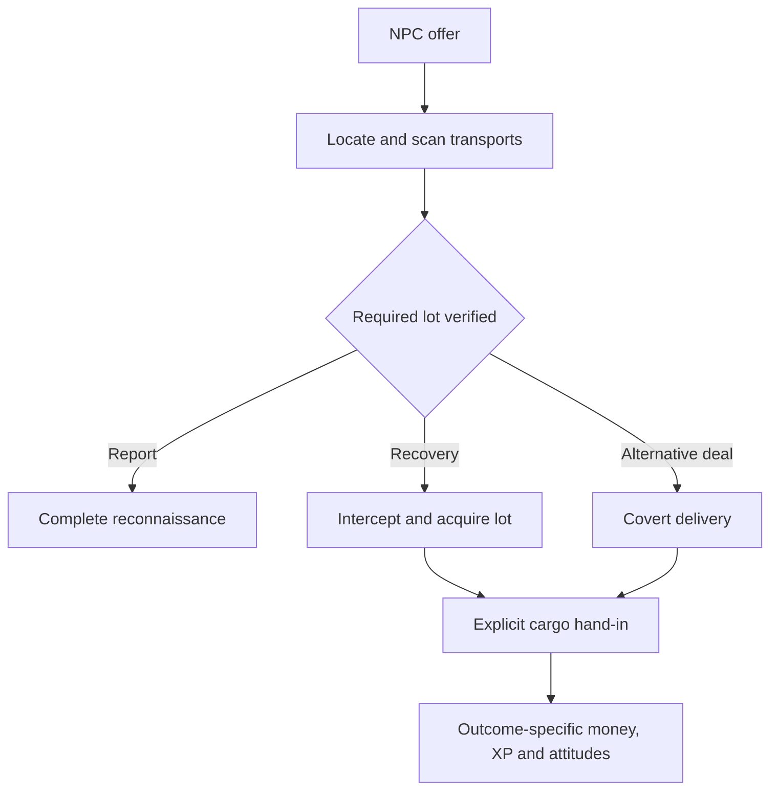

# Cargo contracts, scanning and smuggling

**English** · [Русский](../ru/re/content_cargo_contracts.md)

Freelancer can support authored delivery, procurement, cargo intelligence, inspection, confiscation, interception and smuggling contracts. Use new independent mission controllers with shared cargo, scan and reward services. A mission generator, `GenericMission` and progression through `StoryLauncher` are not prerequisites.

Research date: 2026-10-26. Evidence is the working sources over `af086d9` and Frontier documentation. This is an assessment and proposal, not an implemented feature; no in-game validation was performed. Related research: [new mission architecture](content_open_world_missions.md), [career progression](content_progression.md).

## What to borrow from Elite Dangerous

The useful model is an obligation with an employer, commodity, quantity, destination and deadline, with collection and delivery tracked separately. Elite's official journal describes `MissionAccepted`, `CargoDepot` and cargo associated with `MissionID`. The depot distinguishes collected and delivered quantities, supporting multiple trips and group participation. Source: [Frontier Player Journal v31, sections 3.1, 8.3 and MissionAccepted](https://hosting.zaonce.net/community/journal/v31/Journal_Manual_v31.pdf).

Frontier's [Update 13](https://www.elitedangerous.com/de-DE/neues/elite-dangerous-update-13-notes) also describes displaying collected and delivered amounts for transport missions. This is a useful UI model instead of a single active-mission indicator.

These sources establish an architectural reference, not current prices, fines or an exhaustive Elite mission catalogue. The variants below are Freelancer proposals, not claims that every one exists in Elite. Hand-authored contracts do not require an Elite-scale background economy.

## Verified Freelancer foundations

| Capability | Sources | Limitation |
|---|---|---|
| Player scans NPC cargo | `FClientEquippedObj::scan_cargo` in [client_gameobj.cpp](../../src/freelancer/Client/client_gameobj.cpp), [hud_target_panel.cpp](../../src/freelancer/Client/hud_target_panel.cpp), [nn_scanner.cpp](../../src/freelancer/Client/nn_scanner.cpp) | Displaying cargo is not yet proof of contract fulfilment |
| Scan mechanics | `CEScanner::ScanCargo` in [common_cescanner.cpp](../../src/Common/common_cescanner.cpp), [common_iobjinspectimpl.cpp](../../src/Common/common_iobjinspectimpl.cpp) | Checks interference-adjusted range and power; success consumes power and copies equipment descriptions. This function has no prolonged beam-holding phase |
| Script event | `SPScanCargo` in [IServerImpl.cpp](../../src/Server/IServerImpl.cpp), `CndCargoScanned` in [MissionCnd.cpp](../../src/Content/MissionCnd.cpp) | Payload is only `{scanner_id, target_id}`, without success, manifest or violation |
| Patrol inspections | `FCargoScanRoute` in [PatrolGuides.cpp](../../src/Content/PatrolGuides.cpp) | Target selection, approach, checking cargo, jettison demands, collection and hostility exist |
| Scanner faction interests | `scan_for_cargo`, `scan_chance`, `scan_announce` in [FactionProps.cpp](../../src/Content/FactionProps.cpp), [NpcShip.cpp](../../src/Content/NpcShip.cpp) | An interest list is not a complete legal model: pirates can also scan |
| Inspection dialogue | `QueueScanEvent`, `FGcsScanEvent` in [PatrolGuides.cpp](../../src/Content/PatrolGuides.cpp), [Gcs.h](../../src/Content/Gcs.h) | Conversation events carry outcomes for radio dialogue, not a unified authoritative contract-evidence interface |
| Cargo inspection/mutation | `SpaceObj::EnumerateCargo`, `Player::EnumerateCargo`, `AddCargo`, `RemoveCargo`, `GetRemainingHoldSize` in [server_pub.cpp](../../src/Server/server_pub.cpp) | Contracts need capacity, ownership and mutation validation; temporary equipment slots are not persistent lot identities |
| Jettison and collection | `JettisonEquipment` in [PatrolGuides.cpp](../../src/Content/PatrolGuides.cpp), `LootAcquired` and `Cnd_LootAcquired` | Associate the actual ejected lot with the contract, not only the commodity type |

### Why Cnd_CargoScanned is insufficient

The client wrapper calls `SPScanCargo` for the player's ship after invoking the scanner **without gating on success**. The UI separately checks the result before opening its window. The server handler dispatches two IDs and does not verify the scanner belongs to the sender. `CndCargoScanned` matches object labels, not contents or success.

Consequently the event cannot prove that twenty units of a prohibited commodity were found. Add a verified result. Also, the `SPScanCargo` name does not prove absence of an MP path: serialization exists in [RemoteServer](../../src/RemoteServer/IServerImpl.cpp), reception in [RemoteClient](../../src/RemoteClient/RemoteClient_main.cpp), and local transport in [rpclocal](../../src/rpclocal/rpc_payload_ch3.cpp). Transport support is not server validation.

### Why mission_flag is insufficient

Docked `pub::Player::AddCargo(..., mission_flag)` forwards this parameter as a no-combine flag; that path does not set `EquipDesc::bMission`. The in-space path sets the descriptor flag. MP saves skip items marked `bMission`. See [server_pub.cpp](../../src/Server/server_pub.cpp) and [server_classes.cpp](../../src/Server/server_classes.cpp).

The patrol handler also sends a player carrying a matching mission item straight to its hostile stage. For an NPC carrying such cargo, the inspected branch retains response `3` and repeats its checking state: a statically visible loop risk requiring separate validation. Do not indiscriminately mark all contract cargo or inspection targets with this flag.

### Additional smuggling constraints

`GMissionScanClamp` blocks patrol target selection. New contracts must not enable the campaign's global scan suppression. `FCargoScanRoute::SetShip` checks scanner range and then sets the route's scan distance to 500; this differs from a direct player scan. Attitudes, formation, probability and previously scanned identities influence selection.

Issuing prohibited cargo does not guarantee an interesting inspection: appropriate patrols, interest lists and routes are needed. A nebula is not universally invisibility: direct scanning considers interference, but patrol behaviour needs separate verification. Any visibility policy must apply consistently across scan producers.

## Variant catalogue

Additional effort **after the common contract framework exists**: **A** mainly authored plans/data; **B** extending an existing operation/event; **C** a new gameplay mechanic. None is currently implemented as a new contract.

| Family | Player activity | Outcome and additional work |
|---|---|---|
| Delivery | Carry employer cargo from A to B | Deliver the issued lot; **B**, provenance |
| Procurement | Find and supply a commodity independently | Consume eligible quantity on hand-in; **A**, pre-owned stock can qualify |
| Specified supplier | Buy from a named base after acceptance | **B**, verified purchase and lot origin |
| Bulk supply | Deliver 120 units with capacity for 30 | **B**, incremental collection/delivery, depot and persistent balances |
| Collection route | Pick up lots at several bases | **A** above lot/depot support; separate waypoints |
| Distribution route | Split cargo among several recipients | **A** above depot support; obligations per recipient |
| Express delivery | Meet an agreed deadline | **A**, explicit time and persistence policy |
| Special cargo | Transport perishable or fragile goods | **C**, quality/decay/storage; hull HP is not each commodity's condition |
| Space rendezvous | Meet a transport and transfer a lot | **B**, proximity validation and consistent owner transfer |
| Insurance survey | Scan a specified transport and certify contents | **B**, saved scan evidence; target must survive |
| Trade intelligence | Scan distinct carriers in an area | **B**, unique targets and a cargo-flow report |
| Identify carrier | Find the relevant commodity among several NPCs | **B**, content filter and evidence-driven branch |
| Manifest audit | Compare declared and actual cargo | **C**, declarations, discrepancies and reporting action |
| Customs patrol | Inspect ships and report violations | **B/C**, verified scans, jurisdiction and authority |
| Confiscation | Find prohibited cargo, demand jettison, deliver evidence | **B**, NPC response control and custody; a scan does not automatically authorise attack |
| Surveillance | Follow an identified suspect to a hand-off | **B**, persistent actor role and route; covert detection needs a separate rule |
| Raid reconnaissance | Discover cargo composition and return alive | **B**, report; destroying the carrier may lose a bonus |
| Recover stolen goods | Return a particular stolen lot | **B**, provenance; purchased substitutes cannot satisfy it |
| Pirate extortion | Scan, select loot and demand jettison without destroying the ship | **B/C**, player demand UI and NPC response; existing pirate AI is not a player command |
| Cargo seizure | Intercept a carrier and acquire the required quantity | **B**, jettison/loot path; explosion must not promise survival of all cargo |
| Wreck recovery | Find a missing shipment and deliver its remnants | **A/B**, authored objects and associated lots |
| Covert delivery | Deliver without confirmed detection by authorities | **B**, inspection result and failure policy |
| Blockade running | Deliver through a guarded route | **A/B**, controlled encounters; detection is allowed, arrival remains the objective |
| Smuggler intermediary | Collect from an NPC and deliver to a secret recipient | **B**, lot owners, rendezvous and settlement |
| Patrol diversion | Draw an inspection away from another transport | **C**, attention, patrol targeting and escape conditions |
| Shipment substitution | Replace marked cargo with a counterfeit lot | **C**, provenance, false manifests and authenticity checks |
| Controlled delivery | Carry prohibited goods under investigative authority | **C**, permit scoped to place, time and lot |
| Concealed container | Pass a scan with partially concealed contents | **C**, concealment and scanner capabilities; not supplied by ordinary cargo scanning |
| Choose a side | Deliver discovered cargo to employer, police or a competitor | **A/B** above lot accounting; mutually exclusive outcomes/rewards |
| Cooperative operation | One player locates, another intercepts, another carries | **C** initially: shared evidence, permissions, MP persistence and rewards |

Scanning can be a profession in its own right; discovery need not end in combat. A negative result can matter, such as certifying three distinct transports have no prohibited cargo. Reopening one NPC's cargo window must not repeatedly award progress.

## Shared mechanisms

Build variety from **locate → scan → classify → choose an action → acquire/transfer cargo → report**. Omit or replace stages as appropriate. Plans remain hand-authored.

Proposed hierarchy, not existing code:

```text
FMissionObject
  FAuthoredMission
    FTradeMission          delivery and procurement
    FInspectionMission     surveys and inspections
    FInterdictionMission   interception and cargo acquisition
    FSmugglingMission      delivery with detection conditions
    FConvoyMission         transport protection

Shared services: CargoLedger, CargoDepot, ScanService,
                 CargoLawPolicy, MissionPlanRuntime, ProgressionService
```

These are independent controller types, not one class for every contract variant. Smuggling can reuse a delivery component; inspection can reuse reporting. Existing `Cnd_*`/`Act_*` classes depend on `FMissionScript*`, so reuse requires adaptation or independent plan operations. Initially retain one accepted assignment. Concurrent contracts need a new journal and objective ownership, not merely another factory invocation.

### Verified scans

The proposed `ScanService` distinguishes requests, successful scans, finding relevant cargo and inspection consequences:

```text
ScanCompleted(scan_id, scanner_actor, target_actor, system,
              authority_faction, cargo_snapshot, visibility_policy, time)
CargoViolationDetected(scan_id, jurisdiction, lot_ids, rule_id)
InspectionResolved(scan_id, outcome)
```

Actor identities are stable within a mission instance; runtime object IDs only resolve live entities. Copy snapshot values rather than keeping pointers into a temporary `EquipDescVector`. The server validates sender, ship ownership, target, system, range, scanner and success conditions. Charge power exactly once; do not invoke a second consuming scan merely to validate the first.

NPC patrols need their own adapter. Do not derive detection from spoken dialogue: speech can be disabled, interrupted or absent. A covert contract reacts to the specified side's verified cargo result, not simply being targeted. Prolonged covert scanning, distance holding, an observation cone and detection chance are possible new rules, not properties of the inspected scan function.

### Cargo identity and hand-in

Proposed `CargoLedger`: `lot_id`, commodity, quantity, owner, origin, contract instance, current carrier/depot/container and state. Physical commodities remain Freelancer cargo/equipment; the ledger supplements them. Reconcile stack merges/splits, ship purchases, jettison, collection, sale and destruction.

Ordinary procurement accepts eligible commodities from allowed origins. Recovery or sealed delivery needs the actual lot. `bMission` stores neither owner nor contract nor provenance. A dedicated archetype can simplify a first prototype but cannot distinguish multiple instances by itself.

Use explicit hand-in: the player chooses contract and quantity; the server checks destination, outstanding obligation and eligible cargo, removes it and records delivery. Docking alone does not complete the obligation. One unit cannot satisfy two contracts. Give the operation a duplicate-prevention ID and keep removal, progress and persistence consistent.

Check commodity volume and remaining hold on collection. Leave the remainder in the contract depot instead of requiring the whole shipment to fit. Track issued cargo as `total = at depot + in transit + accepted + lost`. Replacement of lost cargo is a contract policy. Partial delivery and early settlement for partial pay are distinct operations; partial settlement must be explicitly allowed.

### Smuggling and faction rules

Distinguish a commodity prohibited in a jurisdiction, a lot stolen from an owner, cargo violating a contract, and pirate interest in valuable loot. These are different circumstances.

`CargoLawPolicy` can consider inspecting faction, system/base, commodity/origin and permits. Existing `scan_for_cargo` is an initial interest list, not a replacement for this model. Fines, confiscation authority, licences, forged paperwork, concealed holds and local wanted status need new rules/UI. Pirate discovery must not automatically count as police exposure.

Early missions can use explicit contract rules: Rheinland police detection removes a bonus; confiscation of a critical lot fails the contract; pirate attacks are allowed. A world-wide law system can follow. Cancellation must specify cargo disposition: return, removal or unlawful possession. Selling freely issued cargo must not be more profitable than fulfilling the assignment.

## Authored example at rh_ber_01

An NPC requests inspection of three transports near a trade route. One carries a marked lot, the other two ordinary cargo. Verified identification opens three outcomes:

1. Report the finding and receive intelligence pay.
2. Accept an additional recovery objective, secure jettison and deliver the lot.
3. Choose an alternative recipient and smuggle the lot, risking relations with the original employer.

The third branch is an explicit player choice, not silent replacement of the accepted job. Destroying the transport before identification, target departure and partial loss have authored outcomes. Contract NPCs must persist long enough for the task; ordinary despawn must not accidentally make it impossible. Cross-system targets need actor/route restoration.



This illustrates composition, not a requirement to implement every branch in the first prototype. The author specifies ambushes and patrols; no generator is required. Persisted stage flags prevent repeated spawning and rewards after loading.

## Money, careers and UI

Delivery pays for a service; procurement must state whether payment includes the commodity's purchase cost. A fixed all-inclusive procurement payout is a reasonable start: players assess acquisition costs themselves. Reimbursement of actual spending requires verified purchases, not a client claim. Handing cargo to a contract must not also sell it to the market.

Award experience for verified objectives: trade for delivery, exploration for reconnaissance reports, combat for combat activity, faction service for employer work. Customs checks need not grant exploration XP; profiles follow the actual task. A scanner click is not itself a reward. Alternative endings are mutually exclusive; kill and completion rewards share an intentional balance budget.

Offer cards show employer, source/destination, quantity, origin requirements, legality, deadline, total pay, any deposit and failure consequences. The journal separates remaining collection, carried, delivered and lost amounts, evidence and the current objective. Bulk orders need quantity controls in a depot panel. Inspection UI shows established facts and available actions; server knowledge must not reveal hidden cargo prematurely.

## Implementation order and validation

| Stage | Result | Assessment |
|---|---|---|
| 1 | Independent InspectionMission: one NPC, valid scan, cargo predicate, report | Best small slice for the latest request; needs verified scan result |
| 2 | TradeMission: procurement/delivery, explicit hand-in and multiple trips | Moderate; lots/restoration are harder than checking quantity |
| 3 | SmugglingMission: patrol, recorded detection, delivery and consequences | Moderate/significant; reconcile both scan systems |
| 4 | Interception, jettison demand, confiscation and specific-lot recovery | Significant; NPC control, provenance and loot persistence |
| 5 | Manifests, concealment, substitution, diversion and controlled delivery | New mechanics, not existing scanner INI settings |
| 6 | Concurrent contracts and cooperative MP execution | Additional work across ownership, depot, permissions, network and settlement |

Persist accepted terms, instance, participants, stages, actor roles, lots/depot, scan evidence, detection outcomes, timer and reward receipts. Prefer in-game time paused while the SP game is closed; MP may use a server-calendar deadline. Make this explicit instead of inheriting an incidental controller timer.

Future tests: failed out-of-range/unpowered scans; repeated requests; clean cargo; wrong target; unloading after scan before reporting; forged scanner ID; identical commodities from different lots/contracts; partial collection/hand-in; loss, return and collection by another participant; docked/in-space saves; reconnect; cancellation/death; NPC disappearance; repeated success; `GMissionScanClamp`; feature-enabled/disabled builds.

Implement as an optional port feature under [CONTRIBUTING](../../CONTRIBUTING.md), retaining the disabled retail paths. This research does not alter retail scanning, cargo format, protocols or gameplay code.
