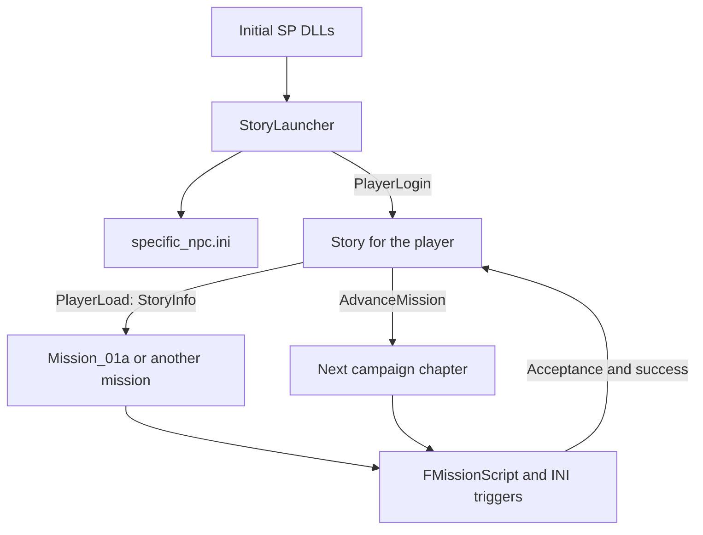
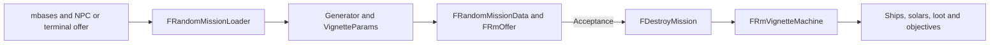

# Story scripts and open world missions

**English** · [Русский](../ru/re/content_open_world_missions.md)

Freelancer's story script engine can support custom quests activated by entering a system, selecting an NPC or hearing a rumor. The wealth gate belongs to `Story`, not to the mission interpreter. There is, however, no existing mbases key that loads a story INI on interaction: independent quests need a launcher and a state owner. Cutscenes can also run independently of the campaign; `RtcSlider` controls presentation and does not authorize story progression.

These findings are based on static inspection of this port at base revision `af086d9`. The examples require an in-game prototype: this workspace has no `DATA` directory, and the available `m01a.ini` is from `plugins/jflp`, not a verified pristine retail data set. Existing code paths and proposed extensions are distinguished below; no quest dispatcher has been implemented by this documentation change.

## Feasibility

| Request | Existing mechanism | Additional work |
|---|---|---|
| Start without waiting for a level | Create `GenericMission` or an `FMissionScript` subclass; send `MissionStart` | Correct parameters, player state, mission ownership and persistence |
| Start upon reaching a system | `Cnd_SystemEnter` | A preloaded script or an external dispatcher |
| Start from a fixed NPC | `GFObjSelect`, `Cnd_CharSelect`, `mRoom fixture` | Bind a stable role to the quest and initialize room context |
| Start from a rumor | `RumorHeard`, `Cnd_RumorHeard` | Account for the speaker role, eligibility and already-heard state; add an IDS event for exact rumor matching |
| Vary procedural combat missions | Vignette trees, ships, solars, loot, waves, text and rewards | Data changes within implemented generators |
| Add escort, delivery or exploration jobs | Story objects, AI object lists, conditions and objectives | An authored script and launcher, or a new C++ random-mission generator/runtime |
| Play a cutscene without the campaign | GF behavior, ambient scripts, `RequestSpaceScript` | Scene ownership, actors, completion and restoration of control |
| Use these mechanisms in MP | Shared events, GF/RPC and some group infrastructure | Separate adaptation of persistence, shared flags, mission ownership and client behavior |

## StoryLauncher and Story



[`StoryLauncher.cpp`](../../src/Content/StoryLauncher.cpp), `FStoryLauncher`, loads `missions\specific_npc.ini` into `GSpecificNpcs` and creates `Story` on `PlayerLogin`. It does not check rank, read mbases or execute mission triggers. Its heartbeat is disabled.

[`Story.cpp`](../../src/Content/Story.cpp), `FStory`, owns the mission name, `MissionNum`, `delta_worth` and ship-purchase flag. `OnLoad` creates the controller named by `[StoryInfo] Mission`; reading `MissionNum` then sends that controller `PlayerLoad` and `MissionStart` (`0x1000`). Those two keys must therefore appear in the appropriate order.

`AdvanceMission` checks **cash plus asset value**, the stored `DeltaWorth`, the player's live-mission slot and a specific campaign stage. This is not a generic script-engine check of “level >= N”. `SetNextRankWorth` stores current worth plus a chapter-specific increment:

| Waiting stage | Increment | Controller |
|---:|---:|---|
| 5 | 3500 | `Mission_02` |
| 9 | 5200 | `Mission_03` |
| 12 | 7000 | `Mission_04` |
| 15 | 10000 | `Mission_05` |
| 18 | 16000 | `Mission_06` |
| 21 | 0 | `Mission_07` |
| 24 | 36000 | `Mission_08` |
| 27 | 30000 | `Mission_09` |
| 30, 33, 36, 39 | 0 | `Mission_10` … `Mission_13` |

The saved `delta_worth` is the resulting total threshold, not just the increment. The relevant events are `PlayerWorthChanged` and `PlayerMissionChanged` when the mission slot becomes free. Although the constructor requests a five-second heartbeat, **Story does not handle Heartbeat**. Merely waiting for its next tick does not run this test.

`StartMission` sets the chapter, clears the displayed money requirement, creates the mission at `ABOVE_NORMAL` priority and sends `MissionStart`. `OnMissionEvent` also performs immediate transitions: `01a → 01b`, `06 → 07`, and `09 → 10 → 11 → 12 → 13`. Stage 42 ends the campaign. Campaign stages additionally affect rumors and random-mission difficulty, so changing `MissionNum` has wider consequences.

The first mission comes from `NewPlayer.fl`, not `InitialWorld.ini`; see [save templates](../ini/saves-and-initial-world.md). Removing StoryLauncher from the initial DLL list also removes its NPC-table initialization and the normal owner of `[StoryInfo]`; it does not install an alternative quest system.

## The story INI runtime

[`StoryMissions.cpp`](../../src/Content/StoryMissions.cpp) provides the campaign wrappers and `GenericMission`. They inherit [`FMissionScript`](../../src/Content/MissionScript.cpp), which inherits [`FMissionObject`](../../src/Content/MissionObject.cpp). The latter owns mission objects, players, objectives and rewards; the former adds triggers, dialog, RTC and ambient scenes.

INI paths are relative to the data directory. Sections such as `[MsnShip]`, `[MsnSolar]`, `[MsnFormation]`, `[MsnLoot]` and `[ObjList]` describe script resources; loading a definition does not spawn every object. Trigger conditions subscribe to controller events. Timers and polled conditions use the mission heartbeat, normally about 30 Hz. `MissionStart` activates `InitState = ACTIVE`, and a matching condition executes the actions in file order.

Two parser details matter when authoring quests:

* A trigger has one condition. Multiple `Cnd_*` lines do **not** form AND: the condition pointer is replaced while event subscriptions accumulate. Use successive triggers for successive requirements.
* The `[Trigger] system = ...` key is tested and ignored. Use an actual condition or a launcher eligibility check to restrict a quest to a system.

`Act_ChangeState = SUCCEED` leads to the success message, reward and cleanup, followed by a callback if `StoryEvents` is non-null. `FAIL` uses the failure path. Removing the story callback does not isolate the runtime from the player's live-mission slot, shared world flags or the save format.

See [script format](content_mission_script.md), [opcodes](content_mission_opcodes.md) and [mission INI reference](../ini/missions.md).

## Starting a mission without the wealth gate

### Independent authored mission

The existing low-level route is `pub::Controller::Create("Content.dll", "GenericMission", parms, priority)`, followed by a targeted `MissionStart`. Neither its constructor nor `FMissionScript` checks the Story wealth threshold.

`parms` is **not a path string or random-mission data**. The Win32 contract consists of polymorphic `CreateParms`, `PlayerId` at `+4`, `IStoryMissionEvents*` at `+8`, and an inline path at `+0xC`. See [`content.h`](../../src/include/content.h), `FStoryMissionCreateParms`, and `FStoryOnLoadCreateParms` in `Story.cpp`. A new interface should expose typed parameters instead of making callers reproduce the implicit trailing buffer.

Replacing StoryLauncher with GenericMission in `[Initial SP DLLs]` is insufficient: the startup loader in [`IServerImpl.cpp`](../../src/Server/IServerImpl.cpp) passes null parameters. That section should create the dispatcher, which later creates a mission for a specific player with valid parameters.

The base script supports `StoryEvents = nullptr` at acceptance and success. This does not apply to every campaign wrapper: `Mission_01b`, for example, dereferences the callback without a null check and has special first-chapter behavior.

A complete launcher must establish:

1. A valid `FContentPlayerState` and current system/base/room. `CurrentLocationId` is updated by `LocationEnter`; creating the script after that event requires explicit context initialization.
2. Mission-slot ownership. Loading a script and **accepting** a mission are different operations. The normal acceptance path performs `JoinMissionAsGroup`, `PlayerMissionChanged` and `SetMsnID`.
3. Persistence of the script path and quest state, cancellation and repeat rules.
4. Resource and controller lifetime. `FMissionObject::HandleMessage` destroys the controller when `bPendingDestroy` is set.

For immediate event-based acceptance, the dispatcher must also perform the appropriate ownership transition; `MissionStart` alone does not register an accepted assignment. An interaction that already caused creation is not automatically replayed to the new script. Pass explicit startup context or start at the intended trigger.

### Starting an original chapter early

For an original campaign continuation, add a request handled by `FStory` which invokes its `StartMission` with the correct chapter after checking current ownership. That keeps the mission name, callback, saves and later transitions consistent. `StartMission` is currently private; no public “start any chapter” command exists.

Directly creating `Mission_02` bypasses the threshold but does not update Story's bookkeeping. A null callback prevents campaign continuation; a Story callback with stale fields can save the wrong mission name. Original chapters also assume specific world, faction and player state. Calling the factory is only one part of a correct chapter jump.

### GenericMission persistence limitation

`FStory::OnLoad` accepts this input format:

```ini
[StoryInfo]
Mission = GenericMission, Missions\Custom\quest.ini
MissionNum = 42
delta_worth = -1
```

This is **not a complete persistent free-roam recipe**. `OnSave` emits only `Mission = GenericMission` and loses the path. GenericMission does not call `SetChapter`; its chapter fields default to zero in the current port. Acceptance with the normal Story callback can therefore reset Story to stage 0, and Story has no corresponding custom completion branch. A reliable extension needs its own state owner and persistence contract.

## NPCs and rumors in mbases

### Fixed characters and role identity

[`BaseDB.cpp`](../../src/Content/BaseDB.cpp), `LoadBaseNpc`, `mRoom` parsing and `OnPlayerEnter`, distinguishes the NPC description from its placement and role:

* `[GF_NPC] nickname` identifies the description.
* `room` supplies room eligibility to population; a fixed placement is defined by `[mRoom] fixture`.
* `fixture = npc_nickname, placement, fidget_script, role` binds the description to a room position, animation and **role**. The NPC must already have been parsed, and the placement must exist.
* `Cnd_CharSelect` uses `FBaseRoomState::FindCharacter` to find the role for the player, then compares the character's runtime ID with the selection event.

For a fixture with role `quest_contact`, the condition is:

```ini
Cnd_CharSelect = quest_contact, Bar, Li01_01_Base
```

The first argument need not equal `GF_NPC.nickname`. NPC nickname, role, placement and quest path are separate identifiers. Duplicate roles resolve to the first matching character, so quest contacts need unambiguous roles. mbases has no existing `script = ...` handler that creates an `FMissionScript` on selection.

### Rumor identity and timing

In [`BaseSupport.cpp`](../../src/Content/BaseSupport.cpp), handling `GFObjSelect` for `BAR_OFFER_RUMOR` records the conversation and first rumor IDS, broadcasts `RumorHeard` with `{PlayerId, Role}`, then updates room offers. [`CndRumorHeard::Matches`](../../src/Content/MissionCnd.cpp) compares the player, current room and role string:

```ini
Cnd_RumorHeard = quest_contact, Bar, Li01_01_Base
```

**The event contains no rumor text IDS.** Multiple rumors from the same role are indistinguishable to this condition. Use a dedicated contact with one eligible rumor, or add an explicit IDS-bearing event where BaseSupport still has `Character->Offer.Rumor`.

Despite its name, the event is sent during character selection, not when the spoken line finishes. A cutscene launched immediately can overlap the conversation. A new dispatcher should queue it until the conversation is idle.

`rumor` and `rumor_type2` use the same loader. [`BaseNpcRecords.cpp`](../../src/Content/BaseNpcRecords.cpp), `FBaseNpcRumor::GetWeight`, gates eligibility by **campaign stage range**, faction attitude and already-heard state. `base_0_rank, mission_end` covers stages 0…42; `mission_end, mission_end` only stage 42. Reputation levels 0…3 correspond to thresholds 0.0, 0.2, 0.4 and 0.6. The NPC still selects an offer from eligible alternatives, so a configured rumor is not necessarily the one shown.

Already-heard state is not quest state. Persist availability, acceptance, success, failure and repeat eligibility independently; loading a save does not emit the old conversation event again.

### Example trigger chain

This fragment belongs to an **already loaded** mission INI. It demonstrates “visit Li01 → hear a rumor from quest_contact → enter quest logic”. The NPC fixture, rumor resource and actual quest stage must be supplied separately.

```ini
[Trigger]
nickname = custom_wait_system
InitState = ACTIVE
Cnd_SystemEnter = Li01
Act_ActTrig = custom_wait_rumor

[Trigger]
nickname = custom_wait_rumor
Cnd_RumorHeard = quest_contact, Bar, Li01_01_Base
Act_ActTrig = custom_quest_begin

[Trigger]
nickname = custom_quest_begin
Cnd_True = no_params
Act_DebugMsg = custom quest entry reached
```

Replace the second condition with `Cnd_CharSelect` for a simple selection trigger; do not add both conditions to the same section. `Cnd_SystemEnter` can check the current system upon activation, so explicit `Li01` can match without another jump. Selection and rumor conditions require an event and should be armed beforehand. This chain stays within one loaded script: the action factory has no `Act_StartMission = path` operation.

## RandomMissions extension limits

`DestroyMission` is the controller name for procedural combat jobs, not a claim that every job merely destroys a fighter group. It uses a different execution engine:



The generator reads `NpcRankToDiff`, `Diff2Money`, `RMLootInfo`, `SolarFormations`, `KillableSolars`, `VignetteCriticalLoot` and `VignetteParams`; faction, ship and `RankDiff` tables add constraints. Offer creation chooses difficulty, hostile faction, a suitable zone and a vignette-tree path. Special node names enable flags in **prewritten C++ generators**. Acceptance creates runtime machines, which handle combat stages, loot and return objectives. See [the complete table reference](../ini/random-missions.md).

| Capability | Source evidence |
|---|---|
| Installations, defensive solars, waves and support | `FRmDestroySolarsFilter::CreateOffer`; `big_solar`, `defensive_solars`, `hostile_waves`, `friendly_ships` |
| Targets, preliminary combat and reinforcements | `FRmAssassinateFilter::CreateOffer`; `pre_battle`, `target_runs_to_main_battle`, `continuous_reenforcements` |
| Destroy, tractor or return critical loot | `target_drops_critical_loot`, `destroy_loot`, `tractor_in_loot`, `bring_back_loot`; vignette state 12 |
| Standalone `destroy_ships_mission` and `loot_item_mission` branches | Recognized names, but their filters inherit `CreateOffer` returning false |
| `cavalry` branch | `FRmCavalryFilter` inherits the destroy-solars generator, starts with cleared flags and stops applying nodes; it is not a separate escort generator |

The nonfunctional standalone destroy-ships and loot-item filters do not prohibit ship combat or loot objectives within working branches. Changing `implemented = true` cannot enable those generators. The cavalry branch needs separate evaluation with its actual data; the recognized name does not establish a new mechanic. Also distinguish `FRmOffer::Type`, used for mission classification/statistics, from `MachineType`: `CreateRmRuntimeMachine` only handles machine types 1…3, creating `FRmVignetteMachine`.

Sources: [`RandomMissionGen.cpp`](../../src/Content/RandomMissionGen.cpp), `Specialize`, `CreateOffer`, `BuildOfferFromPath`; [`RandomMissionGen.h`](../../src/Content/RandomMissionGen.h), the incomplete filters; [`RandomMissionMachine.cpp`](../../src/Content/RandomMissionMachine.cpp), `CreateRmRuntimeMachine`; [`RandomMissionVignette.cpp`](../../src/Content/RandomMissionVignette.cpp).

### Why another mission_type is insufficient

1. `[BaseFaction] mission_type` ignores value 0 and explicitly stores `"DestroyMission"` in `BaseDB.cpp`.
2. `[GF_NPC] misn` does retain the name, but [`CreateRandomMissionLoader`](../../src/Content/RandomMissionDB.cpp) ignores it and always supplies the same loader and `FRandomMissionData`.
3. Acceptance passes that data to a fixed factory in [`Content.cpp`](../../src/Content/Content.cpp). An unknown controller name creates nothing; `GenericMission` is known but expects **a different parameter layout**.
4. `FDestroyMission` explicitly saves `type = DestroyMission`; [`Support.cpp`](../../src/Content/Support.cpp) restores it through the standard loader.

Thus `misn = GenericMission, ...` is not a story-script bridge. A new type requires changes to selection/data loading, controller creation, runtime, acceptance UI and persistence. FMissionScript provides an alternative for authored scenarios; the selected independent-controller design below instead introduces an FMissionObject branch with its own plan runtime.

Random-mission saves are not snapshots of every running machine either. Saving is allowed only in suitable states; it records parameters and a seed, and loading rebuilds the offer. Changing the vignette tree can change reconstruction despite retaining the seed. New generators need versioned persistence.

## Reusing m01a.ini

Reuse its **language and composition**: NPCs and ships, trigger sequences, contact selection, acceptance/rejection, flight, escort behavior, objectives and scenes. The interpreter does not restrict these constructs to the original campaign.

Do not treat the whole file as a neutral side quest. In the available [`jflp copy`](../../plugins/jflp/DATA/MISSIONS/M01A/m01a.ini), `tr_initialize_init` arms the Freeport 7 opening; `tr_fp7_cam_end` forces a landing at `Li01_01_Base`; `remove_playership` applies `Act_SetShipAndLoadout = none, none`; `chs_juni_bar` selects Juni's role and registers the offer RTC; `mrp_accept` grants `ge_fighter, msn_playerloadout`. The script also changes population/clamps, music, history and objectives.

The `FMission01a` C++ wrapper additionally sets chapters 1/2, special state 3 and `[Mission01aSave]`. `FMission01b` hardcodes a subsequent scene. Loading `m01a.ini` through GenericMission and creating `Mission_01a` therefore do not reproduce the same behavior.

Author a compact separate INI and transfer only the needed patterns. Ships, object lists, distance/destruction/cargo/base-entry conditions establish the building blocks for escort and delivery; this does not imply an already tested generic quest template.

## Cutscenes outside the campaign

### RtcSlider controls presentation

[`common_rtcslider.cpp`](../../src/Common/common_rtcslider.cpp) implements a slider and `set`/`set_less` thresholds for particles, fog, ship loadouts, character LOD, shadows and FPS limits. Room objects and some scene records also have priority settings tested against that table.

There is no StoryLauncher, campaign-stage, rank or mission-acceptance check here. An unknown setting is enabled with a warning; numeric ID 0 is enabled without lookup. Deleting the file is not an appropriate “unlock”: a missing `fps_20_cap`, for example, selects a 20 FPS limit. If a custom scene loses elements at low settings, inspect their priority and resource requirements.

### Base scenes

The normal route is `Act_AddRTC` → `FMissionScript::StartRtcScript` → `FCharacterEncounter::Load` → `FContentBase::CreateBarScene` → `pub::GF::CharacterBehaviorCreate` → Server BaseDB/RPC → client `FGfScriptSequence` → Thorn.

An RTC INI is a `[CharacterEncounter]` wrapper with `Location`, `walkup/greet/action/offer/decision/accept/reject`, `autoplay`, `[Char]` and `[Reserve]`, referencing `.thn` assets. It is distinct from a mission INI. `autoplay` is enabled by the presence of the key; even `autoplay = false` enables it in this parser.

`StartRtcScript` starts only on the matching current base. Otherwise, the script record is retained and retried on base entry. `CreateBarScene` reuses characters by role or creates them from `GSpecificNpcs`, reserves placements and assigns behavior. Without StoryLauncher, arrange NPC-table initialization for actors that must be newly created.

An independent controller can own the encounter, sequence ID and scene through this route; the owner need not be `FStory`. It must release behaviors, reservations and characters on completion/exit. This is an existing integration point, not an already implemented mbases switch.

Ending `FGfScriptSequence` sends `IServer::RTCDone(PlayerId, SequenceId)`. The server broadcasts `RtcDone`; `Cnd_RTCDone` matches the sequence ID and RTC path in the mission's registered list. An independent owner must retain that mapping or process the event itself. Acceptance/rejection uses a separate `MissionResponse`, which an offer scene also needs to handle.

Sources: [`RtcScripts.cpp`](../../src/Content/RtcScripts.cpp), [`BaseDB.cpp`](../../src/Content/BaseDB.cpp), [`server_pub.cpp`](../../src/Server/server_pub.cpp), [`server_basedb.cpp`](../../src/Server/server_basedb.cpp), [`gf_script_object.cpp`](../../src/freelancer/Client/gf_script_object.cpp), [`IServerImpl.cpp`](../../src/Server/IServerImpl.cpp).

### Space scripts and ambient scenes

`Act_CallThorn` invokes `pub::SpaceObj::RequestSpaceScript(object, position, mode, player, path)`. The server sends the client request, and `IClientImpl::SendServerRequestSpaceScript` resolves the object and calls `SetupSpaceScriptCamera`. Modes 1/2 use the existing transform or a supplied position. These entry points do not check campaign progress.

An external controller can use this camera route, provided the object exists on the client and the `.thn` suits the space-camera bindings. It is not a universal player for arbitrary base scenes. `Act_CallThorn` additionally changes invulnerability, nag/GCS and NPC behavior; a direct server request does not automatically perform those actions. The owner must decide which controls to suspend and restore camera/control state on completion, cancellation and object loss.

`Cnd_RTCDone` concerns registered `CharacterEncounter` scenes, not every `Act_CallThorn` execution. Coordinate space-camera completion through a scripted timer and `Act_RevertCam`, or a new callback. The camera engine can detect Thorn completion, but this is distinct from the base RTC protocol.

`Act_AddAmbient`/`pub::GF::AmbientScriptCreate` provide another campaign-independent route for room background scenes. They do not automatically supply conversation UI, mission choice or RTC completion handling.

Sources: [`MissionAct.cpp`](../../src/Content/MissionAct.cpp), `ActCallThorn::Execute`, `ActRevertCam`; [`client_iclient_space.cpp`](../../src/freelancer/Client/client_iclient_space.cpp), [`space_camera.cpp`](../../src/freelancer/Client/space_camera.cpp), [`space_camera_script.cpp`](../../src/freelancer/Client/space_camera_script.cpp).

## Proposed open world quest architecture

The selected direction is **new independent controller types**, such as `ConvoyMission` and `TradeMission`, rather than GenericMission. Start with SP and one accepted assignment at a time. The FMissionScript approach described above remains an alternative, not the foundation of this design.

The server's `IDLL`/`pub::Controller::Create` model already accepts additional controllers. The restrictions are in Content's fixed factory, offer pipeline and persistence. Registering another name is necessary but insufficient.

### Controller architecture

Proposed classes, not yet implemented:

```text
FMissionObject
  FRandomMissionObject -> FDestroyMission       existing
  FMissionScript -> Mission_* / GenericMission existing
  FAuthoredMission                            new shared base
    FConvoyMission
    FTradeMission

FAuthoredMission contains FMissionPlanRuntime
```

`FMissionObject` supplies object, player, objective and completion infrastructure. Audit the scope of its cleanup and saves before reuse: some operations reach system-wide collections, and save sections are not instance-scoped. `FRandomMissionObject` is not a ready generic base: its constructor and stored data specifically require vignette-related `FRandomMissionData`.

`FAuthoredMission` owns acceptance, instance state, objects and persistence. `FMissionPlanRuntime` executes authored stages and events. ConvoyMission adds critical transports, route progression, separation rules and arrival; TradeMission can add cargo and delivery rules. Requiring an actual shop purchase/sale needs verified server transaction events, not just cargo possession.

For a broader contract catalogue and the inspected limitations of cargo scanning, patrol inspections and mission cargo persistence, see [cargo contracts, scanning and smuggling](content_cargo_contracts.md).

One C++ type can support many authored definitions. Ten convoy plans need not mean ten controller classes. A persistent `mission_id` identifies each assignment; each acceptance creates an instance with a temporary controller ID.

### Authored plans

A plan defines actors, stages, transition conditions, actions and completion rules. A first convoy can use:

```text
Accepted -> AwaitLaunch -> Rendezvous -> EscortLeg1
         -> Ambush1 -> EscortLeg2 -> Arrival -> Succeeded

Critical transport destroyed -> Failed
Player cancels               -> Aborted
```

If intended by the author, the **transport** reaching a point enters Ambush1 and spawns the enemies; destroying the selected enemy group advances the plan. Distinguish player position from convoy position and an entry event from current occupancy. Otherwise, the player may trigger an ambush prematurely, or loading a save may spawn it again.

This is a small new scripting runtime inside the controller, without randomly selecting routes or encounters. Individual `Cnd_*`/`Act_*` syntax could be reused, but their current C++ classes take `FMissionScript*` and access its state. They cannot simply be plugged into another controller. Start with a limited independent operation set; supporting the entire m01a language is a separate substantial task.

### Offers and acceptance

The dispatcher consumes system/base/location entry, character selection and rumor events, matches them to a quest registry and queues launch. Match NPC interactions by base, room and stable role/NPC, not by a runtime character ID saved between sessions. Add a rumor IDS where needed. Recheck eligibility after the current conversation finishes.

A registry maps mission ID, controller type, plan file, base/role, prerequisites and repeat rules. This is new configuration. It can live separately from mbases or be bound through a new explicit `[GF_NPC]` key.

Introduce an offer contract for description, reward, eligibility, acceptance validation and typed controller creation. DestroyMission delegates to its existing loader; ConvoyMission reads a fixed plan. Do not cast new data to `FRandomMissionData*` or place it into vignette `Offers`.

The coupling extends beyond the factory: `FBarMissionOfferData` holds concrete random-mission loader/data pointers; `CreateBarMissionOffer` rolls difficulty and retries generation; `GenericScripts.cpp` reads `Difficulty` and `Description` directly. These callers and offer lifetime management need the new contract. Authored terminal offers should come from the eligible catalog rather than faction-weight sampling. A dedicated NPC can expose the assignment without randomly competing with rumor/bribe offers.

| Area | Integration point | Required behavior |
|---|---|---|
| Launch | `Content.cpp`, new controllers | ConvoyMission/TradeMission factories, typed parameters and their own startup contract |
| Offers | `BaseDB.h`, `LootProps.cpp`, `GenericScripts.cpp`, `BaseSupport.cpp` | Common offer contract and validation at acceptance time |
| Plans | New `FMissionPlanRuntime` | Authored stages, event subscriptions, timers, objects and one-time actions |
| Contact events | `BaseSupport.cpp`, `BaseDB.cpp` | Stable identity, launch after dialog, exact rumor IDS when required |
| Campaign coexistence | `Story.cpp`, dispatcher state | Do not start a chapter over a quest; also account for loaded but not accepted campaign scripts |
| Acceptance | New controller, `PlayerState.cpp` | Reject/queue busy slots; existing notifications and SetMsnID after successful creation |
| Side effects | New cleanup, audited FMissionObject helpers | Remove only owned objects and restore owned settings |
| Persistence | New format, `Support.cpp`/load owner | Type, mission ID, plan version, progress and actor state; an independent loader |
| Cutscenes | GF behavior / `RequestSpaceScript` | Ownership, completion, cancellation, room exit and control restoration |

The new controller should not call story `OnOfferResponse`/`EndMission`. Those destroy another assignment or reset shared encounter/scan/dialog state. Reuse useful infrastructure below that layer with explicit ownership.

### One-time rh_ber_01 convoy

An example definition has stable ID `rh_ber_01_convoy_01`, controller type ConvoyMission, the requested offering base, a fixed plan and no replay after success. Verify the actual base nickname in the target mod before implementation. Completion is stored separately from the live controller, so destroying the instance does not make the job available again.

Acceptance revalidates the offer, completion record, mission slot and player requirements before creating and attaching the instance. Repeated answers must not create duplicate convoys. Success saves reward state consistently with completion and removes the offer. Retry after failure/cancellation is a separate policy.

Save/load restores the stage, remaining timers, performed actions, transport/cargo state and unfinished enemy groups. Persist logical actor names and necessary state, not stale runtime IDs. Resume must not blindly rerun stage-entry actions. An explicit checkpoint policy is suitable for a first prototype; arbitrary mid-combat saves add substantial work.

### Scope and implementation sequence

This is a medium-to-large extension depending on persistence and route requirements. A first verifiable milestone is one fixed NPC, ConvoyMission, one system, one ambush, success/failure, one-time completion and an explicit save-resume policy. Then add inter-system routes, multiple waves, trade operations and terminal offers. Factory registration is the easy part; transport navigation, repeated events, acceptance and world restoration carry most risk.

MP additionally requires player/group ownership, shared acceptance, disconnect handling and server persistence. Receiving server events does not by itself make the new controller multiplayer-ready; the first prototype remains SP.

Under project policy this extension belongs behind a feature build switch, preserving the original path when disabled. The dispatcher is a proposal, not part of this documentation-only change.

## Prototype validation

| In-game case | Expected result |
|---|---|
| Low rank and post-campaign | No Story wealth gate; no unintended rank/chapter changes |
| Enter a system or load while already there | Correct eligibility without manufacturing a jump |
| Correct/wrong role and repeated selection | Only the intended quest; no duplicate instance or stolen conversation |
| Two rumors from one role, already-heard rumor | Exact IDS distinguishes them; quest state survives revisits |
| Accepted RandomMission or pending story offer | Existing work survives; new work follows the queue/reject policy |
| Accept, reject, fail and succeed | Correct objectives, one reward and cleanup of objects and mission slot |
| Save/load before acceptance, in space and after success | Path/progress retained; no duplicate reward; deliberate scene-resume behavior |
| Base RTC and space camera, including interruption | Completion and control restoration; no stuck scene after room exit or object loss |
| Low/high rtc_performance | Same quest event, only intended presentation changes |
| Next ordinary mission | Population, docking, scanning, music and dialogs work after cleanup |

No build or gameplay test was run for this documentation change. Example conditions were checked against their factories and parsers; claiming a working mod requires the prototype and game assets.

Resource authoring references: [THN format](thorn_thn_format.md), [Thorn](thorn.md). LancerEdit's mission INI editor and vignette DSL compiler are listed in the [official Librelancer 2025.11 release notes](https://github.com/Librelancer/Librelancer/releases/tag/2025.11). These are authoring tools, not evidence that an unfinished generator works in this port.
