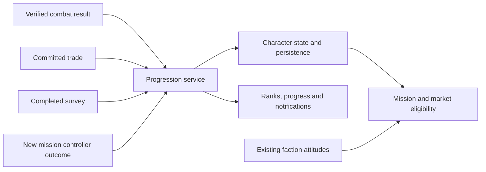

# Experience, careers and faction progression

**English** · [Русский](../ru/re/content_progression.md)

Freelancer can support independent combat, trade and exploration careers, plus service to individual factions. This needs a new progression layer: the existing `Experience` is a wealth threshold, not accumulated activity experience. Preserve campaign rank and faction relationships, and introduce separate career XP, service records and qualifications.

Research date: 2026-10-26. Evidence is static inspection of the working sources over base revision `af086d9` and primary sources for other games. The progression system, proposed classes, events and INI keys below are not implemented. No in-game validation was performed. See [open world missions](content_open_world_missions.md) for the proposed independent mission controllers.

## Existing Freelancer mechanisms

| Mechanism | Source evidence | Consequence |
|---|---|---|
| Experience threshold | `LoadPlayerToughnessScale`, `RecalculateContentPlayerRank` in [Support.cpp](../../src/Content/Support.cpp) | `ptough_graph_pt` maps wealth to rank. Input is `InspectCash + GetAssetValue`, not kills or completed jobs |
| Campaign rank | `SetContentPlayerMissionNumber` in the same file; [Story.cpp](../../src/Content/Story.cpp) | Selected campaign stages increase rank; Story separately checks wealth. Replacing this rank affects campaign progression |
| SP/MP distinction | `OnPlayerStatsRequest` in [GameSupport.cpp](../../src/Content/GameSupport.cpp) | SP reports `pub::Player::GetRank`; MP reports `pub::Reputation::GetRank`. These are paths to a general rank, not separate careers |
| Player statistics | `FContentPlayerStats` in [ContentPlayerState.h](../../src/Content/ContentPlayerState.h) | Kills by archetype; completed, aborted and failed missions; time, money, visited systems, bases and holes |
| Visits | `OnSystemChange`, `OnBaseChange`, `OnTargetChanged` in [PlayerState.cpp](../../src/Content/PlayerState.cpp) | Systems/bases are recorded uniquely. Targeting a hole records both ends: this is not proof of surveying the remote endpoint |
| Kills | Destruction handling in [SpaceSupport.cpp](../../src/Content/SpaceSupport.cpp) | Kill statistics use `KillerId`; loot/reputation separately use `GetTopDamagers`. Shared XP needs an explicit participation policy |
| Faction attitude | `ApplyFactionReputationChange` in [FactionProps.cpp](../../src/Content/FactionProps.cpp), [CombatReputation.cpp](../../src/Content/CombatReputation.cpp) | Attitude changes and empathy already exist. Political relationships are not professional competence |
| Mission outcome | `FRandomMissionObject::OnMissionSucceed` in [RandomMissionDB.cpp](../../src/Content/RandomMissionDB.cpp) | Success updates statistics and employer attitude; a possible adapter for career rewards |
| Persistence | `FContentPlayerState::Save`, `SaveContentPlayerStats` in [PlayerState.cpp](../../src/Content/PlayerState.cpp), loading in [Support.cpp](../../src/Content/Support.cpp) | Existing values live in `[mPlayer]`; new progression needs its own persistence contract |
| UI | [GameSupport.cpp](../../src/Content/GameSupport.cpp), [nn_player_info.cpp](../../src/freelancer/Client/nn_player_info.cpp) | Statistics/reputation screen exists; multiple career tracks do not. The statistics packet has a fixed `0x34` header |
| Market restrictions | `MinLevel`, `MinRep` in [common_basedata.cpp](../../src/Common/common_basedata.cpp), checks in [nn_ship_trader.cpp](../../src/freelancer/Client/nn_ship_trader.cpp) | New eligibility rules are possible; replacing general rank changes existing purchase restrictions |

`pub::Reputation::SetRank` does not improve attitude to every faction. Rank on a reputation object differs from `SetReputation(handle, faction, feeling)`. After campaign stage `0x2a`, rank recalculation can raise SP rank from the wealth table; it does not lower SP rank through that path. MP extends the table with further thresholds, still based on wealth.

Money counter names also need care. `Stats.TotalCashEarned` is loaded/saved but does not carry commodity acquisition costs. Server `PlayerSlot.total_earned` is a different counter: `PlayerData_ResetTotalEarned` resets it to equipment value when entering a base in MP. Neither is a trade-profit ledger. See [server_classes.cpp](../../src/Server/server_classes.cpp).

## Lessons from other games

| Game | Verified principle | Application |
|---|---|---|
| Elite Dangerous | Separate Combat, Trade and Exploration ranks; faction relationships and naval advancement exist separately | Several careers for one pilot instead of one level expressing everything |
| Star Citizen | The official cargo guide connects successful deliveries, hauling reputation and access to more lucrative contracts | Employers entrust harder work after demonstrated results |
| EVE Online | Skills train in real time, including while logged out; levels gate ships, modules and other skills | Explicit qualifications and readable requirements; offline timers do not serve the intended activity-based progression |

Elite's [official manual](https://hosting.zaonce.net/elite/website/assets/ELITE-DANGEROUS-GAME-MANUAL.pdf) and separate `Rank`/`Progress` fields in the [official journal specification](https://hosting.zaonce.net/community/journal/v10/Journal_Manual_v10.pdf) establish the distinction. These historical documents support the architectural comparison, not a current exhaustive rank/XP table. Exact Elite thresholds are not imported here.

Star Citizen's delivered hauling loop is described in the [Cargo Guide](https://robertsspaceindustries.com/en/comm-link/transmission/20040-Cargo-Guide). The [2021-05-14 developer AMA](https://robertsspaceindustries.com/en/comm-link/transmission/18123-Reputation-System-AMA-Recap) discusses professional versus local reputation, outcome quality, future perks and possible decay. It describes intentions at that date, not proof that every feature has shipped. The combat/exploration XP proposed below for Freelancer are not attributed to Star Citizen.

EVE's mechanism is documented in [Skill Training](https://support.eveonline.com/hc/en-us/articles/203217062-Skill-Training). For Freelancer, distinguish activity experience, awarded qualifications and purchased equipment: three different progression mechanisms.

## Recommended state model

Keep four independent forms of state:

1. **Careers:** accumulated `combat_xp`, `trade_xp`, `exploration_xp`; derive rank from thresholds. Purchases do not spend XP, and failed jobs do not erase professional experience.
2. **Faction service:** `service_xp[faction]`, earned by fulfilling that employer's tasks. Separate military/commercial tracks can follow when there is enough content.
3. **Current attitude:** existing Freelancer reputation. Hostility, betrayal, bribes and empathy operate here. Buying a better relationship does not grant service or combat experience.
4. **Qualifications and achievements:** certification, licence, NPC introduction, completed unique mission. These use persistent identifiers rather than another general XP bar.

A skilled combat pilot entering Rheinland retains competence but is not yet a trusted police contractor. A decorated veteran who becomes an enemy retains a service history but loses active access to that faction's work. Membership and promotion may require a qualification mission as well as XP.

Start with three careers and one service track per faction. Owned-cargo trading and transport contracts can share the trade career while retaining separate statistics. Flying a transport and protecting it warrant different rewards. Add mining, salvage, piracy or smuggling careers only when each has a substantial gameplay loop; use stable string track identifiers so expansion remains possible.

## Earning experience

All rules in this section are proposals for Freelancer, not formulas attributed to other games.

| Track | Valid activity | Potential unlocks |
|---|---|---|
| Combat | Verified participation in defeating combat targets; defence, interception and escort objectives | Harder contracts, certifications, specialised equipment variants |
| Trade | Verified trading profit; fulfilled hauling contracts and delivery quality | Larger orders, special offers, commercial contacts |
| Exploration | First personal survey, completed regional survey, expedition data delivery | Scientific contracts, coordinates, specialised scanners |
| Faction service | Employer objectives and optional success conditions | Titles, restricted contracts, licences, faction stock |

### Combat

Starting model: `XP = reward_budget × threat_factor × contribution × repeat_factor`. Define a budget per target/encounter, and assess threat from ship, loadout and AI. Bound factors instead of scaling without limit with ship price. Weak opposition gives less to an experienced pilot.

Award once per destroyed entity and divide a bounded budget among verified participants. Damage is one participation signal; a defence objective can separately reward an escort pilot. Group membership alone is insufficient, and the final shot must not claim the entire reward. Repeated destruction of a restored story target must not repeat its unique award.

Start with PvE; PvP requires a separate policy against arranged kills. Harmless targets should not become the best source of combat XP. Faction consequences determine legality; a career rank does not certify lawful behaviour.

### Trade and hauling

Distinguish a merchant's profit from a carrier's fee. An employer's cargo was not bought by its carrier: reward fulfilment, volume and delivery conditions, not an invented purchase margin.

Free trading requires lot provenance: commodity, quantity, acquisition price, acquisition location/source and remaining quantity. Recognise profit on sale using a fixed policy such as FIFO: proceeds minus the sold portion's cost and explicitly tracked fees. Unknown acquisition cost is not zero. Mined, gifted, stolen and mission cargo need distinct origin policies.

Convert profit to XP with bounded, configurable rules independent of cash balance. A first-route bonus can be unique while ordinary repeated routes remain legitimate work. Apply limits by route/lot/window, not each sale operation, so splitting a lot does not multiply rewards. Same-base buybacks, player transfers, refunds and ship-hull sales must not automatically award trading experience.

**Integration needs more than one handler.** In [IServerImpl.cpp](../../src/Server/IServerImpl.cpp), `GFGoodBuy`/`GFGoodSell` dispatch notifications while `ReqAddItem`, `ReqRemoveItem`, `ReqSetCash`, and `ReqChangeCash` separately mutate cargo and cash. The inspected path has no single committed transaction event with acquisition cost. MP needs a new server transaction contract or verified reconciliation producing `TradeCommitted` after consistent cargo/cash changes. Subscribing to `PlayerWorthChanged` does not establish a valid trade.

First implement XP for completed authored transport contracts. Add free-market trade XP after lot accounting and transaction validation.

For delivery depots, procurement, NPC cargo scans, confiscation and smuggling variants, see [cargo contracts](content_cargo_contracts.md). Contract fulfilment and free-market profit are separate reward sources.

### Exploration

Freelancer has a finite world. System-entry XP alone runs out quickly; repeated gate crossings create empty progression. Use personal discoveries and authored work: nebula surveys, wreck inspection, hazardous measurements, jump-hole searches and delivery of scientific data.

Track `known → surveyed → reported`. A purchased map or rumor provides knowledge but does not replace a completed survey. Discovery identity should use a persistent object/region nickname plus survey type, not a temporary spawned-object ID. First discovery for this character and first discovery on the MP server are distinct achievements; ordinary XP need not require server-wide priority.

Existing visit lists provide context/migration data, not proof of every stage. In particular, do not award two surveys for the two hole endpoints inserted by one `OnTargetChanged`. Timed measurements and hazardous anomalies need new objectives and result validation. Repeatable expeditions with new instances can sustain progression; repeatedly rewarding the same static object cannot.

## Connecting a new ConvoyMission

Example: unique mission `rh_ber_convoy_01`, offered by a fixed NPC on `rh_ber_01`. Use the proposed `FConvoyMission : FAuthoredMission`, with `FMissionPlanRuntime` executing its authored plan. It does not require `GenericMission`.

Meet transports → start route → trigger an ambush at a waypoint → defend → deliver → settle the outcome. An authored scene may introduce the encounter; progression does not depend on the scene playing.

Proposed metadata, **not currently parsed by the game**:

```ini
[MissionProgression]
mission = rh_ber_convoy_01
once_per_character = true
require_career = combat, 1
require_service = rh_p_grp, 0
require_feeling = rh_p_grp, 0.0
reward_profile = rh_ber_convoy_intro

[ProgressionReward]
nickname = rh_ber_convoy_intro
career_xp = combat, 200
service_xp = rh_p_grp, 100
unlock = rh_ber_convoy_followup
```

This example is a police commission; a commercial convoy uses its actual employer faction. Values are illustrative. An introductory contract can omit the career threshold so newcomers have a route into the profession.

The 200 XP is a fixed escort completion reward; balance it together with the separate enemy kill budget. Add trade XP only for actual logistics work, not simply shooting near another ship's cargo. Evaluate transport-condition bonuses at the outcome. Deliberately failing after the ambush should not pay better than delivery.

The controller sends `{instance_id, reward_id, participant_id, outcome, metrics}` to the shared reward service. The service validates eligibility and duplicate delivery, awards XP, applies attitude changes under separate rules and records completion. Check `once_per_character` both when listing and when accepting the offer. Each group participant has an individual reward entitlement.

StoryLauncher is not involved. Career rank, attitude, NPC introduction and quest prerequisites are explicit conditions of the new offer dispatcher. Later, story scripts can use an adapter to the same service; they should not own career XP or fake campaign-rank advancement.

## Architecture changes



Proposed components:

| Component | Responsibility |
|---|---|
| `FProgressionService` | Validated outcomes, reward rules, duplicate prevention |
| `FPlayerProgressionState` | Career XP, faction service, discoveries, licences and reward receipts tied to a persistent character |
| `FProgressionRules` | New data for thresholds, coefficients, reward profiles and a balance version |
| `FProgressionEligibility` | Shared checks for mbases, terminals, acceptance and purchases, returning a readable rejection reason |
| Event adapters | Translate Content/Server events and new mission results into verified activities |

Initially these can live in Content with explicit events from Server. `PlayerId` identifies a connected player, not a permanent character. Do not blindly enlarge public structures, vtables or the old statistics packet: provide a separate versioned progression snapshot. MP requires both ends to agree on support; the retail client cannot display the new careers.

The character screen should show each career, its current rank, progress and the next available contract. Offers should show requirements and reward types. Hostility and insufficient service must produce different explanations.

Ranks should primarily unlock content: contracts, qualifications, equipment variants and NPC relationships. Hidden permanent damage/hull bonuses need a modifier system and substantially change combat. Prefer visible equipment/access benefits initially. Set thresholds by meaningful activities per promotion, then measure XP/hour across careers; copying a long MMO grind does not match Freelancer's world size.

## Persistence, compatibility and duplicate delivery

Add a section such as `[ProgressionV1]`, with 64-bit integer XP, a schema version and stable identifiers. This needs its own 64-bit reading/writing; ordinary `get_value_int` is insufficient. Derive ranks from XP, but persist awarded licences and unique completions explicitly so a threshold-table change cannot silently revoke them.

Mission state, completion, awards and reward receipts must restore from a consistent snapshot. Deduplicate using character + persistent mission instance + reward identity. World combat needs a spawn-generation identity to prevent reuse of a numeric object ID. Keep unique completions/discoveries permanently; ordinary events need a bounded journal/sequence rather than an unlimited list of every kill.

For old saves without the section, initialise career XP to zero and preserve existing rank/reputation. Import visited locations as `known`, not automatic completed surveys. Optional retrospective achievement awards require an explicit one-time migration. Preserve unknown track identifiers so temporarily disabled content can return.

Redelivered outcomes and restoring the current mission must not duplicate awards. Loading an earlier SP save legitimately rolls back the whole profile; preventing this would require an external persistent profile, which is not proposed. In MP, the server calculates rewards; clients submit activity intentions, not XP amounts.

Under [CONTRIBUTING](../../CONTRIBUTING.md), implement this as an optional port feature, provisionally `FREELANCER_PROGRESSION`, disabled by default. The symbol is not added yet. The disabled path preserves retail behaviour. Saving with an older build cannot preserve new data without explicit support; use separate profiles for the prototype.

The subsequent [perks and boosters design](perks_and_boosters.md) separates career XP from selected perks, equipment characteristics, temporary modifiers and instant abilities. Earning a rank is not itself permission to activate auto-turrets or a resource-consuming ability.

## Scope and first deliverable

| Stage | Scope/risk | Observable result |
|---|---|---|
| XP, rank tables, persistence, mission-outcome rewards | Moderate | Completion changes the intended track once and survives reload |
| Offer eligibility and UI | Moderate; new client contract | NPC explains requirements and access changes at a threshold |
| Open-world combat XP | Moderate; participation and identity | Contributors share the intended budget without final-shot theft |
| Free trading | Significant; provenance and consistent transactions | Partial sales, transfers and reconnects cannot create extra XP |
| Exploration career | Visits are simple; substantial surveys need content | Unique surveys and expeditions support varied progression |
| MP | Additional work across all layers | Persistent identity, server decisions, group awards and network UI |

First vertical slice: **a new ConvoyMission on `rh_ber_01`, combat career, employer service, a separate UI bar and unlocking a follow-up offer**. Prepare the common model for three careers; demonstrate trade with one delivery contract and exploration with one authored survey. No mission generator is required.

Implementation acceptance cases: repeated success callback; saving before/after awards; restart during ambush; cancellation/failure; refusing a repeated unique offer; a group member previously rewarded; hostile attitude despite high service; old saves; feature enabled/disabled. Trading additionally needs mixed lots, partial sales and duplicate network requests. These are future acceptance criteria, not tests already run.
