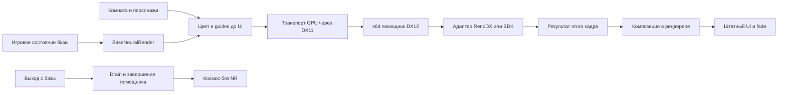
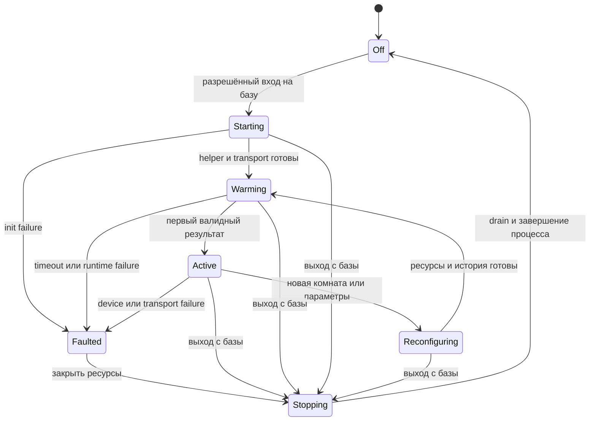

# Технический проект нейрорендеринга DLSS 5 для интерьеров баз

Дата проекта: 7 ноября 2026 года. Обновление 8 ноября: первый экспериментальный этап реализован под флагом `FreelancerDlss5`; статус, сборка и ограничения описаны в [base_neural_implementation.md](base_neural_implementation.md). Рабочая установка игры пока не изменена.

Цель — улучшить персонажей в интерьерах баз Freelancer с помощью DLSS Neural Rendering. На базе допустима дополнительная нагрузка и более длительное открытие первого интерьера. В космосе нейрорендеринг должен быть полностью остановлен: без обработки кадров, помощника, вычисления дополнительных motion vectors и сохраняемой памяти модели.

Рекомендуемая архитектура: управление из игрового состояния базы, захват сцены до интерфейса, отдельный x64-процесс с DX11/DX12 и заменяемым адаптером нейрорендеринга. Клиент остаётся x86. Первым проверяется транспорт изображения без DLSS, затем существующая связка RenoDX, затем качество движения персонажей. Выбор транспорта фиксируется после проверки текущего RP9, а не по результату старой retail-установки.

## Требования и границы

| Область | Решение |
| --- | --- |
| Игровые интерьеры | Бары, торговцы, оборудование, внутренние ангары и разговоры на базе допускают обработку |
| Планеты | Их внутренние комнаты проходят тот же путь; название типа космического объекта не определяет включение |
| Космос | Полное отсутствие работы подсистемы NR, включая космические катсцены, посадку снаружи, джампгейты и трейдлейны |
| Главное меню | Выключено, хотя оно использует ту же функцию рисования комнат |
| Скрытые базы пересадки | Выключено, в частности техническая пересадка курьерской миссии |
| Интерфейс | Кнопки, субтитры, курсор, окна торговли, fades и letterbox остаются штатными |
| Изображение | На первом этапе SDR, исходное разрешение, без генерации дополнительных кадров и без обязательного апскейлинга |
| Художественная цель | Более убедительные лица, кожа, волосы и одежда при сохранении узнаваемости персонажей |
| Отказ функции | Текущий оригинальный кадр; ошибка помощника не отменяет диалог, миссию или вылет |
| Настройка | Пользовательский переключатель и сила эффекта; технические параметры отдельно |
| Сеть и сохранения | Локальная графическая функция, без изменений сетевого протокола и содержимого сейвов |

Полностью выключенный DLSS и неизменный графический backend — разные условия. DX11-транслятор, если выбран, остаётся частью рендерера в космосе. Также перевод RP9 на D3D9Ex меняет жизненный цикл графического устройства всей игры. Для обоих вариантов обязательна проверка производительности космоса с выключенным NR. Переключать D3D9 и DX11 устройства при каждой посадке в первой реализации не планируется.

## Проверенная исходная реализация

### Текущий порт

Пути ниже относительны корню репозитория. Символы служат устойчивыми ориентирами при изменении номеров строк.

| Файл и символ | Что уже есть | Использование в проекте |
| --- | --- | --- |
| `src/freelancer/Client/gameflow.cpp`, `UpdateGameflowBaseFrame` | Отдельный кадр базы: `DrawClientLocation`, очистка depth, `Win3DDrawAll`, `DrawFade`, present | Владелец допуска к NR; место завершения подсистемы при выходе из состояния |
| `src/freelancer/Client/menu_enter_state.cpp` | Главное меню также вызывает `DrawClientLocation` | Запрет включения только по факту вызова рисования комнаты |
| `src/freelancer/Client/menu_universe_base.cpp`, `DrawClientLocation` | `RoomControlDraw`, затем `RenderEx::AntialiasScene` | Обработка законченного 3D-кадра до UI |
| `src/freelancer/Client/room_control.cpp`, `RoomControlDraw` | Геометрия комнаты, contact shadows, отложенные персонажи и корабли, прозрачность, эффекты | Источники масок и дополнительных проходов движения |
| `src/freelancer/Client/gf_character_object.cpp`, `FCharacterObject::DrawOpaque` | LOD и `DALib::Deform->Draw` | Идентификация экземпляра персонажа и его видимости |
| `src/Deformable2/Deformable2.cpp`, `FMeshArchetype::Skin`, `DrawPartLive` | CPU-скиннинг, запись позиций в VB, remap вершин и выбор LOD | Предыдущие деформированные положения без повторной симуляции анимации |
| `src/freelancer/Client/gf_script.cpp`, `FGfCameraPool` | Выбор активного слота и перенос его параметров в камеру комнаты | Смена источника камеры и история ракурса |
| `src/freelancer/Client/gf_thorn_camera.cpp` | Изменения камеры из Thorn | Различение непрерывного движения и смены кадра |
| `src/freelancer/Client/render_ex.cpp` | `AntialiasScene` вызывает `IRPFrameQuality::ApplySceneAntialiasing` | Согласование штатного AA с обработкой NR |
| `src/include/render/IRenderPipelineEx.h` | Расширения рендера, `GetSceneDepth`, признак INTZ | Получение глубины; новая функция добавляется отдельным интерфейсом |
| `src/RP9/RP9.cpp` | `Direct3DCreate9`, `CreateDevice`, `Reset` | Сейчас это D3D9, не устройство D3D9Ex |
| `src/RP9/RP9Ex.cpp` | Ex passes, сохранение состояния, INTZ depth, managed-ресурсы | Захват, упаковка guides, возврат результата; аудит ресурсов для D3D9Ex |

`IRenderPipelineEx` — собственное расширение движка, его наличие не означает `IDirect3DDevice9Ex`. Готового общего буфера движения персонажей в исследованном пути нет.

### Рабочая связка пользователя

Эталон для сравнения находится в `E:\games\freelancer game\FL_MOD\exe`. Это отдельная старая установка. Рабочий порт запускается из `D:\Games\FL_MOD\bin`; его установка не должна менять эталон.

| Компонент | Наблюдение |
| --- | --- |
| `D3D8.dll` | dgVoodoo, версия файла 4.8.2.134 |
| `dxgi.dll` | ReShade x86 6.8.0.2156; журнал содержит создание D3D11-устройства |
| `dlss5-feed.addon32` | Журнал идентифицирует Feed 0.7.0 |
| `ReShadePreset.ini` и `DLSS5_Feed.fx` | Launchpad запускается перед Feed; provider 1; Feed читает motion texture Launchpad и запрашивает optical flow |
| `host64/dlss5-feed-host.log` | Соединение protocol v2, источник D3D11, кадры 2560×1440, успешные evaluations |
| `host64/ReShade.log` | RenoDX Generic v4.6, D3D12, runtime DLSSNR 310.8.0.0, успешный NR feature 18 |

В журнале успешного запуска есть последующая ошибка устройства; другой запуск не смог запустить помощник. Это подтверждает работоспособность нейрообработки, но не её долговременную устойчивость. Число `feature 18` используется только как диагностическое свидетельство существующего addon, а не как предполагаемый публичный SDK-контракт.

Роль Launchpad здесь — оценка движения по изображениям. Его возможность получать normals не доказывает, что normals передавались в NR этой связкой. Назначение optical flow описано и в [документации Launchpad](https://www.martysmods.com/launchpad/).

### Целевая среда и проверка возможностей

Первичная среда приёмки — Windows x64 и RTX 5080 пользователя. Клиент x86 работает с помощником x64 на одном физическом GPU. Устройства DX11/DX12 создаются по adapter LUID, а не по «адаптеру по умолчанию». Разные GPU, WARP и удалённый программный рендер не получают автоматического NR-пути.

Проверка возможностей выполняется один раз при разрешённом входе на базу: разрядность процесса, доступность DX12 и нужных feature levels, форматы и shared resources, нужные версии интерфейсов DX11 для fences, доступность конкретного NR backend, чтение depth и ресурсный бюджет. Наличие RTX в имени адаптера не заменяет успешной инициализации feature. Требования к версии Windows и драйвера поставки фиксируются по выбранному runtime; в проекте не предполагается их совместимость со всеми версиями Windows 10.

## Архитектурное решение

Разделяются три независимых контракта: допуск игрового состояния, транспорт текстур, backend нейрообработки. Тогда замена обёртки или runtime не затрагивает управление базой и анимацией.



### Выбор транспорта

| Вариант | Преимущество | Цена и ограничение | Назначение |
| --- | --- | --- | --- |
| RP9 через D3D9→DX11-транслятор и addon-мост | Ближе к рабочей схеме пользователя, не требует немедленной переделки managed-пулов | Совместимость текущего RP9, INTZ, Ex shaders и точного pre-UI вызова ещё должна быть проверена | Первый кандидат для прототипа |
| RP9 на D3D9Ex → shared textures → DX11 → DX12 | Собственный контролируемый мост без ReShade в игровом процессе | Аудит `D3DPOOL_MANAGED`, reset/present, форматов и синхронизации всей RP9 | Целевой собственный транспорт, если цена обёртки или её ограничения неприемлемы |
| Полный RP11 | Прямое владение DX11-ресурсами | Отдельный крупный проект рендерера с регрессиями всего контента | За пределами первой реализации |
| D3D9 readback → CPU → upload | Простой диагностический возврат кадра | Синхронизация CPU/GPU и копирование на каждом кадре | Только инструмент проверки, не штатный режим |

Начальный выбор — проверять DX11-трансляцию на текущем порте. Старый D3D8 retail-результат не заменяет эту проверку. Если первый кандидат проходит критерии транспорта и космоса, на нём делается рабочая версия для оценки лиц. Для полностью собственного пути проект определяет D3D9Ex-мост; начинать его миграцию до результатов первого кандидата не требуется.

У обычного D3D9 нет того же документированного механизма разделяемых поверхностей, что у D3D9Ex. [Microsoft описывает границу совместимости API](https://learn.microsoft.com/en-us/windows/win32/direct3darticles/surface-sharing-between-windows-graphics-apis). Перевод на Ex нельзя свести к замене одной функции: `D3DPOOL_MANAGED` там недопустим. [Правила D3DPOOL](https://learn.microsoft.com/en-us/windows/win32/direct3d9/d3dpool).

### Выбор backend NR

1. `passthrough`: возврат исходного изображения через весь транспорт; обязателен до загрузки NVIDIA runtime.
2. `renodx_compat`: контролируемый x64-помощник с проверенным набором Feed/RenoDX/runtime. Может сохранять зависимость от ReShade внутри помощника. Наличие этой зависимости явно отражается в диагностике и составе поставки.
3. `native_sdk`: непосредственный backend на документированном доступном SDK после подтверждения API, headers, правил инициализации и распространения. Это отдельная замена адаптера, не условие первого прототипа.

Копия `nvngx_dlssnr.dll` сама по себе не задаёт контракт вызова. Проект не предполагает, что публичный SDK воспроизводит внутренние вызовы установленного RenoDX. Не использовать угаданные feature ID и адреса функций. Для совместимого backend зафиксировать версии и SHA-256 используемых компонентов, их зависимости и проверенный драйвер. DLSS Super Resolution или DLAA, если они технически требуются адаптеру, не считать доказательством работающего NR.

Публичное описание NVIDIA определяет входы NR как текущий кадр, движение, временное состояние и параметры художественного управления. Это не перечень экспортов DLL. [Описание модели NVIDIA](https://research.nvidia.com/labs/adlr/DLSS5/). Существующий [DLSS5 Feeder](https://github.com/jlrouzies-fr/DLSS5-Feeder) служит исходным техническим ориентиром для x86/x64-моста; его текущий main не считать исходником установленного 0.7.0 без сопоставления версии.

## Полное отключение в космосе

Владельцем подсистемы становится состояние игрового интерьера, а не глобальный обработчик present. Явный `BaseFrameScope` создаётся только в разрешённом кадре `UpdateGameflowBaseFrame`. `DrawClientLocation` принимает его через внутренний контекст; при отсутствии scope NR даже не начинает инициализацию.

Допуск требует одновременно: включённая настройка, обычное игровое состояние базы, действительные base/room/runtime, видимый интерьер и работоспособный транспорт. Главное меню, загрузка, технические базы пересадки и внешние сцены не получают scope. Исключение технической базы должно передаваться смысловым флагом существующего transfer-пути, а не списком захардкоженных nickname.

Порядок выхода:

1. При принятии перехода из состояния базы выставить `Leaving`, запретить новые submit и захват guides.
2. Дождаться окончания уже отправленного GPU-кадра с ограниченным ожиданием. Нельзя запускать очередную оценку NR во время этого ожидания.
3. Освободить feature, историю и все GPU-ресурсы помощника; получить подтверждение завершения работы.
4. Закрыть transport handles, события, pipe и историю деформаций клиента. Завершить принадлежащий игре процесс помощника.
5. Только затем завершить переход к первому игровому кадру космоса. Отказ NR не должен отменять сам переход.

Обрабатывать централизованный выход из gameflow, включая обычный launch, скриптовый переход, консоль, загрузку сохранения, disconnect и курьерскую пересадку. Обработчик кнопки «Вылет» не покрывает все пути. При внезапном завершении клиента процесс помощника закрывает Job Object с `KILL_ON_JOB_CLOSE`.

Проектный предел нормального drain — 500 мс; это ограничение перехода, не покадровый бюджет. При потере связи процесс закрывается принудительно, подсистема помечается неисправной до следующей разрешённой попытки. Зависание всего GPU и TDR требуют штатного восстановления устройства: завершение процесса не доказывает мгновенное окончание уже зависшей GPU-команды. Нельзя обещать сохранение FPS при аппаратном или драйверном сбое.

Инварианты обычного космического режима:

- Нет процесса `fl_neural_host64.exe`, активного feature и текстур NR.
- Нет NR dispatch, копирований его поверхностей, расчёта optical flow и добавочных проходов движения.
- Нет потока опроса IPC, периодического restart, shader hot reload и сбора деформированных вершин ради NR.
- Нет NR-вызова из `AfterSpaceScene` или пространственного `AntialiasScene`.
- Все счётчики submit/evaluate/copy подсистемы постоянны; её учёт активных GPU-ресурсов равен нулю.

Проверка конфигурации и запуск помощника происходят при следующем входе на базу. Режим удержания прогретой модели в космосе в первой версии отсутствует. Возможный драйверный cache освобождается по правилам драйвера; проект контролирует свои живые объекты, а не обещает нулевое изменение общей цифры VRAM в диспетчере задач.

## Порядок обработки кадра базы

1. Зафиксировать frame ID, идентичность комнаты, поколение сцены, камеру и финальные матрицы проекции.
2. Нарисовать комнату существующим путём, сохранив порядок AO, персонажей, стекла и эффектов.
3. Получить цвет до UI и очищения depth. Оригинал сохранить до успешной композиции результата.
4. Сформировать guides: глубину, движение, validity и маски управления внешностью. Дополнительные проходы не обновляют анимацию и не двигают игру.
5. Если backend требует предварительного AA, выполнить выбранный единственный AA-путь, не меняя координат guides. Для NR без встроенного AA начальный вариант — существующий spatial AA перед NR. Для адаптера с обязательным DLAA отключить дублирующий штатный AA на обработанном кадре. Оба режима сравнить на тонких контурах.
6. Передать кадр и дождаться результата с тем же frame ID в пределах установленного deadline.
7. Выполнить композицию в исходный color target. При ошибке оставить оригинал и применить обычный AA, если он ещё не выполнялся.
8. Вернуть управление существующим `Win3DDrawAll`, `DrawFade` и present.

NR не добавляется просто после глобального present: тогда внутрь модели попадёт UI. Предлагается отдельный `RenderEx::FinishBaseScene(context)`, вызываемый вместо прямого комнатного `AntialiasScene`; существующие пространственные вызовы сохраняют свою функцию.

Не выполнять позднее наложение результата предыдущего кадра. Оно создаёт рассогласование рта, звука, курсора и камеры. Два слота транспорта нужны для безопасного владения и освобождения ресурсов, а не для очереди отстающих изображений. Одновременно допускается только один NR evaluate.

## Контракт изображения и guides

Все значения ниже — контракт нашего моста. Адаптер преобразует его в требования конкретной версии runtime.

| Поле | Формат в помощнике | Семантика |
| --- | --- | --- |
| `scene_color` | RGBA8 UNORM для начального SDR-пути | Финальная сцена до UI; alpha не является маской персонажа |
| `scene_depth` | R32_FLOAT | Нормализованный hardware depth в диапазоне 0..1; направление, clear value и near/far передаются явно |
| `motion` | R16G16_FLOAT | Смещение от пикселя текущего кадра к соответствующему месту предыдущего в пикселях, X вправо, Y вниз |
| `motion_validity` | R8_UNORM | Достоверность соответствия; 0 означает отсутствие истории, а не неподвижность |
| `appearance_mask` | R8_UNORM | Где разрешено изменение внешности; 0 сохраняет исходную сцену |
| `temporal_rejection` | R8_UNORM | Области разрыва соответствия и изменения материала; адаптер использует только при поддержке |
| `output_color` | RGBA8 UNORM | Результат в том же цветовом кодировании и размере, что исходная сцена |

Размеры из фактического render target, а не размера окна. Передаются active viewport, crop, sample count исходника, матрицы, jitter, transfer function и exposure mode. В начальном режиме jitter равен нулю; нельзя подставлять несуществующее дрожание камеры ради DLAA-контракта.

Проверить тракт SDR ramp: один и тот же серый градиент должен оставаться тем же после `passthrough`. Не выполнять автоматическое декодирование/кодирование sRGB дважды. При необходимости перевода в линейное пространство преобразование делается один раз на входе и обратное на выходе. HDR — отдельный последующий режим с собственным контрактом, не скрытое изменение SDR.

INTZ нельзя просто открыть как обычную DX11-текстуру глубины. Глубина читается в RP9 shader pass, затем упаковывается или конвертируется в допустимую общую color texture. MSAA color сначала разрешается в single-sample target; доступность соответствующей depth проверяется отдельно. Если корректная depth недоступна, NR выключается с понятной причиной, а не получает случайный depth от UI или теней.

Маска временного сброса и маска художественного воздействия имеют разный смысл. Нельзя использовать `DLSS5_Mask` старого Feed как гарантированный аналог engine-level appearance mask.

## Транспорт DX11 и DX12

### Вариант с транслятором

В игровом процессе работает узкий x86 addon-мост. Он получает DX11 device/context и textures через поддерживаемый API используемой обёртки или ReShade. Движок вызывает его экспортируемый versioned C-интерфейс в `FinishBaseScene`; addon не выбирает момент обработки по эвристике present.

Обязательная проверка этого варианта: все D3D9-команды комнаты уже исполнены или корректно отправлены транслятором к моменту обращения к DX11-ресурсам. Нужно удостовериться, что доступна именно активная scene color/depth, а не промежуточный или устаревший backbuffer. Протокол pre-UI вызова и завершения commands — результат первого транспортного прототипа. Если обёртка не позволяет это обеспечить поддерживаемым способом, вариант не проходит допуск.

Если flow/evaluate запускаются через ReShade effect runtime, мост должен уметь выполнить нужные эффекты в этом pre-UI месте и подавить их повторный автоматический запуск при present. Одна смена preset или переключение техники после present задачу не решает. Порядок первого кандидата: room commands → явный flush через доступный контракт → guides/flow → helper → copy back → дальнейшие UI commands. Невозможность обеспечить этот порядок является основанием перейти к собственному транспорту, даже если обычный ReShade показывает красивый финальный кадр.

В космосе этот addon не получает base frame и ничего не обрабатывает. Однако сама трансляция команд всей игры остаётся; её цена измеряется отдельно. Переключатель NR не подменяет или выгружает `d3d9.dll` на лету.

### Собственный транспорт D3D9Ex

После аудита RP9 устройство создаётся в Ex-режиме, а shared textures — без mipmaps и MSAA. Legacy shared handle D3D9Ex открывается устройством DX11 в помощнике. Адаптеры должны иметь один LUID. Не поддерживать незаметное копирование между разными GPU.

Для начального согласованного набора предлагаются RGBA8 color/output/masks, RGBA16F motion и RGBA8 с упакованной 24-битной depth. Конкретный D3D9 format и его DXGI mapping выбираются по capability probe; порядок каналов проверяется цветовой таблицей. RGBA16F depth по умолчанию не использовать: это теряет точность аппаратной глубины.

Microsoft ограничивает набор форматов и параметры D3D9→D3D11 shared textures. [Контракт OpenSharedResource](https://learn.microsoft.com/en-us/windows/win32/api/d3d11/nf-d3d11-id3d11device-opensharedresource). `Flush` отправляет работу, но не является доказательством её GPU-завершения.

Ресурсы legacy 9Ex и ресурсы DX12 не объявляются одним универсальным handle. Помощник открывает legacy surfaces на обычном DX11 device, затем копирует/конвертирует на отдельные ресурсы, совместно используемые DX11/DX12 через NT handles и fences. До принятия этого маршрута отдельный probe проверяет формат, resource flags, states и обе стороны копирования. Возможность shared heaps документирована [Microsoft](https://learn.microsoft.com/en-us/windows/win32/direct3d12/shared-heaps); совместимость каждой конкретной комбинации проверяется на машине.

`D3D11On12::CreateWrappedResource` принимает уже созданный DX12 resource. Он не является универсальной функцией преобразования произвольной DX11 или D3D9-текстуры. [Описание CreateWrappedResource](https://learn.microsoft.com/en-us/windows/win32/api/d3d11on12/nf-d3d11on12-id3d11on12device-createwrappedresource).

### Синхронизация и владение

Каждый слот проходит `Free → Writing → InputReady → Evaluating → OutputReady → Reading → Retiring → Free`. Переход разрешён только после доказанного завершения GPU-доступа предыдущего владельца. Notification event сообщает о состоянии, а не заменяет fence/query.

Для DX11/DX12 применять shared fences при поддержке выбранными устройствами. Для границы D3D9Ex без общего fence — event query и ограниченное CPU-ожидание завершения до передачи владения. Не предполагать keyed mutex у legacy 9Ex surface. Симметрично дождаться завершения записи output в DX11 до его чтения RP9, и чтения RP9 до повторной записи.

Не ставить в очередь GPU игры ожидание fence, который может навсегда остаться несигнальным после падения помощника. На первой реализации подтверждение готовности проверяется на CPU с deadline до отправки зависимой команды. При timeout слот не переиспользуется: сначала drain/закрытие поколения. Общие текстуры и handles живут до окончания всех обращений обеих сторон.

Для native RP9 явно согласовать границы `BeginScene`/`EndScene`: resolve/копии, требующие завершения сцены, выполняются с восстановлением предыдущего состояния сцены до UI. При чтении INTZ нельзя одновременно оставлять несовместимое depth binding. Использовать проверенный механизм Ex pass и согласовать с ним cache targets; не удерживать открытый частично изменённый pass на время ожидания IPC.

Начальный transport ring — два слота, максимум один отправленный кадр. При недоступном слоте рисуется оригинал; очередь кадров не растёт. CPU readback разрешён только в диагностике и явно отмечается в логах.

## Межпроцессный протокол

Предлагаемые имена и структуры в этом разделе ещё не реализованы.

Control plane — локальный named pipe `fl.base_nr.<pid>.<session_nonce>` с доступом текущего пользователя. Данные изображения остаются на GPU. Handles передаются отдельной процедурой соответствующего типа: NT handles дублируются в целевой процесс, legacy graphics handles открываются графическим API. Нельзя просто передать числовое значение обычного process-local HANDLE.

Общий заголовок сообщения: `magic`, `protocol_major`, `protocol_minor`, `message_type`, `payload_bytes`, `session_id`, `generation`, `frame_id`. Поля фиксированной ширины; сериализация little-endian; нативные указатели, `size_t`, C++ containers и произвольные packed struct через границу запрещены. Receiver проверяет размер, диапазоны, версию и порядок сообщений до выделения памяти.

Первоначальные protocol limits: control message не более 64 KiB, два resource slots, размеры не более 8192 по каждой оси и не выше меньшего лимита устройств/runtime. Все произведения размеров считать с проверкой переполнения в 64 битах и сверять с бюджетом памяти до allocation. Эти пределы не обещают поддержку NR в 8K: capability backend может ограничить разрешение сильнее. Неизвестный major отвергается, optional поля minor допускаются только при явно согласованной возможности.

| Сообщение | Содержание |
| --- | --- |
| `Hello` / `Capabilities` | Версия, x86/x64, adapter LUID, backend ID, formats, режим sync, возможности reset/masks, runtime fingerprint |
| `CreateSession` / `Ready` | Размер, viewport, encoding, выбранные formats, максимальные размеры, режим motion, набор handles |
| `SubmitFrame` | Slot, frame ID, generation, timestamps, dt, camera/room revision, матрицы, jitter, reset reason, sync values |
| `FrameDone` | Те же идентификаторы, output readiness, status, времена GPU-этапов и диагностика реального NR evaluate |
| `ResetHistory` | Причина и новое temporal generation; не означает немедленного уничтожения занятых textures |
| `Drain` / `Drained` | Запрет новых submit и завершение всех обращений к ресурсам |
| `Shutdown` / `Stopped` | Уничтожение backend и освобождение ресурсов |
| `Fault` | Stage, HRESULT/runtime code, device-removed reason, frame ID; один отказ не вызывает бесконечный restart |

`session_id` меняется при каждом запуске помощника; `generation` — при смене ресурсов, комнаты или сбросе истории. Поздний результат старого поколения всегда отбрасывается. Размер, encoding и format output должны точно соответствовать запросу. GPU fences имеют отдельные монотонные значения; логический frame ID не заменяет их.

Помощник не управляет игровым окном и не перехватывает ввод. Запускать скрыто, без повышения привилегий. Если compatibility backend нуждается в собственной swapchain, она скрытая и используется только внутри помощника. Его оверлей не входит в пользовательский режим игры.

## Движение персонажей

### Базовая семантика

Для текущей видимой поверхности вычисляются `uv_current` и `uv_previous` по её положению в соответствующих кадрах. Вектор нашего контракта:

```text
motion_pixels = (uv_previous - uv_current) * (width, height)
previous_pixel = current_pixel + motion_pixels
```

Переход clip→UV учитывает Y вниз, viewport offset, D3D9 pixel-center convention и фактическую проекцию. Не транспонировать матрицы «на глаз»: проверить синтетическими сдвигами камеры и объекта с известным направлением вектора. Adapter отвечает за другой знак, масштаб или layout конкретного runtime.

### Последовательность реализации

| Уровень | Источник движения | Для чего достаточен |
| --- | --- | --- |
| M0 | Проверенный optical flow по исходным pre-UI кадрам | Первый визуальный прототип и сопоставление с рабочим ReShade |
| M1 | Reprojection depth с предыдущей камерой плюс движение rigid objects | Фон и неподвижная геометрия; не заменяет анимацию лица |
| M2 | Предыдущие деформированные позиции персонажей | Целевой режим для разговоров, поворотов головы и жестов |
| M3 | Гибрид M2 и optical flow в областях недостоверного соответствия | Материалы, UV-анимация, отдельные неподдержанные элементы |

Optical flow вычисляется только по оригинальным кадрам, не по результату NR, иначе появляется обратная связь. Сброс истории NR сбрасывает и flow. Если используется Launchpad, сохранять его как внешнюю зависимость соответствующего compatibility backend; собственный режим не предполагает копирование его исходника.

### История деформаций

Сохранять итоговые позиции после CPU skinning, учитывая текущий remap и stride VB. `FMeshArchetype` может обслуживать несколько экземпляров: история принадлежит instance/part, а не общему архетипу. Ключ: `{scene_generation, instance_id, instance_generation, part_id, mesh_revision, lod_id}`. Переиспользование адреса не должно оживлять историю другого NPC.

Хранить два CPU-массива позиций и необходимые GPU streams. Обновлять previous один раз на логический отрисованный кадр, а не на каждый material draw, shadow pass или вызов `Skin`. Неизменившиеся вершины копируются из сохранённого current; dirty update не означает, что остальные вершины неизвестны. На первом кадре, при LOD/topology change, despawn и повторной видимости после разрыва invalidation локальный.

Передача в новый RP9 motion pass должна включать текущий и предыдущий root/object transform: координаты CPU skinning нельзя автоматически считать world-space. У глаз, головы и присоединённых деталей могут быть свои transforms. Их принадлежность персонажу и история фиксируются отдельно. UV-анимация и смена текстуры не восстанавливаются из геометрических MV: такие области получают temporal rejection либо optical flow.

Motion pass рисует видимые поверхности текущего кадра с согласованными depth test, culling, alpha test и LOD. Не вызывать повторно `FCharacterObject::DrawOpaque` для этого прохода: он меняет LOD/состояние, создаёт тени и отправляет цветовые материалы. Нужен отдельный read-only draw ранее подготовленной геометрии.

Сначала заполнить движение фона из depth и камеры, затем перезаписать видимые dynamic surfaces геометрическим движением. За стеклом и на смешанной прозрачности один depth не описывает все слои; там снижать доверие, использовать flow или ослаблять эффект. Nearest depth, masks и motion должны относиться к одной видимой поверхности.

## Управление внешностью и маски

Модель получает полную сцену комнаты, чтобы видеть освещение и окружение. Маска определяет, где применять изменения. Начальный визуальный прототип обрабатывает всю комнату с умеренным воздействием. Целевой профиль выделяет персонажей и снижает воздействие на фон; пользователь может выбрать обработку всей комнаты.

Engine-level и semantic masks предусмотрены технологией, но конкретная версия adapter может не предоставлять их. [Описание средств управления NVIDIA](https://developer.nvidia.com/blog/whats-new-for-game-developers-dlss-5-with-3d-guided-neural-rendering-nvidia-ace-updates-and-new-rtx-kit-capabilities/). Capability `appearance_mask_supported` обязан отражать фактическую возможность.

Если runtime не принимает appearance mask, собственная финальная композиция использует:

```text
final = lerp(original_scene, neural_scene, appearance_mask * blend_strength)
```

Это управление видимым результатом, а не аналог внутренних параметров модели. Для физически корректного смешивания выполнить его в согласованном линейном пространстве. Мягкий край строить с учётом depth и coverage, не размывать персонажа поверх переднего предмета. Маска персонажа включает волосы и аксессуары; классификация лица отдельно возможна по материалам/part tags, но не по одному ненадёжному имени текстуры.

Стекло перед персонажем требует ослабленной маски по итоговой прозрачности или консервативного исключения пограничных пикселей. Нельзя считать маску, нарисованную до стекла, окончательной. Если корректное покрытие недоступно, начать с профиля всей комнаты, не выпускать режим персонажей с ореолами.

Маска персонажа не гарантирует пропорционального уменьшения стоимости NR: backend может продолжать обрабатывать весь кадр. Кроп отдельных лиц не входит в первую версию из-за границ, движения и потери контекста.

## История камер и сцены

| Событие | Действие |
| --- | --- |
| Новая база или комната | Новое поколение сцены, reset NR/flow/object history |
| Новый активный Thorn camera slot, жёсткий cut | Reset camera и NR history; не смешивать ракурсы |
| Непрерывный трек камеры | Сохранять историю и выдавать корректные MV |
| Непрерывный zoom | Сохранять при корректной previous projection; резкий скачок FOV — reset |
| Разрешение, viewport, encoding, MSAA или device generation | Drain старых ресурсов, пересоздание, reset |
| Пауза и неизменный кадр | По возможности повторно использовать только результат именно того же изображения; не накапливать фиктивное движение |
| Возобновление после длительного разрыва | Reset; начальный порог разрыва 250 мс, настраиваемый |
| Пропущенный submit либо timeout | Следующий evaluate с reset, пока нет реализации MV относительно последнего принятого кадра |
| Новый NPC или LOD | Локальная invalidity его поверхности; глобальный reset только при необходимости backend |
| Загрузка сейва | Новая session/scene generation, история не сериализуется |

Указатель `FRoomCamera` может оставаться тем же при смене ракурса. Нужен camera revision от источника/слота; простое сравнение указателей недостаточно. Защитный детектор скачка матриц дополняет явные события, но не должен сбрасывать историю на каждом обычном движении.

Fades и letterbox рисуются после NR. При полном закрытии переходом можно не отправлять кадры, но при возобновлении требуется reset. ESC-пропуск разговора/сцены должен проходить тот же механизм выхода и invalidation, без ожидания несуществующего следующего callback.

## Состояния и обработка ошибок



Во время Starting/Warming игрок видит обычный интерьер, интерфейс и звук продолжают работать. Init выполняется вне критического render-потока; все обращения к игровому D3D9 device остаются на его потоке. Начальный deadline запуска — 10 секунд, не блокирующих взаимодействие. Включение эффекта можно плавно довести до установленной силы за 0,2 секунды после первых валидных кадров.

Покадровый `result_deadline_ms` первоначально 50 мс и подлежит настройке по измерениям. Это предел ожидания, не обещание 60 FPS. После первой потери результата показать оригинал и перейти в recovery; после повторных ошибок не чередовать нейрокадры с оригиналом бесконечно. Перезапуск разрешён один раз на новую комнату или вручную; в космосе автоматических попыток нет.

Отсутствие поддерживаемого GPU/runtime, несовпадение LUID, несовместимый протокол, невозможность прочитать depth и недостаток памяти приводят к обычному рендеру. Ошибка показывает одну локализованную причину в настройках, подробности идут в лог. Не включать другой SR/FG-режим вместо отсутствующего NR.

## Предлагаемые модули и интерфейсы

| Новый модуль | Ответственность |
| --- | --- |
| `src/freelancer/Client/base_neural_render.h/.cpp` | Допуск базы, состояния, frame context, camera revisions, запуск и остановка |
| `src/include/render/IRPBaseNeural.h` | Отдельный QueryInterface для capture/guides/composite; не менять vtable существующего retail-интерфейса |
| `src/include/base_neural_protocol.h` | Типы сообщений и версии wire-контракта без D3D и указателей |
| `src/RP9/RP9BaseNeural.cpp` | Export textures, resource states, native transport path, композиция и восстановление состояния |
| `src/Deformable2/DeformableMotion.cpp` | Per-instance previous positions и read-only motion submission |
| `src/BaseNeuralBridge11/` | x86 addon/bridge для выбранного DX11-транслятора; compatibility путь |
| `src/BaseNeuralHost/` | Отдельный x64 проект: IPC, DX11/DX12, backend adapters, GPU timings |
| `DATA_EXTRA/SHADERS/base_neural_*.hlsl` | Упаковка depth, motion, маски и композиция |
| `tools/base_neural/` | Build, transport probe, protocol tests, capture/replay, проверка установки |

Предлагаемый внутренний API:

```cpp
// Только эскиз границ ответственности, не готовая ABI декларация.
BaseNeural::EnterBase(BaseContext const&);
BaseNeural::BeginFrame(BaseFrameContext const&);
BaseNeural::FinishScene();  // same-frame evaluate или оригинал
BaseNeural::Invalidate(ResetReason);
BaseNeural::BeginLeaveBase();
BaseNeural::FinishLeaveBase();
BaseNeural::OnDeviceLost();
BaseNeural::Shutdown();
```

Расширение рендера возвращает opaque resource tokens и capabilities; клиент не получает незафиксированный layout внутренних объектов RP9. История Deformable передаётся optional sink через отдельный интерфейс. При выключенном feature sink отсутствует, массивы не выделены, дополнительные циклы по вершинам не выполняются.

Проверить и восстановить render targets, depth target, viewport/scissor, shaders, textures/samplers, streams, indices, blend/cull/depth/sRGB states и cache RP9. Одного восстановления D3D state недостаточно, если внутренний cache продолжает считать изменённое состояние актуальным.

## Конфигурация и пользовательский интерфейс

Настройки движка — `bin/port.ini`, новая секция `[BaseNeural]`. Следующий блок описывает предлагаемый формат; текущая игра его пока не читает.

```ini
[BaseNeural]
enabled = 0
transport = auto
backend = renodx_compat
scope = base_interiors
appearance = room
blend_strength = 0.35
motion = auto
work_scale = 1.0
result_deadline_ms = 50
startup_deadline_ms = 10000
shutdown_deadline_ms = 500
history_gap_ms = 250
debug_view = off
log_level = errors
```

`enabled=0` — безопасное значение поставки до прохождения тестов. Число 0,35 — начальная сила нашей композиции для оценки, не параметр NVIDIA. Прямые model/structure/tone settings определяются capability descriptor backend и сохраняются отдельно с версией схемы; не выдавать произвольное число за одинаковую силу разных runtime.

`scope` в первой версии имеет единственное допустимое значение. `auto` выбирает только прошедший capability probe транспорт и пишет выбор в лог. Если выбора нет, функция недоступна; CPU readback автоматически не включается. `motion=auto` выбирает native/hybrid только после проверки их валидности, иначе известный optical flow provider.

`work_scale=1.0` — исходное разрешение. Снижение масштаба означает обработку уменьшенного кадра и последующее растяжение, не обещает DLSS Super Resolution; в первой пользовательской версии скрыто. Смена масштаба требует пересоздания и reset.

Пользовательские пункты: «Нейрорендеринг персонажей на базах», «Сила эффекта», при готовности масок — «Персонажи / Вся комната». Пояснение: «Работает в интерьерах. В космосе полностью отключён». Статус различает выключено, загрузку, активный NR и причину недоступности. Технические backend/transport/таймауты остаются в конфиге и диагностике.

Строки интерфейса RU/EN — ресурсы проекта с выделенными ID; если попадают в генерируемые ресурсы Pythonlancer, добавить их в static cache существующим способом. Не зашивать пользовательские русские строки в EXE. Изменение UI само по себе не должно запускать helper в главном меню или космосе.

## Память и производительность

Ориентировочный транспортный слот для native 9Ex: color 4 + packed depth 4 + motion 8 + packed masks 4 + output 4 = 24 байта на пиксель. При 2560×1440 два слота занимают около 169 MiB, при 3840×2160 — около 380 MiB. Это расчёт поверхностей без выравнивания, промежуточных DX11/DX12 копий, flow, модели, истории NR и памяти игры. Итог измеряется, а не выводится из этой суммы.

Не хранить полные изображения в адресном пространстве x86. CPU-история вершин рассчитывается отдельно: два положения float3 требуют примерно `24 × число сохранённых вершин` байт плюс метаданные и streams. Учитывать remapped вершины и несколько частей персонажа.

Раздельно измерять capture, guides, transport input, optical flow, evaluate NR, transport output, composite, CPU wait и общий frame time. GPU timestamps разных устройств не вычитать без калибровки; использовать длительности внутри каждой очереди и отдельный CPU end-to-end интервал.

Проектная цель для 1440p на RTX 5080 — устойчивое интерактивное изображение базы; 60 FPS желательно, 30 FPS может быть приемлемо при выбранном пользователем качестве. Конкретный результат определяется измерением модели. Передавать изображение на NR реже, чем обновляется сцена, и подмешивать старые лица к свежему фону в первую версию не входит.

Для космоса целевая добавка от самой подсистемы — нулевые работы и выделения. Эквивалентность производительности backend проверяется серией A/B-прогонов: обычный RP9, выбранный транспорт с `enabled=0`, игра после посещения базы и полного shutdown. Сравнивать median, p95/p99 frame time и пики, а не только средний FPS. Начальный порог расследования — воспроизводимое ухудшение более 3% либо дополнительные пики более 1 мс; это критерий теста, не обещание точности одиночного замера.

## Диагностика и проверка качества

В журнал записывать session/generation/frame IDs, room/camera revision, выбранный transport, LUID, runtime fingerprint, размеры, reset reason, ошибки и агрегированные времена. Не печатать каждый кадр по умолчанию. Успех означает подтверждённое NR evaluate и применение его результата; `DLAA ready` недостаточно.

Режимы просмотра: original, processed, split, difference, depth, motion magnitude/direction, motion validity, appearance mask, temporal rejection. Split и debug overlays располагаются после обработки и не возвращаются в её историю. Для воспроизведения дефекта сохранять короткую последовательность оригинального цвета, guides и metadata только по явной debug-команде.

### Обязательные испытания

| Проверка | Критерий приёмки |
| --- | --- |
| Passthrough pattern | Без потери каналов, поворота, изменения гаммы, stale frames; RGBA8 идентичен при пути без конверсии |
| Depth ramp и MSAA | Верные near/far, ориентация и clear value; нет depth от shadow/UI |
| Движение камеры и rigid object | Верный знак и масштаб; погрешность репроекции синтетического объекта не более 0,5 пикселя на валидной внутренней области |
| Два NPC одного архетипа | Независимая история, разные анимации не смешиваются |
| Разговор | Губы, глаза, повороты головы, руки, волосы; нет заметных шлейфов и изменения личности между ракурсами |
| Прозрачность | Стекло/волосы/эффекты не дают ореол персонажа поверх переднего объекта |
| UI | Надписи, курсор, hotspot, выбор ответа и торговля не попадают в NR и сохраняют кликабельность |
| Camera cuts | Нет примеси прошлого ракурса; обычный трек не сбрасывается каждый кадр |
| LOD и spawn/despawn | Локальная invalidity, отсутствие использования освобождённой истории |
| Resize и Alt-Tab | Drain/recreate, handles не протекают, оригинал доступен при восстановлении |
| Failure injection | Падение helper, timeout, несовпадение версии, недостаток памяти — обычный кадр и отзывчивый клиент |
| Выход с базы | Helper завершён, собственные NR GPU-ресурсы освобождены до штатного космического режима |
| Техническая пересадка | Нет старта helper на невидимой базе локомотива |
| Главное меню | Нет запуска NR при том же `DrawClientLocation` |
| Повторные циклы | 100 входов/выходов и 30 минут диалогов без роста handles/истории/живых ресурсов |
| Космический бой | Счётчики NR неизменны; A/B frame-time без воспроизводимой регрессии от оставшейся работы |

Проверять обычный launch, console launch, base jump, загрузку сейва с базы и из космоса, ESC, disconnect, закрытие игры во время Starting и evaluate. Отдельно испытать переключатель в комнате и его изменение вне базы. Для MP проверить локальность эффекта без изменения gameplay timing или server tick.

Автоматизировать протокол, bounds/overflow validation, stale results, generation changes, state machine, pointer-reuse/LOD history и синтетическую репроекцию. Визуальную узнаваемость NPC нельзя заменить unit test: принять по видеосравнению нескольких разговоров с одинаковыми настройками камеры и освещения.

## Этапы реализации и условия перехода

| Этап | Результат | Условие завершения |
| --- | --- | --- |
| P0 | Снимок текущего renderer/runtime, fingerprint компонентов, baseline базы и боя | Воспроизводимые сцены и метрики, подтверждённые зависимости backend |
| P1 | Room-only scope, passthrough через DX11 и x64, полное выключение на выходе | Корректный pre-UI кадр, same-frame возврат, timeout recovery, space A/B и shutdown проходят |
| P1b при необходимости | Собственный D3D9Ex transport и миграция ресурсов RP9 | Нет MANAGED на Ex, правильные reset/present, регрессии космоса устранены |
| P2 | Совместимый RenoDX backend и M0 optical flow | Подтверждённое NR, приемлемый первый разговор, прогрев и отказ без блокировки игры |
| P3 | Нативные camera/rigid/deformed MV, validity и masks | Репроекция и сравнения анимации проходят; нет деградации относительно M0 |
| P4 | Настройки, RU/EN ресурсы, room profiles, lifecycle и fault injection | Все критические сценарии и повторные входы/выходы проходят |
| P5 | Установочный manifest и длительное тестирование | Воспроизводимая сборка, rollback, подтверждённая производительность базы и космоса |
| P6 отдельно | Прямой SDK backend вместо compatibility adapter | Доступный подтверждённый API и равноценное качество; не блокирует P2–P5 |

Оценка масштаба: P1–P2 — ограниченный графический прототип; P3–P5 — полноценная подсистема рендера. Основные неопределённости — доступ к правильным буферам после DX11-трансляции, требования runtime и стабильность лиц. D3D9Ex-миграция при необходимости добавляет работу во всём RP9, даже при отключении NR в космосе. Календарную оценку фиксировать после P1: до измеренного транспорта она будет ненадёжна.

## Сборка и установка

Клиент, RP9, bridge и при изменениях Deformable2 собираются x86. Помощник — отдельный x64-проект со своим toolchain; не расширять существующие Win32 configurations всей игры ради одного процесса. IPC проверяется между реальными x86/x64 сборками.

Предлагаемое размещение: `D:\Games\FL_MOD\bin\neural\host64\fl_neural_host64.exe` и его runtime-зависимости рядом; bridge — в `bin` или каталоге addon выбранного compatibility транспорта. Конкретный manifest зависит от выбранного backend. DLL lookup помощника ограничен его каталогом и системными библиотеками; не подменять глобально системные DXGI/D3D DLL.

Compatibility runtime хранится изолированно, чтобы RenoDX/NGX помощника не конфликтовали с пользовательским ReShade игры. В runtime manifest перечислять обязательные файлы и их версии/хэши, не копировать весь старый EXE. Компоненты Frame Generation и Ray Reconstruction не включать автоматически только из-за их наличия у пользователя. Набор и права распространения зависимостей уточняются для выбранного backend до подготовки пакета.

Установщик проверяет закрытую игру, делает backup изменяемых файлов и предоставляет rollback. Любые DATA-изменения и staged DATA проходят через `Pythonlancer tools.data_folder.DataFolder`; ресурсы не писать обходным способом. Сейвы и старую установку на E не изменять. Ветка Git остаётся текущей.

## Условия готовности

Функция готова, когда выбранный backend действительно выполняет NR в игровых интерьерах до UI, улучшает персонажей в движении, переживает переходы и отказы, а после выхода с базы не оставляет активной работы или ресурсов подсистемы. На космических сценариях подтверждается отсутствие регрессии сверх оговорённой погрешности измерений.

Техническое решение не требует полной переделки Freelancer в x64 или полного нового DX11-рендерера. Оно требует доказанного транспорта, отдельного lifecycle базы и корректной истории анимированных персонажей. Первый исполняемый результат реализации — P1 passthrough с проверкой отключения в космосе; качество модели оценивается следующим этапом.
