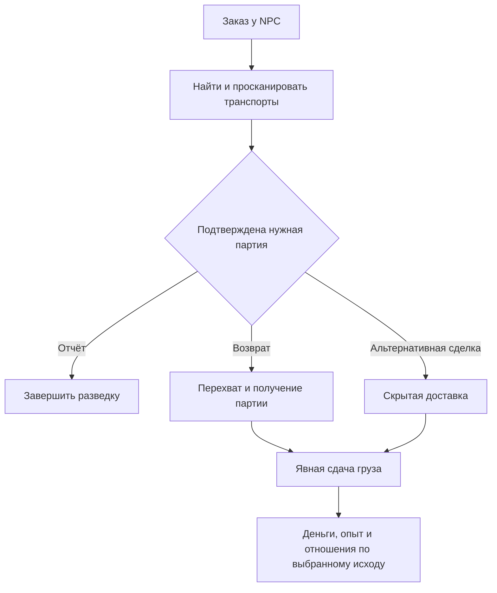

# Грузовые контракты, сканирование и контрабанда

[English](../../re/content_cargo_contracts.md) · **Русский**

В Freelancer можно создать широкий набор авторских контрактов: перевозки, закупки, разведку грузопотоков, досмотры, конфискации, перехваты и контрабанду. Подход — новые самостоятельные контроллеры миссий с общими службами груза, сканирования и наград. Генератор заданий, `GenericMission` и продвижение через `StoryLauncher` для этого не обязательны.

Исследование от 2026-10-26 основано на текущих исходниках поверх `af086d9` и документации Frontier. Это оценка и проект, не реализованная возможность. Проверки в игре не проводились. Связанные документы: [архитектура новых миссий](content_open_world_missions.md), [карьерная прогрессия](content_progression.md).

## Что брать из Elite Dangerous

Полезная модель — контракт как обязательство с заказчиком, товаром, количеством, местом назначения и сроком, плюс отдельная выдача и сдача груза. Официальный журнал Elite описывает `MissionAccepted`, `CargoDepot` и привязку груза к `MissionID`; depot отдельно учитывает полученное и доставленное количество. Это подтверждает основу для нескольких рейсов и участия группы. Источник: [Frontier Player Journal v31, разделы 3.1, 8.3 и MissionAccepted](https://hosting.zaonce.net/community/journal/v31/Journal_Manual_v31.pdf).

В [Update 13](https://www.elitedangerous.com/de-DE/neues/elite-dangerous-update-13-notes) Frontier отдельно указывает отображение количества полученного и доставленного груза для транспортных миссий. Для нашего интерфейса это полезнее одной полосы «миссия активна».

Эти источники подтверждают архитектурный образец, а не актуальные цены, штрафы или полный набор заданий Elite. Варианты ниже — предложение для Freelancer; не утверждается, что каждый из них существует в Elite. Фоновая симуляция экономики масштаба Elite для ручного контракта не требуется.

## Что подтверждено в Freelancer

| Возможность | Исходники | Практическое ограничение |
|---|---|---|
| Просмотр груза NPC игроком | `FClientEquippedObj::scan_cargo` в [client_gameobj.cpp](../../../src/freelancer/Client/client_gameobj.cpp), [hud_target_panel.cpp](../../../src/freelancer/Client/hud_target_panel.cpp), [nn_scanner.cpp](../../../src/freelancer/Client/nn_scanner.cpp) | UI умеет показывать результат, но это ещё не доказательство исполнения контракта |
| Физика скана | `CEScanner::ScanCargo` в [common_cescanner.cpp](../../../src/Common/common_cescanner.cpp), [common_iobjinspectimpl.cpp](../../../src/Common/common_iobjinspectimpl.cpp) | Проверяет дистанцию с учётом scanner interference и запас энергии; успешный скан расходует энергию и копирует описания оборудования. В этой функции нет длительной стадии удержания луча |
| Событие для скрипта | `SPScanCargo` в [IServerImpl.cpp](../../../src/Server/IServerImpl.cpp), `CndCargoScanned` в [MissionCnd.cpp](../../../src/Content/MissionCnd.cpp) | Payload — только `{scanner_id, target_id}`; нет результата, списка груза или признака нарушения |
| Сканирование патрулём | `FCargoScanRoute` в [PatrolGuides.cpp](../../../src/Content/PatrolGuides.cpp) | Поиск цели, сближение, проверка груза, требование сброса, сбор выброшенного груза и враждебность уже существуют |
| Интересы сканирующей фракции | `scan_for_cargo`, `scan_chance`, `scan_announce` в [FactionProps.cpp](../../../src/Content/FactionProps.cpp), [NpcShip.cpp](../../../src/Content/NpcShip.cpp) | Список интересующих товаров не равен полноценному закону: сканирующей стороной могут быть и пираты |
| Реплики досмотра | `QueueScanEvent`, `FGcsScanEvent` в [PatrolGuides.cpp](../../../src/Content/PatrolGuides.cpp), [Gcs.h](../../../src/Content/Gcs.h) | События разговора передают результат для радиообмена; это не единый надёжный интерфейс контрактных доказательств |
| Чтение и изменение груза | `SpaceObj::EnumerateCargo`, `Player::EnumerateCargo`, `AddCargo`, `RemoveCargo`, `GetRemainingHoldSize` в [server_pub.cpp](../../../src/Server/server_pub.cpp) | Требуются собственная проверка объёма, принадлежности партии и подтверждение изменения; временный номер слота не годится как постоянный идентификатор |
| Сброс и подбор | `JettisonEquipment` в [PatrolGuides.cpp](../../../src/Content/PatrolGuides.cpp), события `LootAcquired` и `Cnd_LootAcquired` | Нужна связь конкретной выброшенной партии с контрактом, а не только совпадение типа товара |

### Почему Cnd_CargoScanned недостаточно

Клиентская обёртка вызывает `SPScanCargo` для корабля игрока после вызова сканера **без проверки успешности результата**. UI отдельно проверяет результат, прежде чем открыть окно. Серверный обработчик просто рассылает два ID и не проверяет принадлежность сканера отправителю. Условие `CndCargoScanned` сопоставляет метки объектов, а не содержимое и успех.

Поэтому событие нельзя считать доказательством «найдено 20 единиц запрещённого товара». Нужен новый подтверждённый результат. Название `SPScanCargo` также не доказывает отсутствие MP-пути: сериализация есть в [RemoteServer](../../../src/RemoteServer/IServerImpl.cpp), приём — в [RemoteClient](../../../src/RemoteClient/RemoteClient_main.cpp), локальная передача — в [rpclocal](../../../src/rpclocal/rpc_payload_ch3.cpp). Наличие транспорта не заменяет проверку запроса сервером.

### Почему mission_flag недостаточно

`pub::Player::AddCargo(..., mission_flag)` на базе передаёт этот параметр как запрет объединения стека; он не устанавливает `EquipDesc::bMission` на этом пути. В космосе флаг записывается в descriptor. MP-сохранение пропускает предметы с `bMission`. Это видно в [server_pub.cpp](../../../src/Server/server_pub.cpp) и [server_classes.cpp](../../../src/Server/server_classes.cpp).

Кроме того, в патрульном обработчике найденный миссионный груз игрока ведёт прямо к враждебной стадии. Для NPC с таким грузом в рассмотренной ветке остаётся ответ `3` и повторяется стадия проверки: статически виден риск цикла, который требует отдельной проверки. Поэтому нельзя бездумно маркировать таким флагом все контрактные товары или цели досмотра.

### Что ещё влияет на контрабанду

`GMissionScanClamp` блокирует выбор целей патрулём. Новые контракты не должны включать глобальное подавление сканов из сюжетной миссии. `FCargoScanRoute::SetShip` проверяет дальность сканера, затем задаёт дистанцию маршрута сканирования 500; механика патруля отличается от прямого скана игроком. На выбор влияют отношения, формация, вероятность и уже проверенные цели.

Нельзя гарантировать интересный досмотр только выдачей запрещённого груза: нужны подходящий патруль, его список товаров и рабочий маршрут. Нельзя объявлять небулу универсальной невидимостью: прямой скан учитывает помехи, но поведение патруля нужно проверять отдельно. Общая политика видимости должна применяться ко всем источникам сканирования.

## Каталог вариантов

Оценка добавочной работы **после создания общей системы контрактов**: **А** — в основном план и данные; **Б** — расширение существующего события/операции; **В** — новая игровая механика. Ни один вариант таблицы пока не реализован как новый контракт.

| Семейство | Контракт и действия игрока | Результат и добавочная работа |
|---|---|---|
| Перевозка | Взять груз заказчика на A и доставить на B | Сдать именно выданную партию; **Б**, учёт происхождения |
| Закупка | Самостоятельно найти и предоставить нужный товар | Изъятие допустимого количества при сдаче; **А**, можно принимать ранее купленное |
| Закупка у поставщика | Купить товар на указанной базе после принятия заказа | **Б**, подтверждённая покупка и источник партии |
| Крупная поставка | Доставить 120 единиц кораблём с трюмом на 30 | **Б**, частичная выдача/сдача, depot и сохранение остатков |
| Сборный рейс | Собрать партии на нескольких базах | **А** поверх партий и depot; отдельные пункты маршрута |
| Развоз | Разделить груз между несколькими получателями | **А** поверх depot; количественные обязательства на каждого |
| Срочная доставка | Уложиться в согласованный срок | **А**, явная политика времени и сохранения |
| Особый груз | Доставить скоропортящийся или хрупкий груз | **В**, качество/порча и условия хранения; HP корпуса не равно качеству каждого товара |
| Передача в космосе | Встретить транспорт и передать партию | **Б**, проверка дистанции и согласованный перенос между владельцами |
| Страховое обследование | Просканировать указанный транспорт и подтвердить груз | **Б**, сохранённый результат скана; без уничтожения цели |
| Торговая разведка | Просканировать несколько разных перевозчиков в районе | **Б**, уникальные цели и отчёт о товаропотоке |
| Поиск перевозчика | Среди нескольких NPC найти судно с нужным товаром | **Б**, фильтр содержимого и ветвление после доказательства |
| Проверка манифеста | Сопоставить заявленный и фактический груз | **В**, манифест, правила расхождений и действие «сообщить» |
| Таможенный патруль | Проверить суда и передать сведения о нарушителях | **Б/В**, результат скана плюс полномочия и юрисдикция |
| Конфискация | Найти запрещённый груз, потребовать сброс и сдать улики | **Б**, управление ответом NPC и цепочка владения; скан не даёт автоматического права стрелять |
| Наблюдение | После скана сопровождать подозреваемого до места передачи | **Б**, сохранение роли цели и маршрута; скрытность требует отдельного правила |
| Разведка перед налётом | Узнать состав груза и вернуться живым | **Б**, отчёт; уничтожение носителя может лишать бонуса |
| Возврат похищенного | Найти и вернуть конкретную украденную партию | **Б**, происхождение груза; купленный аналог не подходит |
| Пиратское вымогательство | Просканировать, выбрать добычу, добиться сброса без уничтожения | **Б/В**, интерфейс требования и ответ NPC; пиратский AI сам по себе не является командой игрока |
| Захват груза | Перехватить транспорт и получить заданный объём | **Б**, маршрут сброса/добычи; нельзя обещать сохранение всех товаров после взрыва |
| Поиск обломков | Найти груз исчезнувшего рейса и доставить остатки | **А/Б**, авторские объекты и привязанные партии |
| Скрытая перевозка | Доставить груз без подтверждённого обнаружения властями | **Б**, отдельный результат досмотра и политика провала |
| Прорыв блокады | Доставить груз вопреки охране маршрута | **А/Б**, контролируемые встречи; обнаружение допустимо, доставка остаётся целью |
| Контрабанда через посредника | Получить товар у NPC, передать тайному получателю | **Б**, владельцы партий, встреча и выдача награды |
| Отвлечение патруля | Увести досмотр от другого транспорта | **В**, управление вниманием, целью патруля и условиями ухода |
| Подмена партии | Заменить помеченный груз и довезти поддельный | **В**, происхождение, поддельный манифест и проверка подлинности |
| Контролируемая поставка | Везти запрещённый груз с разрешением следствия | **В**, ограниченное разрешение по месту, сроку и конкретной партии |
| Контейнер с тайником | Пройти скан с частично скрытым содержимым | **В**, сокрытие и возможности сканера; штатный cargo scan не даёт такого контракта |
| Выбор стороны | После обнаружения груза сдать его заказчику, полиции или конкуренту | **А/Б** поверх учёта партий; взаимоисключающие исходы и награды |
| Совместная операция | Один игрок ищет цель, другой перехватывает, третий перевозит | **В** для первой версии: общие доказательства, права участников, MP-сохранение и распределение наград |

Сканирование может быть самостоятельной профессией: не каждый найденный груз должен заканчиваться боем. Отрицательный результат тоже значим — например, подтвердить отсутствие запрещённых товаров у трёх разных транспортов. За повторное открытие окна одного NPC награда не выдаётся.

## Набор общих механизмов

Вариативность удобнее строить сочетанием операций: **найти → просканировать → классифицировать → выбрать действие → получить/передать груз → отчитаться**. Одно звено можно опустить или заменить. Планы остаются написанными вручную.

Предлагаемая иерархия, ещё не существующая в коде:

```text
FMissionObject
  FAuthoredMission
    FTradeMission          доставка и закупка
    FInspectionMission     обследование и досмотр
    FInterdictionMission   перехват и получение груза
    FSmugglingMission      доставка с условиями обнаружения
    FConvoyMission         защита транспортов

Общие службы: CargoLedger, CargoDepot, ScanService,
              CargoLawPolicy, MissionPlanRuntime, ProgressionService
```

Это несколько самостоятельных типов контроллеров, а не C++-класс на каждую вариацию задания. `FSmugglingMission` может переиспользовать компонент доставки; `FInspectionMission` — компонент отчёта. Существующие `Cnd_*`/`Act_*` привязаны к `FMissionScript*`, поэтому нужна адаптация либо собственные операции плана. На старте сохраняется ограничение одной принятой работы; несколько одновременных контрактов потребуют нового журнала и владения целями, а не только ещё одного вызова фабрики.

### Подтверждённый скан

Новый `ScanService` должен отличать запрос, успешный результат, обнаружение интересующего груза и последствие досмотра. Предлагаемый результат:

```text
ScanCompleted(scan_id, scanner_actor, target_actor, system,
              authority_faction, cargo_snapshot, visibility_policy, time)
CargoViolationDetected(scan_id, jurisdiction, lot_ids, rule_id)
InspectionResolved(scan_id, outcome)
```

Идентификаторы акторов устойчивы внутри экземпляра миссии; текущие object ID используются только для доступа к живым объектам. Снимок сохраняет значения, а не указатели на временный `EquipDescVector`. Сервер проверяет отправителя, его корабль, цель, систему, дальность, сканер и условия успешности. Общий путь должен учитывать расход энергии ровно один раз: повторно запускать расходующий энергию скан ради «проверки» нельзя.

Отдельный адаптер нужен для NPC-патруля. Нельзя определять обнаружение по проигранной реплике: речь может быть отключена, прервана или отсутствовать. Миссия «не быть обнаруженным» проваливается по оговорённому результату проверки груза конкретной стороной, а не при выборе игрока целью. Длительное скрытое сканирование, удержание дистанции, конус обзора и шанс раскрытия — возможные новые правила, не свойства уже найденной функции.

### Принадлежность и сдача груза

Предлагаемый `CargoLedger`: `lot_id`, товар, количество, владелец, происхождение, экземпляр контракта, текущий носитель/склад/контейнер и состояние. Физический товар остаётся оборудованием/грузом Freelancer; ledger дополняет его, не заменяет. Нужны согласованные изменения при объединении/разделении стеков, покупке корабля, сбросе, подборе, продаже и уничтожении.

Для обычной закупки достаточно допустимого товара из разрешённых источников. Для «верни украденное» или «перевези запечатанную партию» совпадение архетипа недостаточно. Булевый `bMission` не хранит владельца, договор и происхождение. Выделенный архетип на первый прототип облегчает распознавание, но не заменяет идентичность нескольких экземпляров.

Сдача выполняется явным действием в интерфейсе: игрок выбирает контракт и количество; сервер проверяет базу, остаток обязательства и доступную партию, изымает её и фиксирует доставку. Посадка на базу сама по себе не завершает обязательство. Одна единица не может засчитаться двум контрактам. Операция имеет ID повторности; изъятие, счётчик и сохранение должны быть согласованы.

При выдаче проверять объём товара и свободный трюм. Остаток ожидает на контрактном складе; не требовать вместить весь заказ сразу. Для выданной партии вести баланс `всего = на складе + в пути + принято + утрачено`. Разрешение замены утраченного товара задаётся договором. Сдача части товара и досрочное закрытие с частичной оплатой — разные операции; частичная оплата разрешается явно.

### Контрабанда и правила фракций

Разделить: товар запрещён в данной юрисдикции; партия украдена у владельца; перевозка нарушает условия контракта; сканер принадлежит пирату, заинтересованному в добыче. Это четыре разных обстоятельства.

`CargoLawPolicy` может учитывать фракцию проверяющего, систему/базу, тип/происхождение товара и разрешение. Существующий `scan_for_cargo` пригоден как исходный список интересов, но не заменяет эту модель. Штрафы, конфискационные полномочия, лицензии, поддельные документы, тайники и местный розыск требуют новых правил и интерфейса. Пиратское обнаружение не должно автоматически считаться полицейским разоблачением.

Для первых миссий достаточно явных правил самого договора: «обнаружение полицией Рейнланда лишает бонуса», «конфискация критической партии проваливает заказ», «пиратская атака допускается». Мировую систему законодательства можно добавить позже. Отказ от контракта должен заранее определять судьбу груза: возврат, изъятие или переход в незаконное владение; бесплатная продажа выданной партии не должна становиться выгоднее исполнения.

## Авторский пример на rh_ber_01

NPC предлагает проверить три транспорта у торгового пути. Один везёт отмеченную партию; два — обычные грузы. После подтверждённого скана открываются три исхода:

1. Передать сведения заказчику и получить оплату за разведку.
2. Принять дополнительное поручение на возврат партии, добиться сброса и доставить груз.
3. Договориться с альтернативным получателем и доставить партию скрытно, рискуя отношениями с первоначальным заказчиком.

Третья ветка — сознательный выбор игрока, а не автоматическая замена принятого заказа. Уничтожение транспорта до идентификации, уход цели из системы и потеря части груза имеют авторские исходы. Введённые NPC должны жить достаточно долго для выполнения задачи; обычный despawn не должен случайно делать заказ невыполнимым. При поддержке переходов между системами нужны восстановление акторов и маршрута.



Это пример общей цепочки, не требование реализовать все ветки в первом прототипе. Засады и патрули задаются планом, а не генератором. Устойчивые флаги стадий не допускают повторного спавна и повторной награды после загрузки.

## Деньги, карьеры и интерфейс

Перевозка оплачивает услугу; закупка должна явно показывать, включает ли выплата стоимость товара. Для первого варианта закупки разумна фиксированная полная выплата: игрок сам оценивает цену приобретения. Возмещение реальных расходов требует проверенной истории покупки, а не слов клиента. Груз сдаётся контракту и не продаётся рынку второй раз.

Опыт выдаётся за подтверждённые цели: торговый — за доставку, исследовательский — за разведывательный отчёт, боевой — за боевые действия, заслуги — за работу на заказчика. Таможенная проверка не обязана давать исследовательский XP: профиль награды зависит от задачи. Сам клик сканера не является наградой. Альтернативные финалы взаимоисключающие; убийства и завершение имеют согласованный общий бюджет.

Карточка контракта показывает заказчика, источник/назначение, количество, правила происхождения, законность, срок, полную оплату, возможный залог и последствия провала. Журнал отдельно показывает «осталось забрать / везу / сдано / потеряно», найденные доказательства и текущую цель. Для большой поставки нужна панель depot с выбором количества. Для проверки — «что установлено» и доступные действия; скрытый груз не показывается заранее только потому, что сервер знает его.

## Порядок реализации и проверки

| Этап | Результат | Оценка |
|---|---|---|
| 1 | Самостоятельный InspectionMission: один NPC, успешный скан, проверка товара, отчёт | Лучший небольшой срез для последнего запроса; нужен новый подтверждённый результат |
| 2 | TradeMission: закупка/доставка, явная сдача и частичные рейсы | Умеренная работа; партии и восстановление сложнее самой проверки количества |
| 3 | SmugglingMission: патруль, зафиксированное обнаружение, доставка и последствия | Умеренная/значительная; согласование обеих систем сканирования |
| 4 | Перехват, требование сброса, конфискация и возврат конкретной партии | Значительная; управление NPC, происхождение и сохранение добычи |
| 5 | Манифесты, тайники, подмена, отвлечение и контролируемые поставки | Новые игровые механики; не обещать как INI-настройки существующего сканера |
| 6 | Несколько одновременных контрактов и совместное исполнение в MP | Дополнительная сквозная работа: владение, общий depot, права, сеть и выплаты |

Сохранять: условия принятого договора, экземпляр, участников, стадии, роли акторов, партии/depot, результаты сканов, исход обнаружения, таймер и квитанции наград. Для SP выбрать игровое время без течения при закрытой игре; для MP срок может быть серверным календарным. Это должно быть явно задано, а не вытекать из случайного таймера контроллера.

Критерии будущих тестов: неудачный скан вне дальности/без энергии; повторный запрос; чистый груз; неправильная цель; выгрузка между сканом и отчётом; ложный scanner ID; две партии одинакового товара; два договора на один товар; частичная выдача/сдача; потеря, возврат и подбор другим участником; сохранение на базе и в космосе; переподключение; отказ/смерть; исчезновение NPC; повторный успех; влияние `GMissionScanClamp`; сборки с расширением и без него.

Новую функциональность вводить под отдельной возможностью порта по [CONTRIBUTING](../../../CONTRIBUTING.ru.md), сохраняя штатные пути выключенного режима. Это исследование не меняет семантику retail-сканирования, формат груза, протокол или игровой код.
