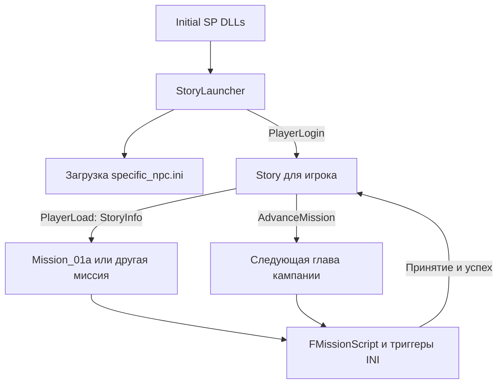
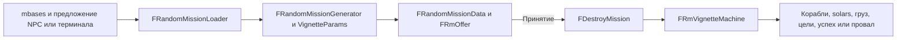

# Сюжетные скрипты и задания открытого мира

[English](../../re/content_open_world_missions.md) · **Русский**

Сюжетный движок Freelancer можно использовать для авторских заданий, запускаемых по прибытии в систему, выбору NPC или слуху. Проверка достатка находится в `Story`, а не в интерпретаторе миссий. Однако готового механизма «вписать путь к сюжетному INI в mbases» нет: для самостоятельных заданий нужен загрузчик и владелец их состояния. Катсцены тоже можно запускать отдельно от кампании; `RtcSlider` регулирует их отображение и не является сюжетным ограничителем.

Выводы относятся к исходникам этого порта на базе `af086d9` и исследованы статически. Примеры требуют проверки в игре: в рабочем каталоге отсутствует `DATA`, а доступный `m01a.ini` находится в наборе `plugins/jflp`, поэтому его отличия нельзя автоматически приписывать retail. Ниже «существует» означает подтверждённый путь в коде; раздел о диспетчере описывает предлагаемое расширение, пока не реализованное.

## Что можно сделать

| Задача | Что уже есть | Что потребуется |
|---|---|---|
| Запустить сценарий без ожидания уровня | Создание `GenericMission` или собственного наследника `FMissionScript`, сообщение `MissionStart` | Корректные параметры, состояние игрока, сохранение и управление занятостью миссией |
| Начать задание в определённой системе | `Cnd_SystemEnter` | Заранее загруженный скрипт либо внешний диспетчер событий |
| Начать задание при выборе постоянного NPC | `GFObjSelect`, `Cnd_CharSelect`, `mRoom fixture` | Связать роль NPC со сценарием; обеспечить существование персонажа и контекст комнаты |
| Начать задание через слух | `RumorHeard`, `Cnd_RumorHeard` | Учитывать роль говорящего, доступность слуха и повторные визиты; отдельный обработчик для точного IDS слуха |
| Изменять случайные боевые задания | Дерево vignette, корабли, solars, груз, волны, тексты, награды | Изменения данных в рамках реализованных генераторов |
| Добавить новый тип вроде сопровождения или перевозки | Сюжетные объекты, условия, команды AI и цели | Авторский сценарий и запуск; либо новый генератор/автомат RandomMissions на C++ |
| Проиграть свою катсцену вне кампании | `CharacterBehaviorCreate`, `AmbientScriptCreate`, `RequestSpaceScript` | Владелец сцены, актёры, ресурсы, обработка завершения и восстановления управления |
| Перенести всё это в MP | Часть событий, GF/RPC и группового механизма уже общая | Отдельная адаптация состояния, сохранений, общих флагов и поведения клиентов |

## StoryLauncher и Story

Цепочка запуска выглядит так:



[`StoryLauncher.cpp`](../../../src/Content/StoryLauncher.cpp), `FStoryLauncher::HandleMessage`:

* Загружает `missions\specific_npc.ini` в общую таблицу `GSpecificNpcs`.
* На `PlayerLogin` создаёт `Story` с `PlayerId`.
* Не выбирает миссию по уровню, не читает mbases и не исполняет сюжетные триггеры. Heartbeat отключён.

[`Story.cpp`](../../../src/Content/Story.cpp), `FStory`:

* Хранит имя миссии, `MissionNum`, `delta_worth` и флаг покупки корабля.
* `OnLoad` создаёт контроллер из `[StoryInfo] Mission`. При чтении следующего ключа `MissionNum` отправляет ему `PlayerLoad`, затем `MissionStart` (`0x1000`). Порядок этих двух ключей существенен.
* `AdvanceMission` проверяет **деньги плюс стоимость имущества**, порог `DeltaWorth`, свободный слот текущей миссии и определённый этап кампании. Это не общая проверка «уровень >= N» внутри скриптов.
* Проверка запускается сообщениями `PlayerWorthChanged` и `PlayerMissionChanged` при освобождении миссии. Конструктор задаёт heartbeat 5 секунд, но `HandleMessage` его не обрабатывает: ждать очередного тика Story недостаточно.
* `StartMission` обнуляет отображаемую сумму до следующего ранга, обновляет главу, создаёт `Mission_*` с приоритетом `ABOVE_NORMAL` и отправляет `MissionStart`.

Пороги являются прибавкой к состоянию на момент окончания предыдущей главы: `SetNextRankWorth` сохраняет текущие деньги + имущество + прибавку. Сохранённое `delta_worth` — уже итоговый порог.

| Этап ожидания | Прибавка | Следующий контроллер |
|---:|---:|---|
| 5 | 3500 | `Mission_02` |
| 9 | 5200 | `Mission_03` |
| 12 | 7000 | `Mission_04` |
| 15 | 10000 | `Mission_05` |
| 18 | 16000 | `Mission_06` |
| 21 | 0 | `Mission_07` |
| 24 | 36000 | `Mission_08` |
| 27 | 30000 | `Mission_09` |
| 30, 33, 36, 39 | 0 | `Mission_10` … `Mission_13` |

Некоторые переходы немедленно вызываются из `OnMissionEvent`: `01a → 01b`, `06 → 07`, `09 → 10 → 11 → 12 → 13`. Этап 42 завершает кампанию. Числа этапов также участвуют в доступности слухов и сложности случайных заданий, поэтому произвольное изменение `MissionNum` влияет не только на сюжет.

Первую миссию задаёт шаблон `NewPlayer.fl`, а не `InitialWorld.ini`; устройство шаблона описано в [сохранениях](../ini/saves-and-initial-world.md). Удаление строки `StoryLauncher` из конфигурации само по себе не создаёт свободный режим с новыми заданиями: исчезнут и владелец `[StoryInfo]`, и загрузка `specific_npc.ini`.

## Исполнение сюжетного INI

[`StoryMissions.cpp`](../../../src/Content/StoryMissions.cpp) содержит оболочки `Mission_01a` … `Mission_13` и `GenericMission`. Их общая основа — [`FMissionScript`](../../../src/Content/MissionScript.cpp), наследующий [`FMissionObject`](../../../src/Content/MissionObject.cpp).

`FMissionObject` обслуживает игроков, объекты, цели и награду. `FMissionScript` добавляет `[Trigger]`, `Cnd_*`, `Act_*`, диалоги, RTC и ambient-сцены. Файлы открываются относительно каталога данных через `OpenContentDataIni`. `[MsnShip]`, `[MsnSolar]`, `[MsnFormation]`, `[MsnLoot]`, `[ObjList]` и другие секции описывают ресурсы сценария; их загрузка ещё не равна появлению всех объектов в мире.

Условия подписаны на события контроллеров: например, выбор персонажа, переход системы, уничтожение объекта. Таймеры и проверяемые периодически условия используют heartbeat миссии, по умолчанию около 30 Гц. `MissionStart` активирует `InitState = ACTIVE`; сработавший триггер исполняет действия по порядку. `Act_ActTrig` и `Act_DeactTrig` управляют следующими этапами.

Две особенности существенны при написании квестов:

1. В триггере одно условие. Несколько строк `Cnd_*` **не образуют AND**: указатель условия заменяется, а подписки на события накапливаются. Последовательные ограничения следует выражать цепочкой триггеров.
2. Ключ `system = ...` внутри `[Trigger]` проверяется парсером, но не используется. Нужны настоящее условие `Cnd_SystemEnter`, проверка координат/зоны или внешнее ограничение запуска.

`Act_ChangeState = SUCCEED` приводит к сообщению об успехе, награде, очистке и завершению миссии, затем при ненулевом `StoryEvents` — к уведомлению кампании. `FAIL` завершает миссию по ветке провала. Одним удалением callback нельзя сделать произвольное число независимых параллельных заданий: остаются общий слот задания игрока, общие флаги мира и формат сохранений.

Подробности: [формат скрипта](content_mission_script.md), [опкоды](content_mission_opcodes.md), [INI миссий](../ini/missions.md).

## Принудительный запуск без ожидания достатка

### Независимый авторский сценарий

Существующий низкоуровневый путь: `pub::Controller::Create("Content.dll", "GenericMission", parms, priority)`, затем адресное сообщение `MissionStart`. `GenericMission` загружает произвольный INI; проверки достатка в его конструкторе и `FMissionScript` нет.

Но `parms` — **не строка пути** и не параметры RandomMissions. В Win32-контракте это полиморфный `CreateParms`, `PlayerId` по смещению `+4`, `IStoryMissionEvents*` по `+8`, затем встроенная строка пути по `+0xC`. См. [`content.h`](../../../src/include/content.h), `FStoryMissionCreateParms`, и `FStoryOnLoadCreateParms` в `Story.cpp`. Для нового интерфейса лучше определить типизированные параметры и убрать зависимость вызывающего кода от неявного хвостового буфера.

Нельзя просто заменить `StoryLauncher` на `GenericMission` в `[Initial SP DLLs]`: стартовый загрузчик в [`IServerImpl.cpp`](../../../src/Server/IServerImpl.cpp) передаёт `nullptr` вместо параметров. В этой секции должен запускаться диспетчер, который позже создаст миссию для конкретного игрока с полноценными параметрами.

Для самостоятельного `GenericMission` допустим `StoryEvents = nullptr`: базовый скрипт проверяет указатель при принятии и успехе. Это не означает, что любую оболочку кампании можно вызывать так же: например, `Mission_01b` вызывает `StoryEvents` без проверки и содержит особую логику первой главы.

Полный запуск должен обеспечивать:

* Уже созданный `FContentPlayerState` и актуальные систему, базу и комнату. `CurrentLocationId` скрипта обновляется по `LocationEnter`; создание миссии после этого события требует синхронизации контекста.
* Учёт существующей миссии игрока/группы. Созданный скрипт и **принятое** задание — разные состояния. Принятие штатно приводит к `JoinMissionAsGroup`, уведомлению `PlayerMissionChanged` и `SetMsnID`.
* Отдельную политику сохранения/восстановления пути и состояния, отмены и повторного запуска.
* Управление завершением и освобождением ресурсов. `FMissionObject::HandleMessage` удаляет контроллер по `bPendingDestroy`; внешний владелец не должен продолжать обращаться к нему.

Для мгновенного запуска по событию диспетчер должен сам завершить процедуру принятия/привязки. Одного `MissionStart` для появления зарегистрированного активного задания недостаточно. Если сценарий должен реагировать именно на событие, которое вызвало его создание, нужно передать ему контекст явно: уже прошедший выбор NPC или слух автоматически не воспроизводится.

### Запуск штатной главы кампании раньше срока

Для продолжения оригинального сюжета лучше добавить запрос в `FStory`, который использует его `StartMission` с правильной главой и проверкой занятости. Так сохраняются имя текущей миссии, callback и дальнейшие переходы. Сам `StartMission` сейчас приватный: готовой публичной команды «начать любую главу» нет.

Прямое создание `Mission_02` из стороннего обработчика обходит порог, но оставляет `Story` без согласованного состояния. Если `StoryEvents = nullptr`, кампания не получит переход; если передать указатель на Story, не обновив его поля, сохранение может содержать другое имя миссии. Кроме того, оригинальная глава предполагает определённое состояние мира, фракций и игрока. «Вызвать фабрику» и «корректно перескочить в любую главу» — разные объёмы работы.

### Ограничение GenericMission при сохранении

`FStory::OnLoad` понимает запись:

```ini
[StoryInfo]
Mission = GenericMission, Missions\Custom\quest.ini
MissionNum = 42
delta_worth = -1
```

Это иллюстрация входного формата, **не готовый рецепт для постоянного свободного режима**. `OnSave` записывает только `Mission = GenericMission`, без пути. `GenericMission` также не задаёт главы через `SetChapter`; в текущем порте их значения по умолчанию нулевые. Переданный штатный `StoryEvents` при принятии способен перевести Story в этап 0, а ветки завершения для такой авторской главы нет. Для надёжной системы нужен собственный владелец и устойчивый формат сохранения.

## NPC и слухи из mbases

### Постоянный персонаж

[`BaseDB.cpp`](../../../src/Content/BaseDB.cpp), `LoadBaseNpc`, чтение `mRoom`, `OnPlayerEnter`:

* `[GF_NPC] nickname` обозначает описание персонажа.
* `room` задаёт допустимую комнату для соответствующего пути заселения; постоянное место задаётся `fixture` в `[mRoom]`.
* `fixture = npc_nickname, placement, fidget_script, role` связывает описание с местом, анимацией и **ролью**. Описание должно быть прочитано до fixture; placement должен существовать в комнате.
* `Cnd_CharSelect` ищет персонажа по роли и игроку через `FBaseRoomState::FindCharacter`, затем сравнивает runtime ID выбранного персонажа. Первый аргумент условия — не обязательно `GF_NPC.nickname`.

Например, для fixture с ролью `quest_contact` условие имеет вид:

```ini
Cnd_CharSelect = quest_contact, Bar, Li01_01_Base
```

Никнейм NPC, роль, placement и имя INI задания — четыре разные сущности. Если используются одинаковые роли у нескольких персонажей комнаты, поиск берёт первое совпадение. Для квестового контакта нужна однозначная роль. Сам mbases не содержит обработчика `script = ...`, который создаёт `FMissionScript` при клике.

### Слух

[`BaseSupport.cpp`](../../../src/Content/BaseSupport.cpp), обработка `GFObjSelect`, делает следующее для `BAR_OFFER_RUMOR`:

1. Запоминает разговор с NPC и записывает первый IDS слуха в состояние игрока.
2. Рассылает `RumorHeard` с `{PlayerId, Role}`.
3. Обновляет предложения слухов у персонажей комнаты.

[`CndRumorHeard::Matches`](../../../src/Content/MissionCnd.cpp) сравнивает игрока, текущую комнату и строку роли. Синтаксис:

```ini
Cnd_RumorHeard = quest_contact, Bar, Li01_01_Base
```

**IDS текста в этом событии не передаётся.** Если контакт выдаёт несколько разных слухов, штатное условие их не различает. Для привязки к конкретному слуху лучше добавить отдельное событие с IDS в месте, где `BaseSupport` ещё располагает `Character->Offer.Rumor`, либо применять специально выделенного контакта с единственным подходящим слухом.

Название `RumorHeard` также не гарантирует, что игрок уже дослушал реплику: событие отправляется при обработке выбора NPC, не по завершению озвучки. Немедленный запуск новой катсцены может пересечься с текущим разговором; диспетчер должен отложить его до освобождения диалога.

`rumor` и `rumor_type2` разбираются одинаковым загрузчиком. В [`BaseNpcRecords.cpp`](../../../src/Content/BaseNpcRecords.cpp), `FBaseNpcRumor::GetWeight`, доступность зависит от диапазона **этапов кампании**, отношения фракции к игроку и того, слышал ли он данный IDS. Например, диапазон `base_0_rank, mission_end` охватывает этапы 0…42; `mission_end, mission_end` подходит только этапу 42. Для `RepLevel` 0…3 пороги равны 0.0, 0.2, 0.4, 0.6. Наличие строки слуха не гарантирует, что именно он выбран: NPC выбирает предложение из доступных вариантов.

Состояние «слух уже услышан» не заменяет состояние квеста. Нужно отдельно хранить доступность, принятие, успех, провал и возможность повторения. После загрузки сохранения само событие разговора не повторится.

### Пример цепочки условий

Ниже фрагмент **уже загруженного** миссионного INI. Он демонстрирует последовательность «побывать в Li01 → услышать слух от роли quest_contact → перейти к логике квеста». Ресурсы, fixture, текст слуха и настоящий этап задания нужно определить отдельно.

```ini
[Trigger]
nickname = custom_wait_system
InitState = ACTIVE
Cnd_SystemEnter = Li01
Act_ActTrig = custom_wait_rumor

[Trigger]
nickname = custom_wait_rumor
Cnd_RumorHeard = quest_contact, Bar, Li01_01_Base
Act_ActTrig = custom_quest_begin

[Trigger]
nickname = custom_quest_begin
Cnd_True = no_params
Act_DebugMsg = custom quest entry reached
```

Для запуска от простого выбора заменяется условие второго триггера на `Cnd_CharSelect`. Добавлять оба условия в одну секцию нельзя. `Cnd_SystemEnter` при активации умеет проверить текущую систему, поэтому конкретная `Li01` может сработать и без нового прыжка. Условия выбора/слуха требуют нового события; их следует включить заранее. Это цепочка внутри одного скрипта, а не команда загрузки другого файла: штатного `Act_StartMission = path` в фабрике действий нет.

## RandomMissions и границы расширения

`DestroyMission` — название общего контроллера случайных боевых заданий, а не утверждение, что единственная цель — уничтожить группу истребителей. У него другой механизм исполнения:



Генератор читает `NpcRankToDiff`, `Diff2Money`, `RMLootInfo`, `SolarFormations`, `KillableSolars`, `VignetteCriticalLoot`, `VignetteParams`; связанные таблицы фракций, кораблей и `RankDiff` дают дополнительные ограничения. Подробный формат: [random-missions.md](../ini/random-missions.md).

При создании предложения выбираются сложность, вражеская фракция, подходящая зона и путь по дереву vignette. Узлы задают условия применимости, веса, тексты и радиопереговоры. Их специальные имена включают флаги **заранее написанных на C++ генераторов**. После принятия `FDestroyMission::CreateRuntimeMachines` создаёт автоматы из предложений; `FRmVignetteMachine` обрабатывает этапы боя, груз и возвращение.

| Возможность | Подтверждение в коде |
|---|---|
| Уничтожение установок, защитных объектов, волны и поддержка | `FRmDestroySolarsFilter::CreateOffer`, флаги `big_solar`, `defensive_solars`, `hostile_waves`, `friendly_ships` |
| Охота на цель, бой до основной точки, подкрепления | `FRmAssassinateFilter::CreateOffer`, `pre_battle`, `target_runs_to_main_battle`, `continuous_reenforcements` |
| Уничтожить, подобрать или вернуть критический груз | Флаги `target_drops_critical_loot`, `destroy_loot`, `tractor_in_loot`, `bring_back_loot`; состояние 12 в `RandomMissionVignette.cpp` |
| Самостоятельные ветки `destroy_ships_mission` и `loot_item_mission` | Имена распознаются, но их фильтры наследуют `CreateOffer`, возвращающий false |
| Ветка `cavalry` | `FRmCavalryFilter` наследует генератор `FRmDestroySolarsFilter`, обнуляет флаги при создании и больше не применяет узлы; это не отдельный генератор сопровождения |

Неработающие самостоятельные фильтры `destroy_ships_mission` и `loot_item_mission` не запрещают бои с кораблями и грузовые цели внутри работающих веток. Их нельзя включить, просто поменяв `implemented = true`. Ветку `cavalry` следует проверять отдельно с её фактическими данными; наличие имени не доказывает новую механику. Различайте `FRmOffer::Type` (в том числе статистический вид задания) и `MachineType`: фабрика runtime принимает только `MachineType` 1…3, создавая `FRmVignetteMachine`.

Основные источники: [`RandomMissionGen.cpp`](../../../src/Content/RandomMissionGen.cpp), `FRmPathFilter::Specialize`, `CreateOffer`, `BuildOfferFromPath`; [`RandomMissionGen.h`](../../../src/Content/RandomMissionGen.h), фильтры без генератора; [`RandomMissionMachine.cpp`](../../../src/Content/RandomMissionMachine.cpp), `CreateRmRuntimeMachine`; [`RandomMissionVignette.cpp`](../../../src/Content/RandomMissionVignette.cpp).

### Почему нельзя написать другой mission_type

Есть несколько независимых ограничений:

1. `[BaseFaction] mission_type = ...` в `BaseDB.cpp` игнорирует значение 0 и записывает `Type = "DestroyMission"`.
2. `[GF_NPC] misn = ...` действительно сохраняет имя из значения 0. Но `CreateRandomMissionLoader` в [`RandomMissionDB.cpp`](../../../src/Content/RandomMissionDB.cpp) игнорирует имя и всегда создаёт один и тот же загрузчик с `FRandomMissionData`.
3. При принятии `BaseSupport`/`FBarOffer::Accept` передают именно эти данные в `Content.dll`. Фабрика [`Content.cpp`](../../../src/Content/Content.cpp) имеет фиксированный набор имён. Несуществующий тип не создаст контроллер; существующий `GenericMission` получит **неподходящую структуру параметров**.
4. Сохранение `FDestroyMission` явно пишет `type = DestroyMission`; восстановление в [`Support.cpp`](../../../src/Content/Support.cpp) снова использует стандартный загрузчик.

Следовательно, `misn = GenericMission, ...` не является мостом к сюжетному INI. Для нового типа нужно расширять выбор/загрузчик данных, фабрику контроллеров, runtime, UI принятия и сохранения. `FMissionScript` даёт альтернативный путь для авторских сценариев; для выбранной архитектуры самостоятельных контроллеров ниже предлагается новая ветка от `FMissionObject` со своим исполнителем плана.

Сохранение RandomMission также не является сериализацией всех текущих автоматов: оно ограничено допустимыми состояниями, записывает параметры и seed, а загрузка повторно строит предложение. Перестройка дерева vignette способна изменить результат восстановления даже при прежнем seed. Новый генератор должен версионировать сохранённые данные.

## Что брать из m01a.ini

Полезен **язык и композиция сценария**: описание NPC/кораблей, цепочка триггеров, встреча с персонажем, предложение и отказ, полёт, сопровождение, цели, катсцены, завершение. Движок не ограничивает эти команды оригинальной кампанией.

Но перенос всего файла как побочного задания меняет состояние игрока. В доступной копии [`m01a.ini`](../../../plugins/jflp/DATA/MISSIONS/M01A/m01a.ini):

* `tr_initialize_init` запускает вступление Freeport 7.
* `tr_fp7_cam_end` принудительно сажает на `Li01_01_Base`.
* `remove_playership` вызывает `Act_SetShipAndLoadout = none, none`.
* `chs_juni_bar` ждёт роль `juni` и добавляет RTC предложения.
* `mrp_accept` выдаёт `ge_fighter, msn_playerloadout`.
* Скрипт меняет population/clamp, музыку, историю и навигационные цели.

Поверх INI класс `FMission01a` задаёт главы 1/2, особое состояние 3 и `[Mission01aSave]`. `FMission01b` содержит жёстко заданную последующую сцену. Поэтому загрузить `m01a.ini` через `GenericMission` и создать `Mission_01a` — не идентичные действия.

Для авторского квеста стоит написать отдельный компактный INI, перенеся только нужные конструкции. Реализуемость сопровождения или доставки следует из наличия кораблей, `[ObjList]`, условий расстояния, уничтожения, груза и входа на базу; готового универсального шаблона этих заданий в такой оценке не подразумевается.

## Катсцены вне кампании и RtcSlider

### Что регулирует RtcSlider

[`common_rtcslider.cpp`](../../../src/Common/common_rtcslider.cpp) хранит ползунок и таблицу порогов `set`/`set_less`. Проверяются, например, particles, fog, ship loadouts, LOD персонажей, тени и лимит FPS. Некоторые записи объектов и сцен комнаты имеют `priority`, которое тоже сверяется с этой таблицей.

Здесь нет проверки `MissionNum`, уровня, StoryLauncher или факта принятия задания. При отсутствии имени `is_enabled` возвращает true с предупреждением; числовой ID 0 разрешён без поиска. Удалять весь файл для «снятия запрета» не нужно: например, отсутствие `fps_20_cap` даёт лимит 20 FPS. Если у собственной сцены пропадают объекты на низких настройках, нужно проверить их `priority` и требования к ресурсам, а не обходить кампанию.

### Сцены на базе

Штатная цепочка: `Act_AddRTC` → `FMissionScript::StartRtcScript` → `FCharacterEncounter::Load` → `FContentBase::CreateBarScene` → `pub::GF::CharacterBehaviorCreate` → Server BaseDB/RPC → клиентский `FGfScriptSequence` → Thorn.

RTC INI — описание `[CharacterEncounter]` с `Location`, действиями `walkup/greet/action/offer/decision/accept/reject`, `autoplay`, `[Char]` и `[Reserve]`. Это обёртка над `.thn`, а не сам миссионный INI. `autoplay` включается самим наличием ключа: `autoplay = false` тоже включает его в данном парсере.

`StartRtcScript` создаёт сцену только на подходящей текущей базе; иначе запись остаётся в списке и повторяется при входе на базу. `CreateBarScene` переиспользует существующих персонажей по роли или создаёт их из `GSpecificNpcs`, резервирует места и назначает поведение. Если StoryLauncher отключён, загрузку описаний нужно обеспечить отдельно для ролей, требующих создания нового актёра.

Для сцены без кампании отдельный контроллер может владеть `FCharacterEncounter`, идентификатором последовательности и созданной сценой, используя тот же путь. Необходимо освобождать behavior, резервирование мест и персонажей на завершении/выходе. Существующий обработчик не требует, чтобы владельцем был именно `FStory`, но это пока точка интеграции, а не готовый INI-переключатель.

Окончание `FGfScriptSequence` отправляет `IServer::RTCDone(PlayerId, SequenceId)`. Сервер рассылает `RtcDone`; `Cnd_RTCDone` сопоставляет SequenceId с путём RTC из списка миссии. Собственный владелец должен поддерживать такое сопоставление либо обрабатывать событие самостоятельно. Переходы принятия/отказа используют отдельный `MissionResponse`; сцена с предложением требует ещё и его обработки.

Источники: [`RtcScripts.cpp`](../../../src/Content/RtcScripts.cpp), [`BaseDB.cpp`](../../../src/Content/BaseDB.cpp), [`server_pub.cpp`](../../../src/Server/server_pub.cpp), [`server_basedb.cpp`](../../../src/Server/server_basedb.cpp), [`gf_script_object.cpp`](../../../src/freelancer/Client/gf_script_object.cpp), [`IServerImpl.cpp`](../../../src/Server/IServerImpl.cpp).

### Космические сцены и ambient

`Act_CallThorn` вызывает `pub::SpaceObj::RequestSpaceScript(object, position, mode, player, path)`. Сервер передаёт запрос клиенту, `IClientImpl::SendServerRequestSpaceScript` находит объект и вызывает `SetupSpaceScriptCamera`. Режимы 1/2 задают работу с текущим transform либо переданной позицией. Ни этот серверный вызов, ни клиентская настройка камеры не проверяют этап кампании.

Это готовая точка для запуска собственной космической камеры внешним контроллером. Она требует существующего объекта на клиенте и подходящего `.thn`; её нельзя считать универсальным проигрывателем любых сцен базы с персонажами. `Act_CallThorn` дополнительно меняет неуязвимость, nag/GCS и поведение NPC. При прямом вызове эти действия автоматически не исполняются: владелец должен определить необходимые блокировки и восстановить камеру/управление, в том числе при отмене и потере объекта.

`Cnd_RTCDone` относится к зарегистрированным `CharacterEncounter` и не является универсальным событием завершения `Act_CallThorn`. В космическом пути нужно согласовать завершение камеры с логикой задания — например, предусмотренным сценарием таймером и `Act_RevertCam` либо новым callback. Сам движок камеры умеет определять завершение Thorn, но это не тот же протокол, что RTC на базе.

`Act_AddAmbient`/`pub::GF::AmbientScriptCreate` подходят для дополнительных фоновых сцен комнаты. Это ещё один независимый от Story путь, но ambient не даёт автоматически интерфейс разговора, выбора задания и завершения RTC.

Источники: [`MissionAct.cpp`](../../../src/Content/MissionAct.cpp), `ActCallThorn::Execute`, `ActRevertCam`; [`client_iclient_space.cpp`](../../../src/freelancer/Client/client_iclient_space.cpp), [`space_camera.cpp`](../../../src/freelancer/Client/space_camera.cpp), [`space_camera_script.cpp`](../../../src/freelancer/Client/space_camera_script.cpp).

## Предлагаемая архитектура заданий открытого мира

Выбранное направление — **новые самостоятельные типы контроллеров**, например `ConvoyMission` и `TradeMission`, а не запуск `GenericMission`. Для первого этапа разумно поддержать SP и одно принятое задание за раз. Использование `FMissionScript`, описанное выше, остаётся альтернативой, но не основой этого варианта.

Серверная модель `IDLL`/`pub::Controller::Create` уже допускает новый контроллер. Ограничение находится в Content: фабрика имеет фиксированный список, а предложения и восстановление используют конкретные классы RandomMissions. Поэтому отдельный контроллер реализуем, но одной регистрации имени в `Content.cpp` недостаточно.

### Новая ветка контроллеров

Предлагаемое дерево классов, ещё не реализованное:

```text
FMissionObject
  FRandomMissionObject -> FDestroyMission       существующий путь
  FMissionScript -> Mission_* / GenericMission существующий путь
  FAuthoredMission                            новая общая основа
    FConvoyMission
    FTradeMission

FAuthoredMission содержит FMissionPlanRuntime
```

`FMissionObject` даёт основу управления объектами, игроками, целями и завершением. Перед повторным использованием его очистки и сохранений нужно проверить область действия: некоторые операции обращаются к системным коллекциям, а формат сохранений не разделён по экземплярам. `FRandomMissionObject` не следует считать готовой универсальной основой: его конструктор и поле `Data` принимают конкретный `FRandomMissionData`, связанный с vignette.

`FAuthoredMission` отвечает за принятие, состояние, принадлежащие экземпляру объекты и сохранение. `FMissionPlanRuntime` исполняет вручную заданные этапы и события. `FConvoyMission` добавляет правила конвоя: критический транспорт, продвижение маршрута, допустимое отставание и прибытие. `FTradeMission` может добавить проверку груза и доставки. При необходимости покупки/продажи именно в магазине нужны подтверждённые серверные события сделок, а не только наличие товара в трюме.

Расширенный каталог контрактов и проверенные ограничения сканирования груза, досмотров патрулями и сохранения миссионных товаров описаны в [исследовании грузовых контрактов и контрабанды](content_cargo_contracts.md).

Новый тип не обязан иметь отдельный C++ класс для каждой истории. Десять разных конвоев могут использовать `ConvoyMission` с десятью определениями плана. У них разные устойчивые `mission_id`; каждое принятие создаёт отдельный runtime-экземпляр с временным controller ID.

### Ручной план задания

План должен описывать объекты, этапы, условия переходов, действия и правила завершения. Для первого конвоя достаточно цепочки:

```text
Accepted -> AwaitLaunch -> Rendezvous -> EscortLeg1
         -> Ambush1 -> EscortLeg2 -> Arrival -> Succeeded

Уничтожение транспорта на активном этапе -> Failed
Отмена игроком                         -> Aborted
```

Вход в `Ambush1` вызывается достижением заданной точки **транспортом**, если так задумал автор; появление врагов — действие входа в этап. Переход дальше может зависеть от уничтожения выбранной группы. Нужно явно различать позиции игрока и транспорта, событие попадания в область и текущее нахождение в ней. Иначе игрок способен активировать засаду раньше конвоя или восстановленная миссия повторно создаст врагов.

Это новый небольшой сценарный исполнитель, хотя он работает внутри типа миссии. Он не выбирает маршрут и нападения случайно. Можно заимствовать синтаксис отдельных `Cnd_*`/`Act_*`, но текущие классы условий/действий принимают `FMissionScript*` и обращаются к его состоянию: подключить их без адаптации нельзя. Для первого этапа проще собственный ограниченный набор операций; поддержка всего языка m01a была бы отдельной крупной работой.

### Предложения и принятие

Диспетчер должен получать `SystemEnter`, `BaseEnter`, `LocationEnter`, `GFObjSelect` и события слухов, сопоставлять их с таблицей авторских заданий и ставить запуск в очередь. Для клика сопоставляются база, комната и стабильная роль/NPC, а не сохранённый runtime ID персонажа. Для слуха при необходимости добавляется IDS. Запрос проверяется повторно после завершения текущего разговора.

Предлагаемая таблица связывает `mission_id`, тип контроллера, файл плана, базу/роль, предусловия и правила повторения. Это новая схема, которой текущий парсер mbases не понимает. Её можно хранить отдельно, оставив в mbases внешность и размещение, либо явно добавить новый ключ привязки в `[GF_NPC]`.

Нужен общий контракт предложения: описание, награда, условия доступности, проверка принятия и создание контроллера с параметрами правильного типа. Для `DestroyMission` он делегирует существующему загрузчику; для `ConvoyMission` читает заранее заданный план. Новые данные не следует приводить к `FRandomMissionData*` или помещать в его `Offers`.

Связь с RandomMissions сейчас присутствует не только в фабрике. `FBarMissionOfferData` хранит конкретные `FRandomMissionLoader*` и `FRandomMissionData*`; `CreateBarMissionOffer` выбирает случайную сложность и повторяет генерацию; `GenericScripts.cpp` напрямую читает `Difficulty` и `Description`. Эти участки, включая владение и освобождение предложения, должны поддержать новый контракт. На терминале авторские предложения следует добавлять из каталога доступных заданий, а не случайно выбирать через веса BaseFaction. Нужную работу можно закрепить за выделенным NPC, не смешивая её со случайным выбором слуха/взятки.

| Область | Точка изменения | Необходимый результат |
|---|---|---|
| Фабрика и запуск | `Content.cpp`, новые контроллеры | `ConvoyMission`/`TradeMission`, собственные типизированные параметры и процедура старта |
| Предложение | `BaseDB.h`, `LootProps.cpp`, `GenericScripts.cpp`, `BaseSupport.cpp` | Общий контракт вместо обязательного `FRandomMissionData`; проверка принятия в момент ответа |
| План | Новый `FMissionPlanRuntime` | Ручные этапы, подписки на события, таймеры, объекты и однократные действия |
| События NPC/слуха | `BaseSupport.cpp`, `BaseDB.cpp` | Стабильная идентичность контакта; очередь после диалога; точный IDS при необходимости |
| Совместимость с кампанией | `Story.cpp`, состояние диспетчера | Штатная кампания не запускает главу поверх принятого квеста; загруженная, но ещё не принятая сюжетная миссия тоже учитывается |
| Принятие | Новый контроллер, `PlayerState.cpp` | Явный отказ/очередь при занятом слоте; существующие уведомления и `SetMsnID` после успешного создания |
| Побочные эффекты | Новое завершение, проверка общих методов `FMissionObject` | Очистка объектов и восстановление настроек только своего экземпляра |
| Сохранение | Новый формат, `Support.cpp`/владелец загрузки | Тип, mission ID, версия плана, прогресс и состояние объектов; свой загрузчик вместо генератора vignette |
| Катсцены | GF behavior / `RequestSpaceScript` | Учёт владельца, завершения, отмены, выхода из комнаты и возврата управления |

Новый контроллер не должен вызывать сюжетные `OnOfferResponse`/`EndMission`: первый уничтожает другую активную миссию и меняет общие attack/encounter/scan-флаги, второй очищает `GMissionDialogs` и сбрасывает SpacePop. Общую полезную функциональность нужно использовать ниже этого слоя, с явной областью владения.

### Однократное задание на rh_ber_01

Пример определения: устойчивый ID `rh_ber_01_convoy_01`, тип `ConvoyMission`, указанная база выдачи, фиксированный план, запрет повторения после успеха. Перед реализацией нужно проверить фактический nickname базы в используемом моде. Статус завершения хранится отдельно от живого контроллера: после его удаления задание всё равно остаётся выполненным.

При принятии проверяются актуальность предложения, завершённость, свободный слот и условия игрока; только затем создаётся экземпляр и выполняется привязка. Повторный ответ на тот же оффер не должен создавать второй конвой. При успехе награда и отметка завершения согласованно попадают в сохранение, предложение удаляется. Правило повторения после провала/отмены задаётся отдельно.

Save/load должен восстанавливать этап, оставшиеся таймеры, факт уже выполненных действий, состояние транспорта и груза, а также незавершённые группы врагов. Сохраняются устойчивые имена объектов и необходимые параметры, не старые runtime ID. При восстановлении используется отдельная процедура возобновления, не повторное исполнение всех действий входа в текущий этап. Для первого прототипа допустима явно ограниченная политика контрольных точек; произвольное сохранение посреди боя заметно увеличивает объём работы.

### Объём и этапы реализации

Это расширение средней или большой сложности, в зависимости от сохранений и маршрута. Первый проверяемый результат: один фиксированный NPC, `ConvoyMission`, одна система, одна засада, успех/провал, однократность и оговорённое восстановление сохранения. Затем добавляются переходы между системами, несколько волн, торговые операции и терминал заданий. Самое простое место — регистрация типа; основные риски — навигация транспорта, повторные события, принятие и восстановление мира.

Для MP дополнительно нужны состояния на игрока/группу, совместное принятие, обработка выхода участника и серверное хранение прогресса. Общая основа не должна обещать MP только потому, что контроллер получает серверные события; первый прототип остаётся SP.

По правилам проекта такое расширение должно быть отдельной возможностью за переключателем сборки; исходный путь кампании сохраняется при её отключении. Реализация этого диспетчера не входит в настоящее исследование.

## Проверка будущего прототипа

| Проверка в игре | Ожидаемый результат |
|---|---|
| Запуск на низком уровне и после кампании | Авторское задание не зависит от порога Story; ранг и глава не меняются самопроизвольно |
| Прибытие в систему и загрузка уже в ней | Одинаково определяются доступные задания; событие не требуется искусственно повторять |
| Выбор нужной/посторонней роли, повторный клик | Только нужное задание, без дубликатов; чужой диалог не перехватывается |
| Два слуха у одной роли, уже услышанный слух | Привязка по IDS различает их; состояние квеста переживает повторный визит |
| Уже принята RandomMission или предложена сюжетная глава | Старое задание не уничтожается, новый запуск откладывается/отклоняется согласно правилам |
| Принятие, отказ, провал и успех | Корректные цели, однократная награда, очистка объектов и освобождение слота |
| Save/load до принятия, в полёте, после успеха | Путь INI и стадия не теряются, награда не повторяется, катсцена восстанавливается по выбранной политике |
| RTC на базе и космическая сцена | Корректный выход, камера и управление восстановлены; выход из комнаты/потеря объекта не оставляет зависшей сцены |
| Низкий/высокий rtc_performance | Сюжетное событие одинаково; меняется только предусмотренное качество сцены |
| Последующее обычное задание | Population, docking, scan, музыка и диалоги работают после очистки авторского квеста |

Проверки компиляции и прохождения здесь не выполнялись: изменяется только документация. Примеры условий сверены с фабрикой и парсерами; для утверждения о работоспособном моде нужен запуск прототипа с игровыми данными.

Для подготовки ресурсов полезны существующие [формат THN](thorn_thn_format.md) и [описание Thorn](thorn.md). Внешний инструмент LancerEdit имеет редактор миссионных INI и компилятор DSL для `vignetteparams.ini`, объявленные в [официальных release notes Librelancer 2025.11](https://github.com/Librelancer/Librelancer/releases/tag/2025.11). Это инструменты авторинга; их возможности не доказывают поддержку конкретной ветки движком этого порта.
