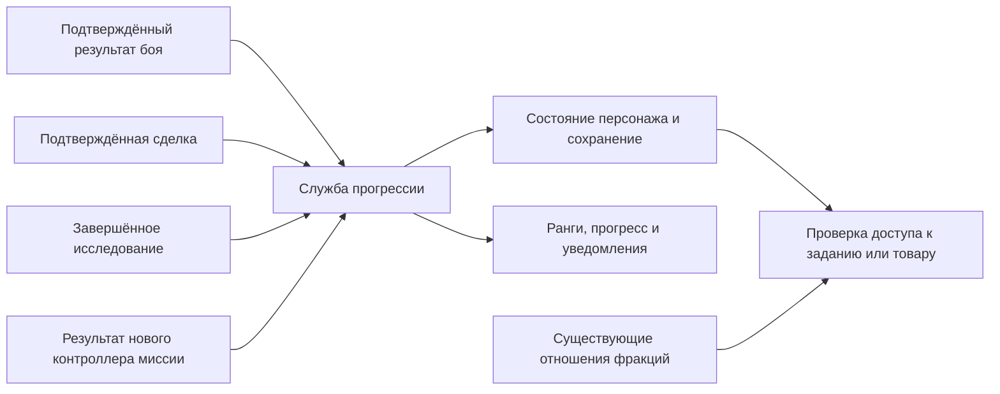

# Опыт, карьеры и фракционная прогрессия

[English](../../re/content_progression.md) · **Русский**

В Freelancer можно добавить независимые карьеры бойца, торговца и исследователя, а также службу отдельным фракциям. Для этого нужен новый слой прогрессии: штатный `Experience` обозначает порог благосостояния, а не накопленный опыт действий. Рекомендуется сохранить сюжетный ранг и существующие отношения фракций, добавив отдельные профессиональные XP, заслуги и допуски.

Исследование от 2026-10-26: статический анализ текущих исходников поверх базовой ревизии `af086d9` и первичных источников других игр. Ни система опыта, ни приведённые ниже классы, события и INI-ключи пока не реализованы. Запуск в игре не проводился. Архитектура новых миссий рассмотрена отдельно в [исследовании заданий открытого мира](content_open_world_missions.md).

## Что уже делает Freelancer

| Механизм | Подтверждение в исходниках | Значение для новой системы |
|---|---|---|
| Порог «опыта» | `LoadPlayerToughnessScale`, `RecalculateContentPlayerRank` в [Support.cpp](../../../src/Content/Support.cpp) | `ptough_graph_pt` сопоставляет стоимость имущества с рангом. В расчёте используется `InspectCash + GetAssetValue`, а не убийства или число заданий |
| Сюжетный ранг | `SetContentPlayerMissionNumber` там же; [Story.cpp](../../../src/Content/Story.cpp) | Некоторые этапы кампании повышают ранг; Story отдельно проверяет благосостояние. Подмена ранга карьерным уровнем затронет кампанию |
| Различие SP/MP | `OnPlayerStatsRequest` в [GameSupport.cpp](../../../src/Content/GameSupport.cpp) | SP показывает `pub::Player::GetRank`, MP — `pub::Reputation::GetRank`. Это два пути получения общего ранга, не разные профессии |
| Личная статистика | `FContentPlayerStats` в [ContentPlayerState.h](../../../src/Content/ContentPlayerState.h) | Уже есть убийства по архетипам, успешные/проваленные/отменённые миссии, время, деньги, посещённые системы, базы и дыры |
| Посещения | `OnSystemChange`, `OnBaseChange`, `OnTargetChanged` в [PlayerState.cpp](../../../src/Content/PlayerState.cpp) | Системы и базы добавляются без повторов. Дыра отмечается при выборе целью, причём записывается и другой конец перехода: это не доказательство его исследования |
| Убийства | Обработка уничтожения в [SpaceSupport.cpp](../../../src/Content/SpaceSupport.cpp) | Статистика использует `KillerId`; добыча и репутация отдельно учитывают `GetTopDamagers`. Для совместного XP нужно явно выбрать правило участия |
| Отношение фракции | `ApplyFactionReputationChange` в [FactionProps.cpp](../../../src/Content/FactionProps.cpp), [CombatReputation.cpp](../../../src/Content/CombatReputation.cpp) | Уже есть изменение отношения и распространение через empathy на связанные фракции. Это политическое отношение, а не профессиональная квалификация |
| Результат задания | `FRandomMissionObject::OnMissionSucceed` в [RandomMissionDB.cpp](../../../src/Content/RandomMissionDB.cpp) | Успех обновляет статистику и отношение заказчика. Здесь возможен адаптер выдачи карьерной награды |
| Сохранение | `FContentPlayerState::Save`, `SaveContentPlayerStats` в [PlayerState.cpp](../../../src/Content/PlayerState.cpp), загрузка в [Support.cpp](../../../src/Content/Support.cpp) | Штатные данные содержатся в `[mPlayer]`; новые XP требуют собственного формата и загрузчика |
| Интерфейс | [GameSupport.cpp](../../../src/Content/GameSupport.cpp), [nn_player_info.cpp](../../../src/freelancer/Client/nn_player_info.cpp) | Есть экран статистики и репутации, но нет передачи набора карьер. Пакет статистики имеет фиксированный заголовок `0x34` |
| Покупки | `MinLevel`, `MinRep` в [common_basedata.cpp](../../../src/Common/common_basedata.cpp), проверки в [nn_ship_trader.cpp](../../../src/freelancer/Client/nn_ship_trader.cpp) | Можно добавить новые условия доступа, но замена общего ранга изменит существующие ограничения рынка |

`pub::Reputation::SetRank` не означает повышение отношения ко всем фракциям: ранг объекта репутации и `SetReputation(handle, faction, feeling)` — разные данные. После сюжетного этапа `0x2a` пересчёт может повышать SP-ранг по таблице имущества, но не понижает его этим путём. В MP таблица продолжается дополнительными порогами; это всё ещё шкала благосостояния.

Названия денежных счётчиков также вводят в заблуждение. `Stats.TotalCashEarned` загружается и сохраняется, но не содержит истории себестоимости товаров. Серверный `PlayerSlot.total_earned` — другой счётчик: `PlayerData_ResetTotalEarned` сбрасывает его к оценке оборудования при входе на базу в MP. Ни один из них нельзя принять за торговую прибыль. См. [server_classes.cpp](../../../src/Server/server_classes.cpp).

## Чему учат другие игры

| Игра | Подтверждённый принцип | Что применить |
|---|---|---|
| Elite Dangerous | Независимые ранги Combat, Trade, Exploration; отношения фракций и продвижение во флотах существуют отдельно | Несколько карьер одного пилота вместо единственного уровня, выражающего всё сразу |
| Star Citizen | Официальное руководство по перевозкам связывает успешные доставки с ростом hauling reputation и доступом к более выгодным контрактам | Заказчик доверяет более сложную работу после доказанного результата |
| EVE Online | Навыки обучаются в реальном времени, в том числе вне игры; уровни навыков служат требованиями к кораблям, модулям и другим навыкам | Явные квалификации и понятные требования. Таймер обучения не нужен для цели «расту, занимаясь профессией» |

Для Elite разделение подтверждают [официальное руководство](https://hosting.zaonce.net/elite/website/assets/ELITE-DANGEROUS-GAME-MANUAL.pdf) и отдельные поля `Rank`/`Progress` в [официальном описании журнала](https://hosting.zaonce.net/community/journal/v10/Journal_Manual_v10.pdf). Это исторические документы, достаточные для архитектурного сравнения; они не служат актуальной таблицей всех рангов и коэффициентов начисления. Точные численные пороги Elite здесь не переносятся.

Для Star Citizen основание — [Cargo Guide](https://robertsspaceindustries.com/en/comm-link/transmission/20040-Cargo-Guide). В [AMA разработчиков от 2021-05-14](https://robertsspaceindustries.com/en/comm-link/transmission/18123-Reputation-System-AMA-Recap) также описаны профессиональная и локальная репутации, качество выполнения, будущие привилегии и возможное затухание отношений. AMA — описание замысла на ту дату, а не подтверждение, что все эти возможности выпущены. Предлагаемые ниже боевые и исследовательские XP Freelancer не приписываются Star Citizen.

Модель EVE подтверждена [Skill Training](https://support.eveonline.com/hc/en-us/articles/203217062-Skill-Training). Для Freelancer полезно различать опыт деятельности, выданную квалификацию и купленное оборудование: это три разных способа прогрессии.

## Рекомендуемая модель

Хранить четыре независимых вида состояния:

1. **Карьера:** накопленный `combat_xp`, `trade_xp`, `exploration_xp`; ранг выводится из порогов. Опыт не тратится на покупки и не исчезает после провала задания.
2. **Заслуги перед фракцией:** `service_xp[faction]`, заработанный выполнением её поручений. Возможны отдельные квалификации, например военная служба и коммерческий подряд, когда появится достаточно контента.
3. **Текущее отношение:** существующая репутация Freelancer. Враждебность, предательство, взятки и empathy продолжают работать здесь. Покупка хорошего отношения не выдаёт заслуги или боевой опыт.
4. **Допуски и достижения:** пройденная аттестация, лицензия, знакомство с NPC, завершённая уникальная миссия. Это устойчивые идентификаторы, а не ещё одна общая шкала XP.

Опытный боец, впервые прибывший в Рейнланд, сохраняет профессиональный ранг, но ещё не является проверенным подрядчиком местной полиции. Ветеран службы, ставший врагом фракции, сохраняет историю заслуг, однако теряет действующий доступ к её заказам. Приём на службу и получение звания могут требовать отдельной миссии: одних XP необязательно достаточно.

В первой версии достаточно трёх карьер и одной шкалы заслуг на фракцию. Перевозку собственного груза и исполнение транспортных контрактов можно учитывать в карьере торговца с отдельной статистикой. Пилотирование конвоя и охрана конвоя дают разные награды. Mining, salvage, piracy, smuggling стоит выделять в новые карьеры только после появления самостоятельных игровых циклов; архитектура допускает строковые идентификаторы направлений.

## Как начислять опыт

Все правила ниже — проект для Freelancer, а не описание формул других игр.

| Направление | Основание начисления | Что открывает |
|---|---|---|
| Боец | Подтверждённое участие в уничтожении боевой цели, выполнение обороны, перехвата или сопровождения | Более сложные заказы, аттестации, специальные варианты вооружения |
| Торговец | Подтверждённая прибыль от торговли; выполненный контракт перевозки; качество доставки | Крупные поставки, специальные предложения, коммерческие связи |
| Исследователь | Первое личное исследование объекта, завершённая съёмка региона, сданные данные экспедиции | Научные задания, координаты объектов, специализированные сканеры |
| Служба фракции | Выполнение поручения конкретного заказчика, выполнение дополнительных условий | Звания, закрытые поручения, лицензии, доступ к фракционным вариантам товаров |

### Бой

Базовая модель: `XP = reward_budget × threat_factor × contribution × repeat_factor`. Бюджет задаётся целью или встречей; угроза оценивается по кораблю, оснащению и AI. Коэффициенты ограничены, а не бесконечно растут вместе со стоимостью корабля. Для опытного бойца слабые противники дают меньше.

Выдавать XP один раз на уничтоженную сущность, распределять ограниченный бюджет между подтверждёнными участниками. Нанесённый урон — один из источников участия; исполнение оборонной цели может дать отдельную награду сопровождающему. Простого присутствия в группе недостаточно. Последний выстрел не должен присваивать весь опыт. Повторное убийство одной и той же восстановленной сюжетной цели не должно повторять уникальную награду.

Начальный объём — PvE. PvP требует отдельной политики против договорных убийств. Цели без реальной угрозы не должны становиться самым выгодным источником XP. Уголовные последствия определяются отношениями фракций; карьерный ранг сам по себе не объявляет пилота законопослушным.

### Торговля и перевозки

Разделить прибыль торговца и оплату перевозчика. Игрок, доставляющий груз заказчика, не покупал этот груз: его опыт определяется выполнением договора, объёмом и условиями доставки, а не фиктивной маржой.

Для свободной торговли нужен учёт партий: товар, количество, цена приобретения, место/источник получения и оставшееся количество. При продаже вычислять признанную прибыль по заранее выбранному правилу, например FIFO: выручка минус себестоимость проданной части и явно учитываемые сборы. Неизвестная себестоимость не равна нулю. Для добытого, подаренного, украденного и миссионного груза нужны отдельные правила происхождения.

Перевод прибыли в XP должен быть ограничен и настраиваться отдельно от денег. Бонус за новый маршрут можно выдать один раз; обычные повторные рейсы остаются допустимой профессией. Ограничения применять к маршруту/партии/периоду, а не каждой операции продажи: иначе дробление одной партии повышает награду. Покупка и обратная продажа на той же базе, обмены между игроками, возврат товара и продажа корпуса корабля не должны автоматически становиться торговым опытом.

**Подключение сложнее, чем один обработчик.** В [IServerImpl.cpp](../../../src/Server/IServerImpl.cpp) `GFGoodBuy`/`GFGoodSell` рассылают уведомления, а `ReqAddItem`, `ReqRemoveItem`, `ReqSetCash`, `ReqChangeCash` меняют груз и деньги отдельно. В рассмотренном пути нет единого подтверждённого события сделки с себестоимостью. Для MP нужен новый серверный контракт сделки либо проверенная сверка операций, формирующая `TradeCommitted` только после согласованного изменения денег и товара. Подписка на `PlayerWorthChanged` не решает эту задачу.

Практичный первый этап — XP за завершённые авторские транспортные контракты; опыт за свободную рыночную торговлю добавлять после учёта партий и проверки сделки.

Частичная выдача/сдача, закупки, сканирование NPC, конфискации и контрабанда рассмотрены в [исследовании грузовых контрактов](content_cargo_contracts.md). Выполнение договора и прибыль свободной торговли — разные основания награды.

### Исследование

Мир Freelancer конечен. XP только за вход в систему быстро исчерпается, а повторное пересечение ворот создаст бессодержательную прокачку. Основой должны стать личные открытия и авторские задания: съёмка туманности, обследование обломков, измерения в опасной зоне, поиск перехода, доставка научных данных.

Нужны стадии `known → surveyed → reported`: купленная карта или слух дают сведения, но не подменяют выполненное исследование. Идентификатор открытия — устойчивый nickname объекта/района плюс тип исследования, а не временный ID заспавненной сущности. Первое открытие для этого персонажа и первое открытие на всём MP-сервере — разные достижения; серверное первенство необязательно для обычного XP.

Штатные списки посещений пригодны как контекст и основа миграции, но не как доказательство всех стадий. Особенно нельзя начислять две исследовательские награды по двум концам дыры, добавленным одним `OnTargetChanged`. Длительные измерения и опасные аномалии требуют новых целей и проверки результата. Источник бесконечного опыта — повторяемые экспедиционные задания с новыми экземплярами, а не повторная награда за тот же статичный объект.

## Как это соединить с новым ConvoyMission

Пример: уникальная миссия `rh_ber_convoy_01`, предлагаемая фиксированным NPC на `rh_ber_01`. Контроллер — предложенный `FConvoyMission : FAuthoredMission`, общий план выполняет `FMissionPlanRuntime`; `GenericMission` для этого не требуется.

Встреча с транспортами → выход на маршрут → появление засады при достижении точки → защита → доставка → итог. До засады можно создать ручную сцену; выдача опыта от проигрывания сцены не зависит.

Предлагаемый формат метаданных, **который ещё не читается игрой**:

```ini
[MissionProgression]
mission = rh_ber_convoy_01
once_per_character = true
require_career = combat, 1
require_service = rh_p_grp, 0
require_feeling = rh_p_grp, 0.0
reward_profile = rh_ber_convoy_intro

[ProgressionReward]
nickname = rh_ber_convoy_intro
career_xp = combat, 200
service_xp = rh_p_grp, 100
unlock = rh_ber_convoy_followup
```

Это пример полицейского заказа: для коммерческого конвоя выбирается фактическая фракция заказчика. Числа иллюстративные. Первый вводный контракт можно сделать без карьерного порога, чтобы не заблокировать вход в профессию.

200 XP здесь означают фиксированную награду за выполненную охрану; бюджет XP за уничтожение врагов учитывается отдельно при балансировке. Торговый XP добавлять, если игрок действительно исполнял логистическую часть, а не только стрелял рядом с чужим грузом. Дополнительная награда за сохранность транспорта выдаётся по итоговому состоянию; намеренный провал после засады не должен быть выгоднее доставки.

Результат миссии отправляется в общую службу наград: `{instance_id, reward_id, participant_id, outcome, metrics}`. Она проверяет допустимость и повторность, начисляет XP, меняет отношения по отдельным правилам и записывает завершение. Проверка `once_per_character` выполняется и при показе предложения, и при принятии. В группе у каждого персонажа собственное право на награду.

StoryLauncher не участвует. Уровень профессии, отношение, знакомство с NPC и цепочка заданий — явно заданные условия нового диспетчера предложений. Сюжетные скрипты позднее могут пользоваться адаптером к той же службе; они не должны самостоятельно хранить профессиональный опыт или вызывать фиктивное повышение сюжетного ранга.

## Изменения архитектуры



Предлагаемые компоненты:

| Компонент | Ответственность |
|---|---|
| `FProgressionService` | Принимает проверенные результаты, применяет таблицы наград, исключает повторное начисление |
| `FPlayerProgressionState` | XP по направлениям, заслуги фракциям, открытия, лицензии и квитанции наград; привязан к устойчивому персонажу |
| `FProgressionRules` | Пороги рангов, коэффициенты и профили наград из новых данных; версия баланса |
| `FProgressionEligibility` | Общая проверка условий для mbases, терминала, принятия миссии и покупки; возвращает понятную причину отказа |
| Адаптеры событий | Переводят события Content/Server и результаты новых миссий в проверенный результат деятельности |

Первые реализации можно держать внутри Content с явными событиями от Server. `PlayerId` годится для поиска подключённого игрока, но не для постоянного ключа данных. Не расширять вслепую публичные структуры, vtable и старый пакет статистики: клиенту нужен отдельный версионированный снимок прогрессии. Для MP требуется согласование поддержки расширения обеими сторонами. Обычный retail-клиент новые карьеры отображать не умеет.

На экране персонажа показывать отдельные строки карьер, текущий ранг, прогресс до следующего и ближайший доступный контракт. На карточке заказа — требования и точные виды награды. Враждебность фракции и недостаточные заслуги должны отображаться как разные причины недоступности.

Ранги прежде всего открывают содержание: задания, квалификации, варианты оборудования, отношения с NPC. Скрытые постоянные `+30%` урона или прочности потребуют отдельной системы модификаторов и существенно изменят бой. Для первого этапа предпочтительны преимущества через оснащение и доступ, понятные игроку. Точные пороги задавать числом осмысленных заданий до повышения, затем проверять фактический XP/час каждой карьеры; копирование длинного MMO-гринда не соответствует размеру мира Freelancer.

## Сохранения, совместимость и повторность

Добавить собственную секцию, например `[ProgressionV1]`, с 64-битными целочисленными XP, версией схемы и устойчивыми идентификаторами. Это предполагает собственное чтение/запись 64-битных значений: обычного `get_value_int` недостаточно. Ранг можно вычислять из XP; выданные лицензии и завершённые уникальные задания сохранять явно, чтобы смена таблицы порогов не отзывала их случайно.

Состояние миссии, её завершение, начисление и квитанция награды должны восстанавливаться из согласованного снимка. Ключ повторности: персонаж + постоянный экземпляр задания + идентификатор награды. Для мирового боя нужен идентификатор появления сущности, исключающий повторное использование числового object ID. Завершённые одноразовые задания и личные открытия хранятся постоянно; для обычных событий нужен ограниченный журнал/последовательность, а не бесконечный список убийств.

Старое сохранение без секции: нулевые карьерные XP, сохранение штатного ранга и репутации. Посещённые объекты можно перенести как `known`, не выдавая автоматически опыт полноценного исследования. Альтернативная выдача стартовых достижений должна быть отдельной однократной миграцией. Неизвестные карьерные идентификаторы нужно сохранять для повторного включения контента.

Повторная доставка события или восстановление текущей миссии не должны дублировать награду. Загрузка игроком более раннего SP-сохранения закономерно откатывает весь профиль: запрет такого отката потребовал бы отдельного внешнего профиля и здесь не предлагается. В MP расчёт выполняется сервером; клиент передаёт намерение совершить действие, а не сумму XP.

По правилам [CONTRIBUTING](../../../CONTRIBUTING.ru.md) реализация должна быть отдельной возможностью порта под предлагаемым `FREELANCER_PROGRESSION`, по умолчанию выключенной. Символ пока не добавлен. С выключенной возможностью сохраняется штатная логика; сохранность новых данных при сохранении старой сборкой не гарантируется без специальной поддержки, поэтому для прототипа нужны отдельные профили.

В последующем [проекте перков и бустеров](perks_and_boosters.md) разделены опыт профессии, выбранные перки, характеристики оборудования, временные модификаторы и мгновенные способности. Полученный ранг сам по себе не разрешает включать автотурели или расходовать ресурс на способность.

## Объём работ и первый результат

| Этап | Объём и риск | Проверяемый результат |
|---|---|---|
| XP, таблицы рангов, сохранение, выдача за итог миссии | Умеренный | Завершение задания меняет нужную карьеру один раз, загрузка сохраняет результат |
| Условия предложений и интерфейс | Умеренный; новый клиентский контракт | NPC объясняет требования, доступ появляется после достижения порога |
| Боевой опыт свободного мира | Умеренный; участие и повторность | Участники получают согласованный бюджет, последний выстрел не крадёт награду |
| Свободная торговля | Значительный; происхождение груза и согласованная сделка | Частичные продажи, передача груза и переподключение не создают лишний XP |
| Исследовательская карьера | Базовые посещения просты; полноценные задания требуют нового контента | Уникальные исследования и экспедиции дают разнообразную прогрессию |
| MP | Сквозная дополнительная работа | Устойчивый персонаж, серверные решения, групповые награды и сетевой интерфейс |

Предлагаемый первый вертикальный срез: **новый ConvoyMission на `rh_ber_01`, боевая карьера, заслуги заказчику, отдельная шкала в интерфейсе и открытие следующего заказа**. Общую модель сразу подготовить для трёх карьер; торговую подтвердить одним контрактом доставки, исследовательскую — одним авторским обследованием. Генератор миссий для этого не нужен.

При реализации проверить: повторный callback успеха; сохранение до/после начисления; рестарт во время засады; отмену и провал; отказ в повторном принятии уникального задания; участника группы, который уже получал награду; враждебность при высоких заслугах; старое сохранение; включённую и выключенную возможность. Для торговли дополнительно нужны смешанные партии, частичные продажи и повторные сетевые запросы. Это будущие критерии приёмки, а не выполненные игровые тесты.
