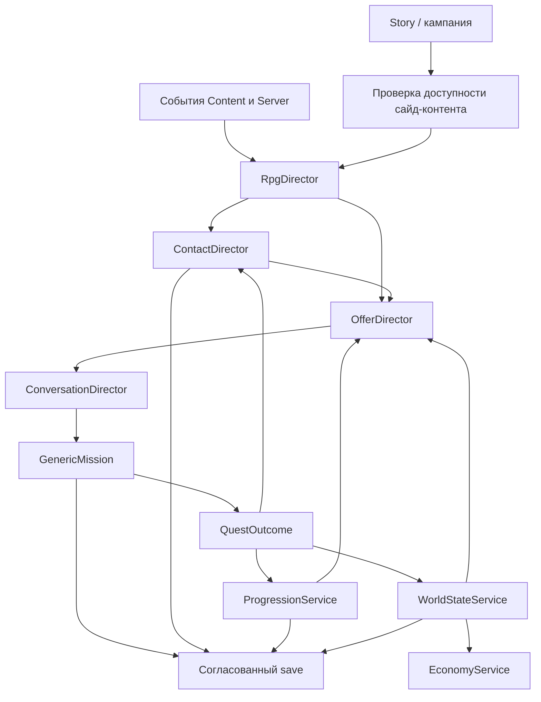

# RPG-надсистема: персонажи, цепочки заданий, фракции и изменяемый мир

**Статус:** архитектурный проект, 2026-11-04. Игровые правила намеренно не зафиксированы. Документ оценивает способы интеграции и задаёт границы компонентов; описанные ниже классы, события, INI-ключи и секции сохранений пока не реализованы. Проверки в игре не проводились.

Связанные исследования: [задания открытого мира](content_open_world_missions.md), [карьерная прогрессия](content_progression.md), [грузовые контракты](content_cargo_contracts.md), [перки и эффекты](perks_and_boosters.md).

## 1. Цель и неопределённости

Требуется не только новый источник заданий. Нужна основа, на которую постепенно можно добавить:

* самостоятельные скриптовые сайд-квесты во Freetime;
* постоянных и динамически назначаемых персонажей на базах;
* знакомство, доверие, память о решениях и другие состояния контактов;
* цепочки заданий с разветвлениями и отложенными последствиями;
* профессиональную прогрессию и несколько независимых характеристик фракций;
* изменение присутствия NPC, доступности контента и правил мира;
* изменение рынков, цен и, в перспективе, других экономических параметров;
* RTC-катсцены и, возможно, собственный интерфейс вариантов ответа.

Пока не решены важные игровые вопросы: личный или общий мир, смертность и перемещения NPC, повторяемость заданий, обратимость последствий, набор характеристик фракций, время симуляции и глубина экономики. Архитектура не должна требовать ответить на них до первого прототипа.

Главный принцип: **не строить всю RPG внутри миссионного INI и не превращать GenericMission в симулятор мира**. Миссия — временный исполнитель одного эпизода. Долгоживущее состояние принадлежит отдельным службам.

## 2. Оценка способов интеграции

| Подход | Преимущества | Ограничения | Оценка |
|---|---|---|---|
| Исправить только `StoryInfo`, чтобы Story запоминала путь GenericMission | Минимальное изменение; повторный save/load перестаёт терять INI | Story остаётся владельцем; главы кампании, завершение и Freetime смешиваются с сайд-квестами | Подходит как локальная заплатка, не как основа RPG |
| Расширить `DestroyMission` и дерево vignette | Уже есть офферы, принятие и сохранение | Генератор и `FRandomMissionData` жёстко связаны с боевыми виньетками; NPC, цепочки и мировое состояние туда не помещаются | Оставить для существующих случайных боевых заданий |
| Независимый GenericMission с собственным `[ScriptMission]` | Полный существующий язык `Cnd_*`/`Act_*`; отдельное сохранение; Story не участвует | Нужны небольшой загрузчик, источник офферов и связь с долгоживущим состоянием | **Рекомендуемая основа заданий** |
| Отдельный C++-контроллер для каждого задания или NPC | Максимальная свобода кода | Дорого, плохо масштабируется, дублирует миссионный движок | Только для действительно новых игровых механик |
| Полностью новый скриптовый движок вместо `FMissionScript` | Можно сразу спроектировать RPG-DSL | Повторная реализация спавна, objectives, триггеров, RTC и save/load | Не нужен на первом этапе |
| Только клиентский/plugin-overlay | Быстрый прототип интерфейса | Не решает серверную власть, сохранение, миссии и экономические сделки | Дополнение, не ядро |
| Заменить StoryLauncher собственным RPG-контроллером | Единая точка управления | Ломает кампанию, загрузку `specific_npc.ini` и штатные переходы | Не рекомендуется |

Рекомендуемый вариант — **отдельный RPG support-контроллер рядом со StoryLauncher**, независимый `[ScriptMission]` и небольшие адаптеры к существующим подсистемам. Новый загрузчик в `[Initial SP DLLs]` получает нулевые параметры, поэтому он должен создавать состояние на `PlayerLogin`, а не пытаться сразу запустить GenericMission.

## 3. Слоистая архитектура



Предлагаемые роли:

| Компонент | Ответственность | Чего не должен делать |
|---|---|---|
| `RpgDirector` | Координация, события входа/выхода, транзакции исходов | Исполнять каждый кадр всех NPC и все миссии |
| `ContactDirector` | Постоянные контакты, назначение на базы, отношения и память | Хранить состояние активного космического боя |
| `OfferDirector` | Условия, выбор и повторная проверка предложений | Сам исполнять принятое задание |
| `ConversationDirector` | RTC, узлы разговора, варианты ответа | Изменять мир по непроверенному клиентскому выбору |
| `GenericMission` | Конкретный эпизод после принятия | Владеть глобальной прогрессией и экономикой |
| `ProgressionService` | Карьеры, заслуги, допуски и квитанции наград | Подменять штатное отношение фракции одним новым XP |
| `WorldStateService` | Устойчивые факты и модификаторы мира | Переписывать DATA INI во время игры |
| `EconomyService` | Эффективные цены и правила рынка | Накапливать множители поверх уже изменённой цены |

`RpgDirector` — orchestration, а не божественный объект со всеми полями. Хранилища и правила контактов, игрока, мира и экономики должны оставаться разделёнными.

## 4. Состояние и область владения

Каждое значение должно иметь явную область:

| Область | Примеры | Владелец |
|---|---|---|
| `Player` | Карьеры, знакомства, личные решения, завершённые задания | Состояние персонажа |
| `Contact` | Доверие, стадия отношений, текущая доступность | Каталог контактов + состояние игрока/мира |
| `QuestInstance` | Путь INI, принятые условия, активные триггеры, объекты | GenericMission |
| `Faction` | Заслуги игрока отдельно; влияние, безопасность и ресурсы фракции отдельно | Player progression либо WorldState |
| `Base/System` | Присутствие контакта, локальные флаги, рыночные модификаторы | WorldState |
| `World` | Исходы уникальных событий, глобальные отношения и состояние правил | WorldState |
| `Presence` | Какой NPC назначен на это посещение комнаты | Временное состояние посещения |

В SP мировое состояние принадлежит сохранению. В MP нужно заранее различать общий серверный мир и личный экземпляр состояния игрока; наличие серверных событий само по себе не решает эту модель.

Все долгоживущие ссылки используют стабильные строковые ID: `contact_id`, `mission_id`, `faction_id`, `base_id`, `world_fact_id`. `PlayerId`, `CharacterId`, controller ID и space object ID нужны только для доступа к живым объектам.

## 5. Независимый жизненный цикл миссии

Сейчас Story при загрузке принимает `Mission = GenericMission, path`, но при сохранении записывает только имя контроллера — [Story.cpp](../../../src/Content/Story.cpp#L337). GenericMission читает путь из неявного хвоста параметров — [StoryMissions.cpp](../../../src/Content/StoryMissions.cpp#L53). Это ненадёжный контракт для самостоятельной системы.

Предлагается:

```ini
[ScriptMission]
type = GenericMission
mission_id = rh_ber_convoy_01
path = Missions\Custom\RhBer\convoy_01.ini
version = 1
```

За этим следуют уже существующие `[MissionState]`, `[TriggerSave]`, objectives и миссионные объекты. Их сохраняет `FMissionScript` — [MissionScript.cpp](../../../src/Content/MissionScript.cpp#L1703). `DestroyMission` даёт образец собственного заголовка `[RandomMission]` — [DestroyMission.cpp](../../../src/Content/DestroyMission.cpp#L403).

При загрузке независимый обработчик создаёт GenericMission с типизированными параметрами, отправляет `PlayerLoad`, затем `MissionStart` и восстанавливает принадлежность принятой миссии. `StoryEvents = nullptr`; кампания и `MissionNum` не меняются. Исходный миссионный INI при сохранении не перезаписывается.

В `[Mission]` уже есть `mission_title`, `mission_offer` и `reward`. Дополнительно нужны устойчивый `mission_id`, версия и, если требуется, `offer_scene`. Привязку контакта лучше хранить отдельно, чтобы один NPC мог предлагать несколько квестов, а один квест — иметь разные источники.

## 6. Контакты и их жизненный цикл

«Живой персонаж» не обязан означать непрерывную AI-симуляцию. Практичная модель — конечный автомат состояний и правила присутствия:

```text
unknown → available → met → offer → quest_active → cooldown → available
                  └──→ departed / unavailable / dead — только если это задаёт контент
```

У контакта могут быть:

* стабильная личность, внешность, голос, домашняя база и допустимые placement;
* стадия знакомства и отдельные отношения с игроком;
* память о нескольких важных решениях, а не журнал каждого клика;
* доступные разговоры и задания;
* правила появления, отсутствия и возвращения;
* сохранённый seed/результат назначения на посещение.

Штатный `FContentBase::OnPlayerEnter` уже создаёт персонажей комнаты отдельно для игрока — [BaseDB.cpp](../../../src/Content/BaseDB.cpp#L1297). ContactDirector может накладывать поверх него правила: изменить offer и behavior постоянного бармена, занять свободный placement или заменить выбранного NPC. Не следует глобально переписывать `mbases.ini` или удалять чужих персонажей без владения их handles.

Первый прототип может использовать фиксированный `fixture`. Динамическая подмена добавляется позже и обязана сохранять результат, чтобы повторный вход и save/load не перетасовывали людей.

## 7. Предложения, катсцены и выбор

До принятия задания разговором владеет ConversationDirector:

```text
выбор NPC → проверка условий → RTC/диалог → accept → создать GenericMission
                                           └→ reject → завершить разговор
```

Это исключает сохранение множества непринятых контроллеров. RTC поддерживает `greet`, `walkup`, `action`, `offer`, `decision`, `accept` и `reject` — [RtcScripts.cpp](../../../src/Content/RtcScripts.cpp#L49); сцена создаётся через `CreateBarScene` — [BaseDB.cpp](../../../src/Content/BaseDB.cpp#L1007).

Фиксированная THN может использоваться для разных предложений, если совпадают актёры, placement и анимации. Текст и контроллер-получатель ответа подставляются при создании сцены.

Колесо выбора — отдельный presentation-адаптер. Серверная модель должна состоять из узлов и типизированных вариантов `{conversation_id, node_id, choice_id}`; сервер повторно проверяет условия выбора. Штатный `MissionResponse` передаёт только accept/reject, поэтому для произвольных веток нужен новый протокол. Существующий клиент уже приостанавливает RTC на диалоге — [gf_script_object.cpp](../../../src/freelancer/Client/gf_script_object.cpp#L864). На первом этапе можно оставить Accept/Decline, не меняя серверную модель будущих вариантов.

## 8. Freetime и совместимость с кампанией

`GetLiveMission() == 0` недостаточно: сюжетная миссия может быть загружена и ждать ответа, ещё не заняв live-слот.

Нужен общий `CanOfferSideContent`, учитывающий:

* принятую story/random/script-миссию;
* загруженный сюжетный оффер;
* активную story RTC;
* текущий RPG-разговор;
* политику после отказа и после завершения квеста.

Story остаётся источником состояния кампании; RPG не переписывает его главы. Сюжетный оффер имеет приоритет. Обычный Freetime, ожидание благосостояния и состояние после кампании могут разрешать сайд-контент.

## 9. Прогрессия и характеристики фракций

Следует различать минимум четыре оси:

1. **Штатное отношение** `player ↔ faction`: враждебность, empathy, взятки и боевые последствия.
2. **Профессиональный опыт игрока:** боец, торговец, исследователь и другие направления.
3. **Заслуги и доверие:** работа на конкретную фракцию или контакт; не отменяется автоматически временной враждебностью.
4. **Состояние самой фракции/региона:** влияние, безопасность, снабжение, доступ к ресурсам и другие авторские параметры.

Не каждой фракции нужны все характеристики. Каталог объявляет только осмысленные для неё метрики и правила. Не следует заменять штатную репутационную матрицу универсальным набором чисел.

Карьерная модель уже детально рассмотрена в [content_progression.md](content_progression.md). Новая архитектура добавляет ей контакты и мировые исходы, а не вторую конкурирующую систему XP.

Цепочка квестов — граф устойчивых ID и условий, а не вызов следующего INI из текущего триггера:

```text
quest_A(success) → unlock quest_B + trust(contact) + service(faction)
quest_A(betrayed) → unlock quest_C + world_fact(betrayal) + close quest_B
```

Условия проверяются и при показе предложения, и при принятии. Награда и переход применяются один раз по исходу экземпляра.

## 10. Изменение мира

Изменения стоит классифицировать по стоимости интеграции:

| Уровень | Примеры | Рекомендуемый способ |
|---|---|---|
| Контент и персонажи | Офферы, слухи, контакты, доступные цепочки | Условия каталога и room overlay |
| Игрок | XP, допуски, отношения, личные решения | ProgressionService и сохранение игрока |
| Динамические правила | Population, доступ к докам, encounter flags, отдельные ограничения | Явные адаптеры с владельцем и восстановлением |
| Экономика | Цены, доступность товара, спрос и запасы | EconomyService + согласованная сделка/синхронизация |
| Статическая вселенная | Состав соларов, ворота, топология и архетипы | Варианты world layer на загрузке/новой игре, не правка INI на лету |

Глобальные clamp/pop/music/scan-флаги сюжетных скриптов особенно опасны: новый исход не должен очищать или включать чужие настройки. Мировые модификаторы имеют источник, область, приоритет и правило снятия.

Для крупных изменений мира предпочтительны версионированные **world layers**: базовый мир + набор применённых изменений. Их можно выбрать при загрузке сегмента или новой игре. Произвольная живая перестройка вселенной и клиентских архетипов — отдельная большая задача, а не естественное следствие миссионного триггера.

## 11. Экономика и цены

Штатный сервер `pub::Market::GetPrice` возвращает цену, уже сохранённую в `BaseData::Market`; он ничего не пересчитывает — [server_pub.cpp](../../../src/Server/server_pub.cpp#L7795). Клиент строит собственный market snapshot и дополнительный `PriceScale` — [client_base_market.cpp](../../../src/freelancer/Client/client_base_market.cpp#L17), [ClientMarketGetPrice](../../../src/freelancer/Client/client_base_market.cpp#L97). Запасы, спрос и цена — разные данные.

Поэтому нельзя изменить только число в интерфейсе или только серверный `MarketGoodInfo::Price`.

Предлагаемая модель:

```text
effective_price = round_policy(base_price, отсортированные модификаторы)
```

* `base_price` неизменен для расчёта; итог всегда вычисляется заново от базы.
* Модификатор имеет ID, источник, область (`world/faction/system/base/good/player`), операцию, пределы и срок.
* Мировые изменения и персональные скидки разделяются.
* Открытый рынок получает новую ревизию снимка либо закрывается/обновляется по явному правилу.
* Сервер подтверждает итоговую цену в сделке; клиент не назначает её сам.

Для персональной цены полезен `price_quote`: `{quote_id, player, base, good, quantity, unit_price, modifier_revision}`. Покупка/продажа повторно проверяет базу, товар, количество, деньги и актуальность quote. Это предотвращает расхождение отображения и оплаты, а также гонку смены цены во время открытого магазина.

Не следует непрерывно умножать текущую цену при каждом событии: после save/load результат будет зависеть от числа применений. Хранить нужно факты и модификаторы, а не только серию «+10% к текущему».

Свободная торговая прибыль, партии груза и карьерный XP требуют отдельной подтверждённой сделки; см. [content_progression.md](content_progression.md) и [content_cargo_contracts.md](content_cargo_contracts.md).

## 12. События и согласованные исходы

Рекомендуется snapshot-состояние плюс идемпотентные события, а не бесконечный event sourcing:

```text
QuestOutcome {
  event_id, mission_id, instance_id, participant,
  outcome, metrics, content_version
}
```

`OutcomeTransaction` в одной согласованной операции:

1. Проверяет, что исход ещё не применён.
2. Выдаёт деньги/XP/допуски и изменяет штатную репутацию по правилам.
3. Обновляет контакт и цепочку заданий.
4. Применяет мировые факты и экономические модификаторы.
5. Записывает receipt и завершение экземпляра.

Повторный callback, повторный сетевой ответ и загрузка не должны повторять награду. Текущие факты сохраняются напрямую; полный журнал событий нужен только ограниченный для диагностики и борьбы с повторяющимися наградами.

Для промежуточных последствий можно добавить один адаптер `Act_RpgSignal = declared_signal`. Скрипт посылает сигнал, разрешённый определением миссии; служба проверяет экземпляр и применяет профиль. Не нужен произвольный исполняемый код в INI.

## 13. Сохранение и версии

Возможная логическая раскладка, не окончательный формат:

```ini
[ScriptMission]
type = GenericMission
mission_id = rh_ber_convoy_01
path = Missions\Custom\RhBer\convoy_01.ini
version = 1

[RpgPlayerV1]
quest = rh_ber_convoy_01, succeeded
contact = rh_ber_bartender, met, trust=1
unlock = rh_ber_convoy_02

[RpgWorldV1]
fact = rh_ber_route_secured
modifier = rh_ber_food_supply, active
```

Правила:

* версия схемы и версия контента различаются;
* старый save без новых секций получает нейтральное состояние;
* неизвестные ID по возможности сохраняются для повторного включения контента;
* принятые условия договора фиксируются, а не вычисляются заново из изменённого баланса;
* длительные модификаторы хранят источник и остаток срока;
* runtime ID не сохраняются как постоянные ссылки;
* незавершённую катсцену на первом этапе можно безопасно начать заново, активную миссию — нет.

В SP загрузка более раннего save закономерно откатывает RPG-состояние вместе с остальным миром. В MP сервер владеет общим состоянием и рассчитывает результат.

## 14. Время и масштаб симуляции

Для SP по умолчанию подходит игровое время симуляции: закрытая игра не двигает сроки. Большинство решений принимается на `BaseEnter`, `LocationEnter`, завершении миссии и других доменных событиях, а не на heartbeat каждого NPC.

Назначение контактов может быть детерминированным по сохранённому seed и дню/посещению. Результат фиксируется до следующего запланированного пересчёта. Это создаёт ощущение меняющегося мира без фоновой симуляции всей вселенной.

MP offline time, общий календарь и глобальные события — отдельная политика. Не следует случайно унаследовать её от heartbeat миссии.

## 15. Этапы внедрения

| Этап | Проверяемый результат | Что пока не требуется |
|---|---|---|
| 0. Независимый ScriptMission | GenericMission переживает несколько save/load без StoryInfo | RPG, новые офферы |
| 1. Фиксированный контакт | Один NPC, RTC, Accept/Decline, один скриптовый квест | Динамическая подмена и колесо |
| 2. Персональное состояние | Контакт помнит знакомство; награда и завершение применяются один раз | Общая экономика |
| 3. Цепочка | Исход открывает одну ветку и закрывает другую после save/load | Живая симуляция NPC |
| 4. Первый мировой факт | Факт меняет присутствие NPC или доступное предложение | Перестройка вселенной |
| 5. Первая экономическая операция | Один товар на одной базе: одинаковая цена в UI и сделке, корректный save/load | Полноценная экономическая симуляция |
| 6. Расширение | Динамические контакты, conversation wheel, больше характеристик фракций | Заранее не выбранные игровые правила |
| 7. MP | Серверный мир, личные состояния, групповые исходы и протокол | Не обещается автоматически |

Первый содержательный вертикальный срез: **фиксированный бармен → RTC → самостоятельный GenericMission → выбор исхода → доверие контакта/заслуги фракции → открытие следующего квеста**. Экономику и динамическую подмену NPC добавлять после доказанной save/load-целостности.

## 16. Проверки архитектуры

* Повторные save/load до принятия, в полёте, после успеха и после провала.
* Повторный ответ на оффер и повторный callback завершения.
* Сюжетный оффер одновременно с доступным сайд-квестом.
* Выход из комнаты и выход игрока во время RTC.
* Один контакт на двух базах и два контакта на одном placement.
* Цепочка с взаимоисключающими исходами и отключённым следующим квестом.
* Старый save, неизвестный mission/contact ID, новая версия правил.
* Два модификатора цены, их снятие и повторная загрузка без накопления.
* Смена цены при открытом магазине; повторный quote; недостаток денег/товара.
* Одинаковый архетип NPC/товара у разных игроков без общего случайного изменения.
* Сборка с возможностью и без неё; штатная кампания и DestroyMission не меняются.

## 17. Решения, которые сознательно отложены

* SP-only или общий MP-мир.
* Какие характеристики действительно нужны фракциям.
* Личное отношение контакта отдельно от фракционной репутации или нет.
* Смерть, перемещение и расписание NPC как контентные события или фоновая симуляция.
* Повторяемость, cooldown и последствия отказа/провала.
* Обратимость мировых изменений.
* Общие или персональные цены и насколько глубоко менять запасы/спрос.
* Нужно ли колесо выбора в первом игровом прототипе.

Эти решения можно принимать после базового каркаса, если не смешивать миссию, контакт, прогрессию и мировое состояние в один контроллер.

Реализацию следует оформить отдельной возможностью порта по [CONTRIBUTING](../../../CONTRIBUTING.ru.md), с нейтральным поведением при выключенном переключателе. Имя `FREELANCER_RPG_WORLD` здесь предложено, но не добавлено.
