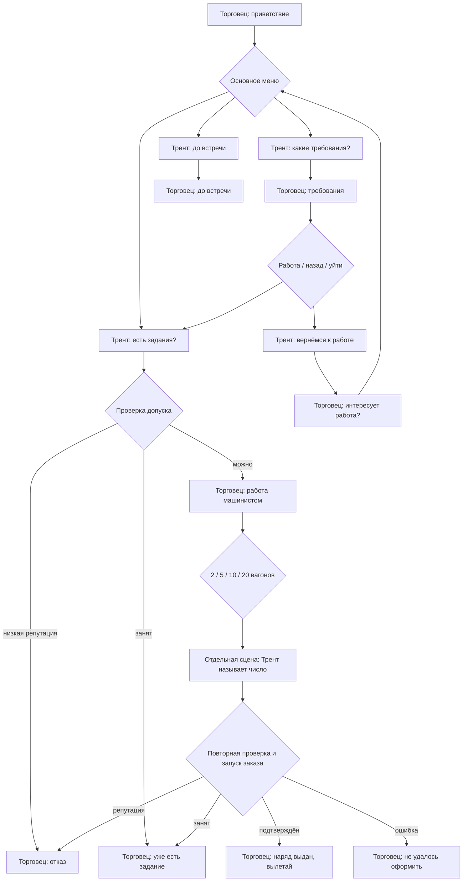

# Фрагменты базовых RPG-диалогов из Pythonlancer

Уточнение сценария от 7 ноября 2026: вендор объясняет, что число вагонов
ограничивается навыком и лицензией, а достигнутый допуск сохраняется между
сменами. Требования к будущей реализации записаны в
[проекте лицензии машиниста](train_courier_design.md#лицензия-машиниста--уточнение-от-7-ноября-2026-реализация-позже).
Сейчас у Трента демонстрационно открыты 2/5/10/20; фильтрацию по навыку добавим позже.

В основном меню добавлена отдельная ветка «Как управлять локомотивом?»:
«Как сесть в локомотив?», «Как прицепить вагоны?», «Как сдать груз?» и возврат
к работе. Каждая тема содержит отдельный вопрос Трента и ответ вендора;
после ответа доступны другие темы, запрос работы, возврат и прощание.

Новые фрагменты: 0022 — предложение работы с учётом лицензии, 0023 — сохранение
допуска, 0024–0025 — вход в обучение, 0026–0027 — посадка,
0028–0029 — сцепка, 0030–0031 — сдача, 0032 — возврат к учебным темам.
Старые 0003/0011 сохранены как архивные реплики и больше не выбираются графом;
их запись и номера не переиспользуются для нового текста.
До записи 0022–0032 новая ветка и объяснение лицензии работают текстом.
`runtime` подключает голос только при совпадении текста и роли с каталогом
готовых сцен; существующие озвученные реплики продолжают работать.

Актуальный этап: английская озвучка rm0001 сгенерирована и установлена в
`DATA/AUDIO/MOD_ENG/RPG/rm0001`. В Pythonlancer добавлен вход
`single.py rpg scenes --group rm0001 --language en`: сборка THN по реальным WAV
в `DATA/SCRIPTS/RPG/rm0001/en`, с каталогом и отдельными субтитрами.
Запись, резервирование и откат проходят через DataFolder. Инструкция:
`Pythonlancer/docs/rpg_cutscenes.md`.

Ниже сохранён исходный проект и описание раннего прототипа. Его команды
preview/compile и камеры PCU/NCU не являются текущим интерфейсом генератора.
Новые фрагменты используют ссылки на камеры сессии `RpgCamera_vendor/player`.
В движок добавлен контроллер фрагментов: постоянная постановка разговора,
Mirror нажатого NPC, камеры ACU/PCU, отдельный текущий THN, остановка звука/мимики
по Esc и отложенное применение выбора Трента. `single.py rpg runtime` подключает
граф `RPG/rm0001_dialog.ini` к контакту Бисмарка. Старые проектные ограничения ниже
относятся к первоначальному прототипу; актуальное использование — в инструкции Pythonlancer.

Проект от 7 ноября 2026. Первый набор — `rm0001`, разговор Трента с главой
местного торгового управления о работе машинистом. Это выдача наряда на
локомотив, а не передача товара в трюм. Число вагонов: 2, 5, 10, 20;
баланс и порог репутации пока не определены.

Результат этого этапа: исследование исходников, каталог реплик/переходов,
работающий автономный генератор тестовых THN на библиотеке Pythonlancer,
RU/EN-листы для озвучки. Подключение проигрывания фрагментов к клиенту,
серверной проверке репутации и TrainCourier — следующий этап реализации.
Игровые файлы и исходники существующего Pythonlancer не изменены.

## Оценка существующей реализации

Pythonlancer уже решает основную задачу постановки последовательного разговора.
Его следует расширять отдельным типом фрагмента и каталогом RPG, сохранив
проверенную логику сцен миссий 14+.

| Участок Pythonlancer | Что делает | Решение для RPG |
|---|---|---|
| `story/script.py: CutsceneProps` | Хранит реплики, связывает их с классом THN, формирует `mNN_alias` и имена WAV | Отдельный каталог `rmNNNN`, независимый от `StoryMission` |
| `story/scripts/epilogue/mission14.py` | Определяет реплики и привязывает `Msn14TrentRescuedScene` / `JuniMeetScene` | Сохраняем разделение текста и постановки |
| `story/cutscenes/scene.py: Scene` | Группы времени, сущности, события, Blender dump, шаблон сцены | Переиспользуем события/таймлайн; загрузку окружения и dump убираем из фрагмента |
| `story/cutscenes/content.py: Autoplay` | По говорящему выбирает камеру, шаг последовательности жестов, facial-анимацию и звук | Используем для одной реплики на один THN |
| `Character.facial(auto_lip=True)` | Берёт длительность звука для языка, нарезает/повторяет готовую facial-анимацию, продвигает время | Сохраняем принцип, пересобираем отдельно для RU/EN |
| `sequence.py`, `anim.py` | Библиотека жестов, типов персонажей и готовых анимаций | Профили поз и жестов; копия параметров на каждую сборку |
| `AudioWatcher` | Читает фактический звук из `DATA/AUDIO/MOD` или `MOD_ENG` | Длительность финального WAV — обязательный вход финальной сборки |
| `AudioFolder.generate_cutscene_sounds` | Вызывает голосовой backend, складывает реплики в папку сцены/миссии | Отдельная папка `rm0001` для каждого языка; озвучку делает пользователь |
| `managers/script.py` | Импортирует/создаёт сюжетные миссии, собирает общие звуки и субтитры | Отдельный RPG manifest; не пересобирать всю кампанию ради одного ответа |

Автоматическая мимика здесь **не является фонемным lip-sync**: это готовые
анимации разговора, подогнанные под длину записи. Для текущей цели подход
подходит; распознавание фонем не требуется для первого этапа.

Выявленные ограничения при массовой сборке:

* `single.py scene` сейчас жёстко выбирает RU, миссию 14 и `lair_done`.
  После одиночной генерации стоит `return`; цикл массовой генерации ниже
  недостижим. `generate_cutscene_voices` имеет свои независимые жёсткие фильтры.
  Импортировать `single.py` как библиотеку нельзя: в конце сразу читается argv
  и выполняется действие.
* `Scene.sync_content()` пишет сразу в игровую `DATA/SCRIPTS/GENERATED`,
  добавляя `_en` для английского. Нужен отдельный writer с явной папкой результата.
* Пути шаблонов, метаданных и dump зависят от cwd. Автономный адаптер временно
  использует корень Pythonlancer; долгосрочно зависимости передаются явно.
* `Autoplay` делает `motion.pop('override_duration', ...)` на словаре из
  последовательности. Общая последовательность может изменяться между сборками.
  Нужен `deepcopy` на фрагмент/язык; в прототипе это сделано.
* В Autoplay вызов движения использует `MAIN`, хотя камера и мимика используют
  выбранную группу. Для первого генератора оставляем единственную группу MAIN.
* `Character.facial` создаёт `SoundEvent` с умолчанием 20 секунд.
  Адаптер выставляет фактическую длину WAV, включая записи длиннее 20 секунд.
* Жесты в исходных последовательностях имеют собственные задержки/скорости,
  обычно событие длится 10 секунд. Их длительность не становится автоматически
  равной длине новой реплики. Для фрагментов нужны ограничение длины и возврат
  к общей позе; RU/EN пересчитываются независимо.
* В `JuniMeetScene` есть отладочный хвост `append_time(4500)`. Его нельзя
  переносить в генератор диалоговых фрагментов.

## Договорённости о фрагментах

Группа `rm0001` — контентный набор разговора, а не номер сюжетной миссии
Freelancer и не экземпляр транспортного задания. Запуск десяти заказов через
этого торговца не создаёт десять копий каталога катсцен.

`rm0001_frag0001` — стабильный ID. Номера выдаём явно, только добавлением.
Редактирование текста, порядка меню или языка не перенумеровывает остальные
фрагменты. Не строим ID из индекса текущего списка или хеша текста.

**Один фрагмент — одна произносимая реплика одного персонажа.** Выбор в меню
ссылается на фрагмент Трента; тот полностью проигрывается или пропускается Esc,
после чего контроллер выбирает следующий ответ. Ответ торговца — другой THN.
Это позволяет пропустить «Хочу задание с двумя вагонами», сохранив выбранное
число и услышав подтверждение выдачи наряда.

Пути финальных ресурсов:

```text
DATA/SCRIPTS/RPG/rm0001/ru/rm0001_frag0001.thn
DATA/SCRIPTS/RPG/rm0001/en/rm0001_frag0001.thn
DATA/AUDIO/MOD/rm0001/rm0001_frag0001_l001_vendor.wav
DATA/AUDIO/MOD_ENG/rm0001/rm0001_frag0001_l001_vendor.wav
DATA/AUDIO/rpg_rm0001_ru.ini
DATA/AUDIO/rpg_rm0001_en.ini
```

Одна аудиопапка на группу в каждом языке, а не папка на каждую реплику.
Звуковые nicknames прототипа имеют суффикс `_ru`/`_en`, чтобы при загрузке
обоих списков не возникали коллизии. Субтитры также экспортируются отдельно.
Подключение INI/субтитров должно дополнять существующие списки ресурсов.
Сам генератор их не устанавливает и не заменяет общие файлы кампании.

Локаль выбирается один раз при открытии разговора из настройки клиента.
RU и EN имеют одинаковые логические ID/ветки, но разные WAV, таймлайны,
конечные времена жестов и мимики. Длительность EN нельзя получать коэффициентом
от RU. Перегенерация изменённого WAV инвалидирует соответствующий языковой
THN; manifest содержит хеш WAV и результата.

## Разговор rm0001

Полный машиночитаемый каталог с RU/EN-текстами:
[`tools/rpg_cutscenes/rm0001.json`](../../../tools/rpg_cutscenes/rm0001.json).
Каталог пока проектный: текущий `RpgDialog.cpp` JSON не читает.

| Фрагмент | Говорящий | Содержание / назначение |
|---|---|---|
| 0001 | Торговец | «Привет, Трент. Я глава местного торгового управления» |
| 0002 | Трент | «Есть задания для меня?» |
| 0003 | Торговец | Предлагает работу машинистом, спрашивает число вагонов |
| 0004 | Трент | «Хочу задание с двумя вагонами» |
| 0005 | Трент | «Хочу задание с пятью вагонами» |
| 0006 | Трент | «Хочу задание с десятью вагонами» |
| 0007 | Трент | «Хочу задание с двадцатью вагонами» |
| 0008 | Торговец | Наряд выдан, можно вылетать, локомотив ждёт |
| 0009 | Торговец | Отказ из-за плохой репутации |
| 0010 | Трент | Спрашивает требования к машинисту |
| 0011 | Торговец | Объясняет требование надёжности и проверку репутации |
| 0012 | Трент | Возвращает разговор к работе |
| 0013 | Торговец | Возвращает основное меню без повторного представления |
| 0014 | Трент | «Не сейчас. До встречи» |
| 0015 | Торговец | Прощается |
| 0016 | Торговец | Уже есть действующее задание |
| 0017 | Торговец | Ошибка оформления наряда; предложить обратиться позже |
| 0018–0019 | Торговец | Дополнительные приветствия |
| 0020 | Торговец | Второй вариант подтверждения выдачи |
| 0021 | Торговец | Второй вариант отказа по репутации |

Первое знакомство использует 0001. В дальнейшем приветствия могут выбираться
из 0001/0018/0019; факт знакомства следует хранить отдельно от истории ротации.



В меню состава ровно четыре ответа — это соответствует текущему лимиту UI.
Esc в этом меню возвращает основное меню без выдуманной произносимой реплики.
Выход выбирается пунктом «Не сейчас. До встречи», который Трент произносит.
После отказа доступны вопрос о требованиях и выход; после объяснения можно
снова спросить о работе. После успешной выдачи разговор заканчивается.

Репутация проверяется на стороне сервера относительно фракции управления
(первоначально `contact.affiliation`). Порог — параметр контента; `minimum=null`
в проектном каталоге означает «ещё не настроен», а не нулевой порог и не
разрешение пропустить проверку. Перед игровым включением его нужно определить.
Повторная проверка после выбора вагонов обязательна: состояние могло измениться.

## Как встраивать сцены в уже существующую комнату

Текущие `RpgContacts.cpp` и `gf_script_spawn.cpp` показывают важное различие:
NPC уже существует в комнате, но используемая тестовая сюжетная THN запускается
без привязки её персонажей к RPG-контакту. `ResolveCharacter` при ненайденном
Actor может создать нового персонажа из костюма. Это источник двойников,
а не способ повторно использовать торговца.

`flags=REFERENCE` для `DEFORMABLE` не решает проблему:
`FGfScript::SpawnDeformable` в этом случае возвращает `nullptr`. Нужны
`userprops.Actor`, корректный BindMode и Mirror существующих персонажей.
Режим 2 позволяет искать по имени роли; `Player` разрешается отдельно.

Предлагаемый жизненный цикл:

1. При клике открыть `RpgConversationSession`, проверить контакт/базу/комнату,
   сохранить состояние камеры, игрока и NPC. Заблокировать повторное открытие
   этим игроком. Для каждого игрока — своя сессия и ротация.
2. Один раз связать `vendor` с конкретным существующим `rpg_biz_contact`,
   а `player` — с существующим Трентом. Для RPG включить строгую привязку:
   отсутствие актёра завершает разговор, не создаёт нового по fallback.
3. Один раз выполнить постановку игрока на `special/p`, выбрать профиль
   комнаты/места, сохранить подходящие камеры, включить общий нейтральный idle.
   Не делать повторную постановку игрока в каждом фрагменте.
4. Каждый THN управляет только говорящим, его камерой, жестами, мимикой
   и своим звуком. Он не загружает интерьер, корабли, свет, музыку, фоновых
   NPC, Blender dump и не запускает миссию. Небольшие обёртки THN могут
   создаваться заново; сами модели комнаты/персонажей остаются прежними.
5. Между репликами поддерживать устойчивую позу/камеру. Во время меню — общий
   idle, а не повтор приветствия и не огромный хвост длительности в THN.
   Fidget торговца не должен одновременно перехватывать его body track.
6. При окончании или выходе с базы восстановить состояние один раз, остановить
   звук/анимации, удалить только объекты сессии, вернуть NPC его fidget.

В прототипе уже нет SCENE, фоновых сущностей, позиционирования, IK-маркеров
и загрузки костюма. На фрагмент приходится один DEFORMABLE, камера, монитор
и (после озвучки) один SOUND. Это контракт с будущей сессией, не автономная
сцена для прямой замены `click_script` в сегодняшнем контакте.

Камеры `camera/PCU` и `camera/NCU` — выбранные имена профиля прототипа.
PCU используется существующим окном RPG-выбора. Наличие NCU и правильный ракурс
для нужного места ещё надо проверить по данным комнаты и в игре. Если камера
не существует, профиль задаёт другую существующую камеру или собственную
постановку. Нельзя молча использовать камеру в начале координат.
Визуальная проверка также должна подтвердить сохранение освещения, высоты пола
и отсутствие скачка позы при прерывании жеста.

## Пропуск и переходы

Состояния сессии: `Entering → PlayingVendor → Choosing → PlayingPlayer →
ResolvingAction → PlayingVendor → … → Closing`.

Выбор сначала фиксирует ID ответа и `first_wagons`, скрывает кнопки и запускает
отдельный THN Трента. Естественное завершение и Esc вызывают один и тот же
`FinishFragment(session_id, playback_id, reason)`; защита по `playback_id`
не допускает двойного перехода, если окончание и клавиша пришли в один кадр.
Esc останавливает звук и facial/body текущей реплики, приводит позу к допустимой
позе входа следующей сцены и продолжает зафиксированную ветку.

**Нельзя реализовать это простым `sequence->bSkip = 1` на всю очередь.**
В `FGfScriptSequence::Update` штатный цикл пропуска может пройти несколько
соседних entries до интерактивной остановки. Нужна RPG-операция завершения
текущего entry с очисткой skip перед запуском следующего фрагмента.
Повторы клавиши и key-up должны поглощаться до отпускания Esc, как уже делает
`cutscene_skip.cpp`, чтобы одно нажатие не закрыло следующее меню.

Отдельный флаг завершения разговора нужен для ухода с базы/разрыва соединения.
Это не «пропустить реплику»: ожидающий выбор отменяется; уже подтверждённое
сервером задание остаётся действующим. Отказ загрузки THN можно обработать
текстовым показом той же реплики, сохраняя серверную ветку и не запуская
действие второй раз. Тайм-аут запроса не равен подтверждению выдачи.

## Изменения в движке для следующего этапа

| Файл / компонент | Необходимое изменение |
|---|---|
| `src/Content/RpgDialog.cpp` | У узла — пул ответов NPC; у выбора — пул произносимых реплик Трента, параметры и типизированные исходы действия |
| `src/Content/RpgContacts.cpp` | Профиль разговора, Actor/Mirror привязка существующего NPC, разделение presence и conversation |
| `src/freelancer/Client/rpg_dialog.cpp` | UI показывает выбор только в Choosing; передаёт выбор сессии, а не сразу Refresh следующего текстового узла |
| `src/freelancer/Client/gf_script_object.cpp` | Проиграть один фрагмент в сохраняемой сессии, локальный skip, однократный cleanup, ограниченная очередь |
| `src/freelancer/Client/gf_script_spawn.cpp` | Строгая RPG-привязка без создания fallback-персонажа и сохранение параметров существующего NPC |
| `src/freelancer/Client/cutscene_skip.cpp` | Приоритет текущего RPG-фрагмента, одно нажатие Esc — один фрагмент |
| `src/Content/TrainCourier.cpp` + API действий | Подтверждённый результат старта/готовности, проверка допуска и занятости, сохранение выбранного числа |

Сейчас `RpgDialogChoose` выполняет `start_train_courier` сразу, а `StartScript`
возвращает void. Реплика «наряд выдан» должна запускаться **после** успешного
создания и готовности задания, а не после самого клика. Нужны исходы
`started / bad_reputation / busy / failed`, идемпотентный токен выбора и проверка
действительности текущего узла/контакта/сессии на стороне сервера.
Выдачу наряда нельзя привязывать к событию звука или концу THN: skip/повтор
сцены не должны создавать второй контроллер.

В установленном диалоге Бисмарка сейчас кнопки 2/10/20/отказ.
TrainCourier принимает выбранное значение от 2 до настроенного `max_wagons`,
поэтому 5 укладывается в существующий диапазон; нужно обновить контент/меню,
проверить ресурсы состава и интеграцию, а не жёстко сохранять старые три кнопки.

Текущий клиент получает функции RpgDialog через локальный `GetProcAddress`
из Content.dll. Это не сетевой протокол удалённого сервера. Для настоящего MP
нужны сообщения выбора/результата с ID сессии, ревизией узла, ID ответа и
проверками на сервере. Нельзя выдавать этому локальному прототипу статус
готовой MP-реализации только потому, что NPC имеет per-player представление.

Не загружать все THN каталога через `AddScript`: текущий массив sequence
рассчитан на ограниченное число entries (в retail 32), а AddScript сам
не защищает переполнение. Держать текущий фрагмент и ближайший следующий;
контентный граф и библиотека ресурсов не должны становиться плоской очередью.

## Ротация

Пул объединяет только семантически эквивалентные фрагменты: приветствия,
подтверждения выдачи или отказы по репутации. Фрагменты «2» и «20 вагонов»
никогда не входят в один случайный пул. Сначала сервер определяет исход,
после этого выбирается подходящий пул и локализованный файл.

Для каждой пары игрок/контакт/пул — перемешанный список без повторений до
исчерпания. При новом круге избегать немедленного повтора последнего варианта.
Выбранный fragment ID закрепляется до завершения реплики; retry/перерисовка
UI/skip не выбирают новый. Для пулов из одного элемента повтор неизбежен.
Ротация не изменяет условия задания, число вагонов и результаты проверок.
В этой поставке пулы описаны в каталоге; игровой выбор из них ещё не реализован.

## Подготовленный генератор и порядок работы

Исходник: [`build.py`](../../../tools/rpg_cutscenes/build.py).
Он не вызывает TTS и не импортирует `single.py`. Использует `Autoplay`,
`Character.facial`, Motion/Sound/Camera events и шаблоны установленного
Pythonlancer. Полный LancerCore/ScriptManager, миссии и Blender dump не нужны.

Из корня репозитория:

```powershell
# Только каталог и CSV для озвучки, без зависимостей сцены.
python -B tools/rpg_cutscenes/build.py prepare --output out/rpg_cutscenes/rm0001_recording

# Тестовые сцены: приблизительная длина по тексту, звук отключён.
D:/Games/FL_MOD/Assets/Pythonlancer/.venv/Scripts/python.exe -B tools/rpg_cutscenes/build.py preview --output out/rpg_cutscenes/rm0001_preview

# После записи финальных PCM WAV: каждая локаль измеряется независимо.
D:/Games/FL_MOD/Assets/Pythonlancer/.venv/Scripts/python.exe -B tools/rpg_cutscenes/build.py compile --audio-root out/rpg_cutscenes/audio --output out/rpg_cutscenes/rm0001_timed

# Проверка генератора на настоящей библиотеке Pythonlancer.
D:/Games/FL_MOD/Assets/Pythonlancer/.venv/Scripts/python.exe -B tools/rpg_cutscenes/check.py
```

Входные записи: `out/rpg_cutscenes/audio/rm0001/ru/*.wav` и
`out/rpg_cutscenes/audio/rm0001/en/*.wav`. Точные имена приведены в CSV.
MP3 из обычного голосового workflow сначала конвертируются в финальные WAV;
для этого прототипа нужен PCM WAV, читаемый стандартным модулем `wave`.
Голос торговца выбирается при озвучке; используется male-профиль анимаций.
Трент имеет свой facial-профиль. Все 21 реплика озвучиваются отдельно на каждом
языке, включая вопросы, выбор числа и прощание Трента.

`prepare` выдаёт обе таблицы записи. Для THN можно выбрать
`--language ru`, `en` или `both`. Сборка каталога массовая: одна команда на
группу и языки, без ручного изменения `mission_index`/alias в `single.py`.
Для другой группы передаётся `--spec <новый каталог>` с собственными ID.
Использовать разные output для prepare/preview/compile и новую папку при
изменении набора/фильтра языка: автоматическая очистка устаревших файлов пока
не реализована. Отдельная установка читает только актуальный manifest.

Сейчас сгенерированы **42 silent preview THN** — по 21 на язык. Это проверяемые
заготовки постановки, а не финальные сцены с записанной речью. После WAV команда
compile экспортирует измеренные THN, sound INI и XML субтитров. WAV не копируются
автоматически. Любой manifest пока имеет `installable=false`: сначала нужны
игровой контроллер фрагментов и проверка привязок/камер.

Прототип использует один простой жест из существующей библиотеки и возврат
в нейтральный idle. Художественная вариативность жестов, профили других комнат,
женские NPC, безопасное прерывание позы и ограниченный runtime-кеш остаются
работой интеграционного этапа, а не скрытыми возможностями текущего CLI.

## Проверки и критерии готовности

Автоматическая проверка прошла: настоящий Autoplay генерирует 42 фрагмента;
синтетические WAV 2 секунды RU и 27 секунд EN дают независимые таймлайны;
на фрагмент один персонаж и один звук; preview не запускает звук и повторяем
байт-в-байт; XML субтитров разбирается; отсутствующий WAV останавливает сборку
до записи результата; дубли ID и больше четырёх кнопок отвергаются.
Синтетические WAV используются только тестом, не выданы за озвучку.

Перед включением в игру проверить реальные THN загрузчиком и визуально:
первый/повторный разговор, все 2/5/10/20, отказ по репутации и повторную
проверку перед выдачей, ошибки/занятость, каждый произносимый ответ Трента,
Esc в начале/середине/конце реплики и удержание клавиши, возврат из меню состава,
уход с базы, потерю соединения, двух игроков и единственность выдачи наряда.
Проверить отсутствие копий NPC, повторной постановки игрока и скачков камеры.
Профили RU/EN проверяются с реальными записями отдельно.

Развёртывание после реализации: Content, Server и клиент собираются с
`FreelancerRpgWorld=1`; рабочие бинарники устанавливаются в
`D:/Games/FL_MOD/bin`, контент — в `DATA`. Для этой поставки сборка/установка
игровых бинарников не выполнялась.
