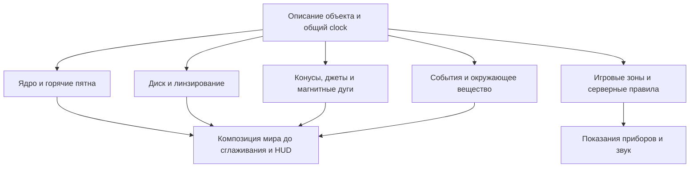

# Проект рендеринга космических аномалий в RP9

[English](../../space_anomalies/rendering.md) · [Обзор](README.md) · [Физика](physics.md) · [Игры](games.md)

Дата: 26 октября 2026 года. Раздел «Доступная основа» описывает прочитанный код текущего рабочего дерева. Все новые имена файлов, интерфейсы данных, бюджеты и этапы ниже — предложения, а не реализованная возможность. Исследование не меняет code beam.

## Доступная основа

| Возможность | Подтверждение в проекте | Ограничение для аномалий |
|---|---|---|
| HLSL VS/PS 3.0 | [RP9Ex.cpp](../../../src/RP9/RP9Ex.cpp), `CompileStage` | Не проектировать вокруг compute, geometry shaders или аппаратной RT-трассировки |
| Проходы, RT, константы, 3D-текстуры | [IRenderPipelineEx.h](../../../src/include/render/IRenderPipelineEx.h) | `BeginExPass`/`EndExPass` не вкладываются; проверять caps и ошибки |
| Читаемая глубина INTZ | `GetSceneDepth` в том же интерфейсе | Может отсутствовать; нельзя одновременно читать её и держать привязанной как depth surface |
| Захват цвета | [IRPSceneCapture.h](../../../src/include/render/IRPSceneCapture.h), `FDirectX9::CaptureSceneColor` | Только полноразмерный `A8R8G8B8`, вне Ex/material pass; копирование закрывает и вновь открывает D3D9 scene |
| FP16 RT | `FRPExCaps::bFloat16Target`, `bFloat16Blending` | Поддержка FP16-ресурса не означает, что весь кадр уже HDR |
| Объём и искажение | [jumphole_visual.cpp](../../../src/freelancer/Client/jumphole_visual.cpp), [jumphole_lens.hlsl](../../../DATA_EXTRA/SHADERS/jumphole_lens.hlsl) | Имеется пример локального объёма и защиты переднего плана; это не гравитационная трассировка |
| Оптика перехода и корабельный warp | [jumphole_optics.hlsl](../../../DATA_EXTRA/SHADERS/jumphole_optics.hlsl), [ship_warp_visual.cpp](../../../src/freelancer/Client/ship_warp_visual.cpp) | Экранная информация неполна за краями изображения и за перекрывающими объектами |
| Корона и лучи солнца | [solar_corona.hlsl](../../../DATA_EXTRA/SHADERS/solar_corona.hlsl), [solar_rays.hlsl](../../../DATA_EXTRA/SHADERS/solar_rays.hlsl) | Основа для маски/свечения, но корона ориентирована на экран; её нельзя принять за готовую 3D-магнитосферу |
| Загрузка cubemap | [IRenderPipeline.h](../../../src/include/render/IRenderPipeline.h), `LoadCubemap`; `BindExPipelineTexture` | Можно рассмотреть статическое окружение; готовый динамический захват шести граней для аномалий не установлен |
| Этап перед HUD | [space_scene_obj_draw.cpp](../../../src/freelancer/Client/space_scene_obj_draw.cpp), `SpaceCameraRenderSlot78` | `RenderEx::AfterSpaceScene` вызывается до очистки глубины для HUD |
| Сглаживание сцены | [render_ex.cpp](../../../src/freelancer/Client/render_ex.cpp), `AfterSpaceScene` | Внутри уже вызывается `AntialiasScene`; новые эффекты нужно ставить до него, а не просто после функции |

Подробнее об ограничениях: [документация RP9](../re/rp9.md). В `FRPExCaps` есть лимиты числа инструкций и исполненных инструкций. В документации существующего объёма отмечен предел 32 временных регистров PS 3.0; число сэмплеров — 16. Не переносить большие современные GLSL-демо механически: после компиляции нужен успешный `CreatePixelShader` на целевом устройстве.

## Архитектура предлагаемой реализации

Разделить данные объекта, визуальные компоненты и игровые последствия:



Предлагаемые новые файлы: `compact_object_visual.cpp/.h`, `compact_object_core.hlsl`, `compact_object_beam.hlsl`, `magnetar_arcs.hlsl`, `accretion_disk.hlsl`, `black_hole_lens.hlsl`. Это удобное разделение ответственности, а не требование создать всё сразу. В первом прототипе использовать существующий Ex API. Отдельный IID добавлять только если обнаружена отсутствующая операция, не менять чужой code beam для получения похожего внешнего вида.

Минимальные группы данных:

| Группа | Поля | Единицы и смысл |
|---|---|---|
| Идентичность | `id`, `host_object`, `seed`, `preset` | Явная привязка к объекту; не распознавать тип по цвету или имени ALE |
| Физические сведения | `mass_solar`, `radius_km`, `field_gauss`, `physical_period_s` | Для расчёта и энциклопедии |
| Представление | `render_radius_world`, `display_period_s`, `palette`, `quality` | Игровые единицы и художественное время отдельно |
| Ориентация | `spin_axis`, `magnetic_tilt`, `disk_normal`, `phase0` | Нормированные векторы, углы в документированной системе |
| Диск | внутренний/внешний радиус, толщина, непрозрачность, скорость рисунка | Один согласованный локальный масштаб |
| Излучение | полуугол конуса, дальность, профиль, толщина, яркость | Пучок излучения отдельно от материального джета |
| Событие | `event_id`, `epoch`, длительность, энергия представления | Стабильная фаза для всех камер; не новый random каждый кадр |
| Воздействие | радиусы, угловые маски, коэффициенты, предупреждения | Отдельная игровая конфигурация; на сервере при изменении состояния корабля |

Первый этап может быть только визуальным. Урон, физическое притяжение, помехи и бонусы оборудования — отдельная задача. Рендерер получает состояние и не меняет его в зависимости от частоты кадров, видимости или активной камеры.

## Общая геометрия и объём

На CPU вычислять преобразование в локальные координаты объекта и положение камеры относительно его центра. В GPU передавать небольшие координаты, а не вычитать два больших мировых `float` на каждом пикселе. Для дальнего квазара предусмотреть отдельное представление на фоне; не растягивать локальные bounds на парсеки.

Конусы и торы ограничивать геометрическим proxy. Интервал луча пересекать с объёмом и заканчивать на непрозрачной геометрии. Для близкой камеры проверить вход внутрь proxy, пересечение near plane и изменение FOV. Псевдокод для художественного испускающего и поглощающего объёма:

```text
T = 1; C = 0
for sample in clipped_ray_interval:
    alpha = 1 - exp(-extinction * density * step_length)
    C += T * alpha * source_colour
    T *= 1 - alpha
    stop when T is negligible
result = C + T * background
```

`source_colour` здесь источник света в модели переноса с выбранным отношением эмиссии к поглощению; для чисто аддитивного свечения нужен отдельный интеграл. Умножение на длину шага не даст яркости произвольно меняться с числом шагов. Смешивать в линейном пространстве; явно согласовать premultiplied alpha с blend state.

## Пульсар

### Слои

1. Сфера ядра с горячими пятнами; реальная геометрия или аналитическое пересечение сферы.
2. Два конуса по `m(t)` и `-m(t)` из [физической модели](physics.md).
3. Небольшой блик, сила которого зависит от направления наблюдателя.
4. При необходимости отдельная большая пульсарная туманность.

Для угла между осью и направлением `v` использовать плавный профиль:

```text
mu = dot(axis, v)
beam = smoothstep(cos(outer_half_angle), cos(inner_half_angle), mu)
```

При `inner_half_angle < outer_half_angle` порядок аргументов правильный. Два полюса могут иметь разные веса. Внутри объёма использовать радиальную и осевую маски плотности, медленное движение неоднородностей; не заполнять весь конус равномерным белым цветом.

Часы: считать фазу по времени симуляции в двойной точности, в шейдер передавать ограниченную фазу и стабильный seed. Для выбранного `display_period` ниже кадрового масштаба усреднять яркость по времени кадра либо использовать плавный огибающий сигнал. Точная форма луча — авторский параметр, не вывод из одного периода вращения.

**Готовность:** при облёте конус сохраняет объём; при взгляде вдоль оси нет бесконечной засветки; корабль закрывает находящуюся за ним часть конуса; обе камеры видят одну фазу; отключённое свечение не отключает игровую опасность.

## Магнетар

Сначала построить набор кривых идеального диполя `r = L sin²(theta)` на CPU. Для каждого `L` выбрать азимут, отсечь внутреннюю часть звезды, дискретизировать дугу и создать ribbon или тонкую трубку. Число кривых небольшое, но их размеры и азимуты различаются. Нужны дуги перед ядром и за ним, а не одна экранная окружность.

Вершинный шейдер добавляет ограниченное отклонение, равное нулю у оснований. Пиксельный шейдер задаёт тонкий яркий центр, мягкий край, направленное движение рисунка и редкие светлые узлы. Несколько слоёв разной толщины дают структуру. В дальнем LOD заменить мелкие дуги слабым ореолом, сохранив 2–3 крупные формы.

Событие вспышки: спокойствие → художественное предупреждение → короткий локальный максимум → длиннее затухание. Визуальная вспышка и воздействие получают один `event_id` и `epoch`. Экранная тряска не нужна для объяснения магнитного поля; при её использовании сделать отдельной настройкой. Предусмотреть уменьшение вспышек без потери предупреждения и контуров опасной области.

**Готовность:** при повороте камеры дуги не поворачиваются за ней; петли закрываются поверхностью; случайное движение воспроизводимо; вспышка не уничтожает весь кадр белой заливкой; пульсарный режим можно включить независимо.

## Чёрная дыра

### Три уровня качества

| Уровень | Метод | Что получается | Что остаётся приближением |
|---|---|---|---|
| A, быстрый художественный | Экранная деформация UV, маска тени, отдельный диск | Дешёвый прототип композиции и перекрытий | Нет правильных многократных изображений, полного внеэкранного фона и геометрии близкого наблюдателя |
| B, основной рекомендуемый | Предвычисленные таблицы лучей Шварцшильда + карта дальнего окружения + диск | Согласованное линзирование и захват света без длинного интегрирования на пиксель | Модель невращающейся дыры, ограниченная сцена и выбранное описание диска |
| C, исследовательский | Численное интегрирование лучей, затем при необходимости Kerr | Больше свободы физической модели | Стоимость, точность, регистры и совместимость требуют отдельного прототипа |

Bruneton показывает метод для невращающейся дыры с предвычислением и специальной фильтрацией звёзд. Это первичная техническая основа уровня B; её нельзя называть готовым портом на D3D9. [Статья и демо автора](https://ebruneton.github.io/black_hole_shader/).

### Уровень A

Маска должна учитывать aspect ratio и реальный viewport. Функция смещения должна быть ограниченной, гладко сходить к нулю на внешней границе и не давать деления на ноль в центре. Это художественное экранное искажение. Слабополевое `deflection ≈ 2r_s/b` годится только далеко от критической области; оно не даёт правильную тень и кольца у горизонта.

Проверять глубину **в конечном пикселе и в смещённой точке выборки**. Иначе передний корабль либо растянется вокруг дыры, либо его цвет будет скопирован внутрь фона. При невалидной выборке сохранять исходное изображение или использовать дальнее окружение; не растягивать край экрана через `clamp`.

Даже такая защита не восстанавливает скрытую геометрию. Экранное искажение с depth-проверками — полезный ограниченный эффект, не решение полной релятивистской видимости.

### Уровень B

Для лучей в плоскости симметрии использовать безразмерную переменную `u = r_s/r`:

```text
d²u/dphi² = 1.5 u² - u
```

На этапе подготовки CPU-интегратор в double строит таблицы отклонения и пересечения плоскости диска. На GPU по положению камеры и начальному направлению определяется захват, направление выхода и пересечения с диском. При переносе соблюдать параметризацию исходной модели и отдельно обрабатывать окрестность критического луча. [Bruneton, уравнение 8](https://ebruneton.github.io/black_hole_shader/paper.pdf).

Дальний фон выбирать по направлению искривлённого луча из cubemap. Это решает выход за границу экрана для далёкого окружения, но не добавляет локальные корабли и станции автоматически. Для первого уровня B заявить поддержку линзированного дальнего фона и собственного диска; локальные объекты сохранять обычным передним планом. Полная линзированная локальная сцена требует нового представления геометрии/захвата и отдельной проверки.

Звёзды — маленькие яркие источники: обычная выборка размазанной skybox создаёт полосы и мерцание у критической области. Нужна фильтрация по площади пикселя либо заранее подготовленное представление источников. Не повышать число шагов диска, пытаясь исправить этим алиасинг звёзд.

### Диск

Задать внутренний и внешний радиусы, наклон и выбранный профиль эмиссии. Рисунок строить в локальных полярных координатах с периодическими угловыми гармониками, чтобы не было шва `atan2`. Вне сильнополевой области удобная стартовая зависимость скорости рисунка — `omega(r) ∝ r^-1.5`; в первом художественном диске её можно ограничить сверху. Это не GRMHD-симуляция.

Сначала сделать тонкий диск и корректные пересечения, затем добавлять толщину, пыль и самопоглощение. Яркость приближающейся стороны привязывать к локальной скорости и направлению наблюдения. Произвольная синусоида, закреплённая слева на экране, при облёте выдаст подделку. RGB-перекраска не восстанавливает физический спектр, которого нет в текстуре.

Интегрировать излучение вдоль луча **до** определения оставшегося фонового вклада: луч, затем захваченный дырой, мог до этого пересечь видимый передний диск. Нельзя последним проходом залить всю область тени чёрным поверх правильно нарисованного диска.

**Готовность:** корректны виды вдоль оси и с ребра; яркая сторона меняется при обходе; отключение вещества оставляет линзирование; размер тени соответствует модели для заданной камеры; переход LOD не меняет геометрию скачком; пересечение critical ray не даёт NaN.

## Микроквазар и квазар

Микроквазар: повторно использовать диск, добавить компаньон, изогнутый поток вещества и пару материальных джетов. Джет состоит из узкого основания, постепенно расширяющегося объёма и нескольких движущихся узлов. Направление джета и магнитная ось пульсара не обязаны пользоваться одной логикой вращения.

Квазар: отдельные LOD для ядра, тора и дальних лопастей. На дальней дистанции достаточно изображения в фоне с умеренной динамикой. Для близкой постановочной сцены тор должен поглощать, а не только складывать свет. При взгляде вдоль джета усилить локальный блик, сохраняя контраст объектов. У радиотихого пресета сильные джеты выключены.

## Порядок проходов и ограничения композиции

Начальный компромисс: корректно искажать дальнее окружение и собственный диск, сохранять ближние объекты. Нельзя обещать полную релятивистскую трассировку всех кораблей с одним изображением сцены и одной глубиной.

1. Вычислить видимость, экранные bounds, локальные преобразования и фазу каждого объекта.
2. Нарисовать дальний фон; для режима B подготовить согласованное статическое окружение той же системы.
3. Непрозрачную геометрию ядра и необходимые маски вставить в соответствующий этап мира. Для первой интеграции отдельно проверить, какие диапазоны глубины используются для соларов и кокпита.
4. Нарисовать мировую сцену. В режиме A получить цвет до искажения через `CaptureSceneColor`, вне Ex pass. При ошибке не читать старый/неопределённый RT.
5. Выполнить линзирование, диск, конусы и дуги с согласованной композицией и глубиной. Где возможно, рисовать дальние эффекты до кокпита; поздний проход обязан защищать его depth partition.
6. Обработать туманности и прозрачность согласно выбранному ограничению: дешёвый первый вариант не линзирует находящиеся вне экрана прозрачные облака. Не умножать на fog повторно уже затуманенный захваченный фон.
7. Добавить ограниченное свечение эффекта, затем существующий `AntialiasScene`, затем HUD. В текущем `AfterSpaceScene` сглаживание уже находится внутри.

Это требования к интеграции, а не готовая замена имеющегося frame graph. Прозрачные объекты часто не записывают depth; одна INTZ-текстура не позволяет восстановить все их слои. Для нескольких перекрывающихся линз нужен определённый порядок и свежие снимки либо запрет такого сочетания в первом пресете. Последовательность двух UV-деформаций не эквивалентна физике двойной чёрной дыры.

Проекции должны учитывать размеры RT, прямоугольник камеры, cinematic bars, FOV и разные диапазоны Z. Сравнивать линейную дистанцию с линейной дистанцией; hardware depth с другой проекцией нельзя использовать как метры.

## Бюджет и LOD

Оценки ниже — **стартовые настройки эксперимента**, не замеры производительности.

| Элемент | Дальний вид | Ближний базовый вариант | При повышении качества |
|---|---|---|---|
| Пульсар | Ядро и упрощённые конусы | 16–32 шага на ограниченный объём | 48–64 шага при подтверждённом запасе |
| Магнетар | Несколько крупных дуг | 8–24 кривые по 24–64 сегмента | Больше деталей только на крупных экранных дугах |
| Диск | Аналитическая поверхность | Тонкий диск с таблицами лучей | Толщина и 24–64 объёмных выборки после отдельного профилирования |
| Линзирование | Отключение при малом экранном размере с плавным переходом | Таблицы и дальняя cubemap | Более полное окружение и специальная фильтрация звёзд |
| Пылевой тор | Дальний impostor | Половинное разрешение | Уточнение глубины и увеличение шагов |

LOD выбирать по размеру эффекта на экране с гистерезисом. Критическую границу тени и тонкие дуги желательно оставлять в полном разрешении; размытые оболочки и glow можно уменьшать. `half resolution` означает половину ширины и высоты — четверть числа пикселей. При увеличении результата учитывать глубину, иначе свечение протечёт на корабль.

Расчёт памяти без mip-уровней и служебных расходов:

- Один полноразмерный `1920×1080 A8R8G8B8` снимок: **7.91 MiB**.
- Один `960×540 A16B16G16R16F` RT: **3.96 MiB**; два — **7.91 MiB**.
- Две модельные таблицы `512×512` и `64×32` в двухканальном half-формате: **1.01 MiB**. Размеры взяты как отправная точка из статьи Bruneton; достаточность half-точности у критических лучей ещё нужно проверить.
- Статическая cubemap `512²`, шесть граней, RGBA8: **6 MiB** без mip. Динамическое обновление дополнительно требует повторного рисования сцены.

Для кадра 60 Гц весь бюджет составляет 16.67 мс. Начальный ориентир профилирования можно поставить в 1–2 мс для одного основного эффекта на согласованной машине и разрешении, но это **целевой бюджет**, не обещание. Измерять GPU-время отдельно для копирования цвета, объёма, линзирования и композиции; CPU-время отдельно для геометрии, culling и подготовки данных.

Снижать прежде всего экранное покрытие, overdraw и число захватов сцены. Даже на современном GPU старые лимиты PS 3.0 и синхронизации D3D9 остаются. Общие снимки допустимы только когда эффекты действительно читают один и тот же неизменённый фон.

## Этапы и проверка

| Этап | Конкретный результат | Условие завершения |
|---|---|---|
| 0 | Одна тестовая сцена, объект с явными данными и неизменной фазой | RP8 сохраняет прежний путь; RP9 штатно освобождает и восстанавливает ресурсы |
| 1 | Ядро и пульсарные конусы | Проверены боковой/осевой вид, перекрытие, пауза и несколько камер |
| 2 | Магнетарные дуги и событие | Есть закреплённая геометрия, воспроизводимая вспышка и режим ослабления вспышек |
| 3 | Художественная линза A | Защищены корабль и кокпит, корректны края экрана и отказ захвата |
| 4 | Таблицы и диск уровня B | Сравнение с CPU-интегратором; известная область применимости; стабильная граница тени |
| 5 | Микроквазар | Совместная сцена компаньона, потока, диска и джетов с общим LOD |
| 6 | Квазар и события окружения | Разделены масштабы; выбранная постановочная сцена укладывается в измеренный бюджет |

Для физического ядра проверять предел больших прицельных параметров, область около `b_crit`, симметрию невращающейся модели, пересечения плоскости диска и отсутствие нечисловых значений. Это будущие содержательные тесты численного алгоритма, не тесты наличия строк в шейдере.

Для визуальной интеграции нужны кадры с объектом по центру и у края экрана, внутри и вне туманности, перед кораблём и за ним, при разных FOV/разрешениях, в cockpit/chase/cinematic camera. Проверить сглаживание, прозрачный фонарь, паузу, переход системы, несколько объектов, device reset и отсутствие INTZ/FP16. На слабом режиме отключать недоступный компонент с понятным fallback, а не показывать повреждённый кадр.

При реализации соблюдать [CONTRIBUTING](../../../CONTRIBUTING.md): port-only переключатель, сохранённый retail-путь и сборка требуемых конфигураций. Новые INI-ключи после реализации описать в соответствующем справочнике. Сейчас никакие предложенные ключи не следует добавлять в рабочие конфиги: загрузчик их ещё не поддерживает.

## Решения перед первым прототипом

Нужно выбрать конкретный объект на карте, относительный размер ядра и корабля, целевое разрешение/GPU и степень стилизации. Для чёрной дыры отдельно решить, достаточен ли линзированный дальний фон или требуется видеть искривлённые местные станции. Для магнетара — видимы ли дуги обычным глазом в художественном мире или включаются приборным режимом. Эти выборы меняют реализацию сильнее, чем выбор оттенка glow.
