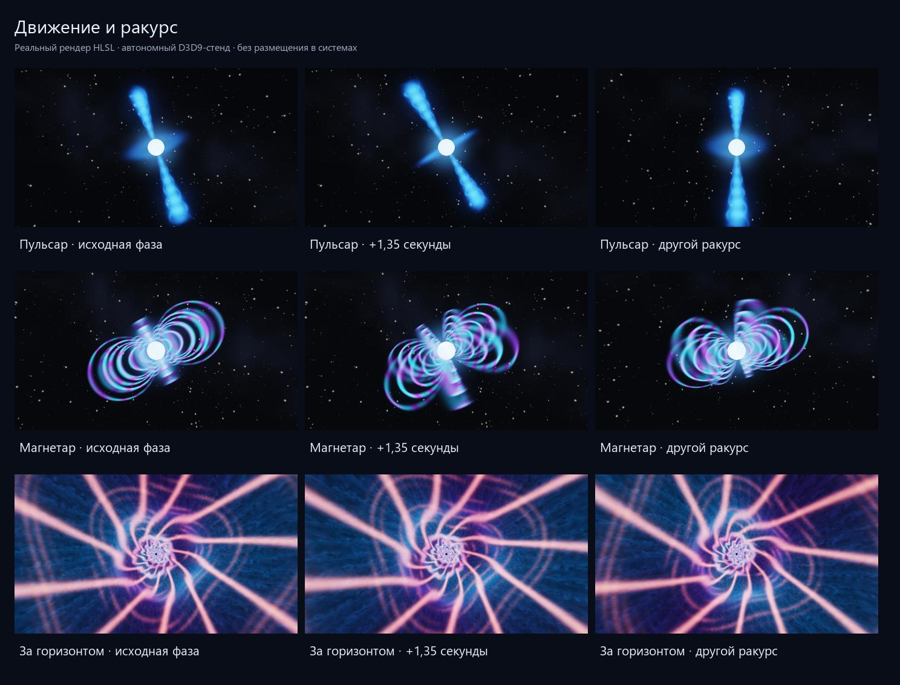

# Шейдерная лаборатория космических аномалий

[English](../../space_anomalies/shaders.md) · **Русский**

Основной результат — [галерея крупных изображений](../../space_anomalies/previews/report.html). Все кадры получены настоящим рендером HLSL на D3D9. Это отдельные художественные прототипы: они не подключены к сцене Freelancer и не размещены в системах.


## Варианты

| № | Объект | Что реализовано |
|---|---|---|
| 1 | Monkey | Тёмное ядро, радиальное преломление звёздного фона и зелёного солнца, небольшая хроматическая кайма, движущаяся рябь |
| 2 | Intro | Красный неоднородный диск, белое внутреннее кольцо, тёмное ядро, тонкий голубой джет и процедурные сгустки раскалённых обломков |
| 3 | Авторская чёрная дыра | Золотой диск, приближённое искривление лучей, поднятое изображение дальней части диска, асимметрия яркости |
| 4 | Пульсар | Горячая звезда, вращающаяся наклонённая магнитная ось, два объёмных конуса, спиральные нити и слабый экваториальный ветер |
| 5 | Магнетар | Трёхмерные дуги дипольного поля, бегущее свечение, перекрытие дальних дуг звездой, отдельный параметр вспышки |
| 6 | Квазар | Ядро, диск, поглощающий пылевой тор, декоративная околоядерная спираль, два закрученных джета |
| 7 | Микроквазар | Звезда-донор, поток вещества к диску и джеты; дополнительный вариант к основному запросу |
| 8 | Внутреннее пространство | Бонусный тоннель из плазмы и световых рёбер; художественный вымысел. [Дальнейшие направления](interior.md) |

Цель — выразительные, преувеличенные формы для «космического шапито». Размеры звёзд, видимость магнитного поля, цвет излучения и скорость вращения намеренно условны. Это базовый набор для выбора художественного направления, а не окончательные игровые эффекты.

## Референсы Monkey и Intro

По уточнению автора, старый эффект Monkey использует преломление атмосферы солнца; впечатление отражающего шара — следствие этого трюка. Новый прототип **не содержит зеркального BRDF или отражения окружения**: он перенаправляет выборку фона и зелёного источника света вокруг чёрного ядра.

В установленном моде проверены `UNIVERSE/SPECIAL/MONKEY/monkey.ini`, `SOLAR/solararch.ini`, `SOLAR/loadouts.ini` и `UNIVERSE/SPECIAL/INTRO_DEMO/Imod.ini`. У Monkey найден `BlackHoleCoreHuge` с радиусом 40000 и зелёный источник `mnk_system_light2`; у тестовой сцены интро — `BlackHoleCore` с `BlackHoleLight`, кольцом и потоками частиц. Эти файлы прочитаны, но не изменены.

На [официальном сайте](https://freelancer2.space/en/) найден публичный проморолик. Его [кадр 1:24](https://www.youtube.com/watch?v=vm0QkrtOF2Q&t=84s) просмотрен: красный диск, белое кольцо, тёмный центр, тонкий полярный луч и крупные раскалённые обломки. По нему исправлена палитра второго варианта. Прежний отдельный отчёт агента1 не найден; тождество этого кадра конкретному интро из прежнего запроса пока не подтверждено. Второй вариант — интерпретация найденного промореференса, не точная реконструкция старого ALE. Крупные обломки пока заменены небольшими процедурными сгустками; полноценные скалы потребуют геометрии.

## Исходники и запуск

Шейдеры: [DATA_EXTRA/SHADERS/ANOMALIES](../../../DATA_EXTRA/SHADERS/ANOMALIES). Стенд: [tools/space_anomalies](../../../tools/space_anomalies). Параметры всех кадров находятся в [presets.json](../../../tools/space_anomalies/presets.json).

Из корня репозитория:

```powershell
python tools/space_anomalies/build.py --output src/obj/space_anomalies/final
python tools/space_anomalies/build.py --no-build --width 640 --height 360 --checks --output src/obj/space_anomalies/checks
python tools/space_anomalies/report.py
```

Для последней команды нужен Pillow. В текущей рабочей среде он уже есть у `src/obj/asteroid_normals/venv/Scripts/python.exe`; для сборки и GPU-рендера пакеты Python не нужны. Требуются MSVC, Windows SDK, June 2010 DirectX SDK и `d3dx9_43.dll`. Пути можно переопределить через `ANOMALIES_MSVC`, `ANOMALIES_WINSDK`, `DXSDK_DIR`. Если среда ограничивает доступ к D3D9, GPU-стенд следует запускать вне песочницы. Его окно скрыто, процесс игры не используется.

Примеры отдельных кадров и последовательности:

```powershell
# Нумерация --preset начинается с нуля: 4 = магнетар.
python tools/space_anomalies/build.py --no-build --preset 4 --flare 0.9 --output src/obj/space_anomalies/flare
python tools/space_anomalies/build.py --no-build --preset 3 --frames 36 --step 0.10 --width 640 --height 360 --output src/obj/space_anomalies/pulsar_frames
```

`--time-offset` меняет время, `--yaw-offset` — азимут камеры. Внутри тоннеля азимут используется как поворот взгляда вокруг оси. `--build-only` собирает EXE без запуска GPU. `--no-build` использует уже собранный EXE, **но HLSL компилируется заново**. После изменения `presets.json` требуется пересборка EXE: из него генерируется таблица пресетов.

## Контракт шейдеров

| Данные | Назначение |
|---|---|
| VS `c0` | Время, aspect, 1/ширина, 1/высота; поправка полупикселя D3D9 |
| PS `c0` | Время, aspect, 1/ширина, 1/высота |
| PS `c1` | Наклон камеры, азимут, экспозиция, расстояние до центра в локальных единицах |
| PS `c2.x` | Сила вспышки магнетара; 0 — спокойно, 1 — сильная вспышка |
| `s0` | Линейная HDR-панорама звёздного фона; U wrap, V clamp |
| `s1` | Периодический 3D-шум, линейная фильтрация, wrap XYZ |
| Постобработка `s2`, `s3`, `c3` | Источник HDR, bloom и параметры размытия/порога/силы |

Вход — полноэкранный quad с POSITION float4 и TEXCOORD float2. Точки входа — `VSMain`, `PSMain`; макрос `VARIANT` выбирает реализацию в общем семействе. Локальный радиус горячей нейтронной звезды — 0,46. Камера в основных пресетах находится снаружи объёма. Фон и шум создаёт стенд, заимствованных игровых текстур нет.

Результат эффекта — линейный FP16 HDR. Далее идут выделение ярких областей, bloom на четверти разрешения, три пары размытия, тональное отображение и приближённое gamma 2.2. Альфа финального изображения равна 1: это **готовая композиция тестовой сцены**, а не прозрачный спрайт для наложения на игру.

## Проверка и ограничения

[Журнал](../../space_anomalies/previews/validation.txt) и [manifest.json](../../space_anomalies/previews/manifest.json) содержат GPU, число статических инструкций, доли изменившихся пикселей и SHA-256 исходников/изображений. На NVIDIA GeForce RTX 5080 проверены восемь `ps_3_0`, общий `vs_3_0` и три постпроцессных шейдера. Все HDR-кадры проверки конечны и неотрицательны; повтор с теми же константами даёт те же пиксели, смена времени/ракурса и вспышка меняют результат.



Это дорогие полноэкранные прототипы с ограниченными циклами: 176 шагов у дисковых чёрных дыр, 144 у нейтронных звёзд, 164 у активных ядер, 148 у тоннеля. Число статических инструкций не равно числу реально выполненных инструкций и не доказывает скорость в игре. Время кадра в игровой сцене не измерялось.

Искривление лучей приближённое; у варианта Intro для стабильного художественного силуэта дополнительно используется экранная маска ядра. Это не трассировка геодезических ОТО. У тонких структур возможны мерцание, ступенчатость и недостаточная детализация при движении; у угловых зависимостей и повторяющихся полос ещё нужна производственная работа с фильтрацией. Фиксированные параметры камеры не рассчитаны на прохождение сквозь поверхность звезды.

Перед интеграцией нужны реальный фон сцены, глубина и перекрытие кораблями, преобразование камеры и масштаба объекта, ограничение области рисования, уровни качества, управление ресурсами/потерей устройства и проверка на целевых GPU. В эти прототипы не добавлены вызовы RP9, игровые archetype, loadout или изменения систем. Файлы code beam другого агента не редактировались.
