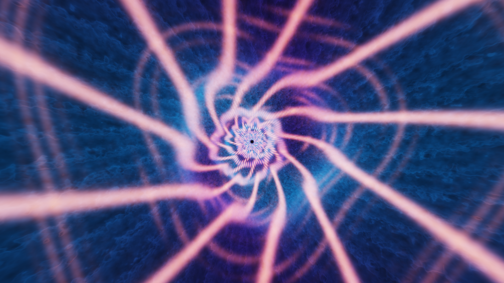

# A playable black-hole interior

**English** · [Русский](../ru/space_anomalies/interior.md)

The proposed direction is a **cathedral of captured light**: deep space built from deliberately impossible luminous structures. A [first working shader study](previews/08_interior.png) accompanies the concept.

## Physical boundary

An event horizon is a causal boundary, not a solid wall. Signals cannot escape from inside it, but an infalling observer need not see an entirely black screen: incoming light and optical distortion remain relevant. In the simple classical nonrotating model, the observer reaches the singularity in finite proper time; the singularity itself lacks a reliable physical description. A freely explorable region with a safe exit is fiction. See [NASA Anatomy](https://science.nasa.gov/universe/black-holes/anatomy/) and [NASA Black Hole FAQ, section 2](https://science.nasa.gov/apod/frequently-asked-questions-faqs-on-black-holes/).

Everything below is art/game design rather than an astrophysical prediction.

## Three directions

| Direction | Visual identity | Possible activity | Implementation |
|---|---|---|---|
| Captured-light cathedral | Gold ribs, blue clouds and twisting arches converging into darkness | Follow a temporary passage using the flow of light | Volumetric shell, periodic filaments, noise and bloom. Basic shader implemented |
| Tidal storm | Molten debris, long trails and torn plasma ribbons | Cross currents and shelter behind large fragments | Mesh deformation along a flow field, ribbon trails and local plasma volumes. Concept only |
| Cosmic palimpsest | Familiar stars and planets repeated through nested, differently moving layers | Identify the one stable landmark among repetitions | Panoramas/cubemaps, transformed coordinates, limited frame history and interference masks. Concept only |

The cathedral is the most direct first step: it provides depth and direction with little geometry. A storm adds action; layered images of the universe suit a story scene involving Nomad technology.

## Proposed transition

Outside, retain the chosen black-hole disk and refraction style. During approach, gather stars into arcs and shrink the visible exterior into an offset aperture. Stretch those arcs along the flight direction until they become the interior ribs, hiding a scene-scale change. Inside, establish a separate palette and slower large-scale motion, leaving a quieter region around the ship. If an exit is needed, give it an explicit fictional mechanism such as Nomad machinery.

This transition is not implemented. The supplied shader starts inside the tunnel; time advances its camera and luminous patterns.

Next, choose one strong motif and make a short continuous fly-through with a ship to assess depth and readability. For the cathedral, break symmetry with a few large arches, bright junctions and sparse debris. Integration needs a local camera, depth-bearing obstacles, controlled brightness around the ship/HUD and a coordinated transition. The shader supplies space and light; interacting objects and collisions belong to geometry/gameplay.
