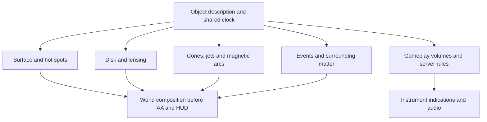

# RP9 rendering design for cosmic anomalies

[Русский](../ru/space_anomalies/rendering.md) · [Overview](README.md) · [Physics](physics.md) · [Games](games.md)

Date: 26 October 2026. Existing capabilities below were checked in the working tree. New filenames, data fields, budgets and milestones are proposals, not implemented features. This research does not modify code beam.

## Existing capabilities

| Capability | Local evidence | Constraint |
|---|---|---|
| HLSL VS/PS 3.0 | [RP9Ex.cpp](../../src/RP9/RP9Ex.cpp), `CompileStage` | Do not depend on compute, geometry shaders or hardware ray tracing |
| Passes, RTs, constants, volume textures | [IRenderPipelineEx.h](../../src/include/render/IRenderPipelineEx.h) | Ex passes do not nest; check capabilities and return values |
| Sampleable INTZ depth | `GetSceneDepth` in the same interface | Optional; cannot simultaneously sample and bind it as the depth surface |
| Scene-colour capture | [IRPSceneCapture.h](../../src/include/render/IRPSceneCapture.h), `FDirectX9::CaptureSceneColor` | Full-size `A8R8G8B8` only, outside Ex/material passes; temporarily ends and restarts the D3D9 scene |
| FP16 render targets | `FRPExCaps::bFloat16Target`, `bFloat16Blending` | FP16 resource support does not establish an HDR frame pipeline |
| Volume and distortion | [jumphole_visual.cpp](../../src/freelancer/Client/jumphole_visual.cpp), [jumphole_lens.hlsl](../../DATA_EXTRA/SHADERS/jumphole_lens.hlsl) | Useful local volume and foreground-protection example, not gravitational tracing |
| Portal optics and ship warp | [jumphole_optics.hlsl](../../DATA_EXTRA/SHADERS/jumphole_optics.hlsl), [ship_warp_visual.cpp](../../src/freelancer/Client/ship_warp_visual.cpp) | Screen data omits off-screen and occluded content |
| Solar corona and rays | [solar_corona.hlsl](../../DATA_EXTRA/SHADERS/solar_corona.hlsl), [solar_rays.hlsl](../../DATA_EXTRA/SHADERS/solar_rays.hlsl) | Useful masks/glow; the screen-oriented corona is not a spatial magnetosphere |
| Cubemap loading | [IRenderPipeline.h](../../src/include/render/IRenderPipeline.h), `LoadCubemap`; `BindExPipelineTexture` | Consider static environments; a ready-made six-face anomaly capture system was not established |
| Pre-HUD hook | [space_scene_obj_draw.cpp](../../src/freelancer/Client/space_scene_obj_draw.cpp), `SpaceCameraRenderSlot78` | `AfterSpaceScene` runs before HUD depth clearing |
| Scene antialiasing | [render_ex.cpp](../../src/freelancer/Client/render_ex.cpp), `AfterSpaceScene` | It already calls `AntialiasScene`; insert effects before that call, not merely after the function |

See [RP9 documentation](../re/rp9.md). `FRPExCaps` reports instruction slots and executed-instruction limits. The existing volume documentation identifies PS 3.0's 32 temporary registers; there are 16 pixel samplers. Porting a large modern GLSL demo requires more than successful compilation: device shader creation must also succeed.

## Proposed architecture

Separate object data, visual components and gameplay effects:



Possible new files: `compact_object_visual.cpp/.h`, `compact_object_core.hlsl`, `compact_object_beam.hlsl`, `magnetar_arcs.hlsl`, `accretion_disk.hlsl`, `black_hole_lens.hlsl`. These divide responsibilities, not mandate an immediate implementation of everything. Use the existing Ex API first. Add an optional IID only for an operation found to be missing; do not couple these effects to the concurrently developed code beam.

| Data group | Fields | Units and purpose |
|---|---|---|
| Identity | `id`, `host_object`, `seed`, `preset` | Explicit attachment; do not infer class from colour or ALE name |
| Scientific metadata | `mass_solar`, `radius_km`, `field_gauss`, `physical_period_s` | Calculation and encyclopaedia inputs |
| Presentation | `render_radius_world`, `display_period_s`, `palette`, `quality` | World units and artistic timing separately |
| Orientation | `spin_axis`, `magnetic_tilt`, `disk_normal`, `phase0` | Normalized directions and documented angle conventions |
| Disk | Inner/outer radius, thickness, opacity, pattern speed | One consistent local scale |
| Emission | Cone half-angle, length, profile, thickness, intensity | Radiation beam separate from material jet |
| Event | `event_id`, `epoch`, duration, presentation energy | Stable phase across cameras; no new random seed each frame |
| Influence | Radii, angular masks, coefficients, warnings | Separate gameplay configuration; server-owned when changing ship state |

The first implementation can be visual only. Damage, attraction, interference and equipment bonuses are separate work. Rendering consumes state without changing it according to frame rate, visibility or camera selection.

## Shared geometry and volumes

Compute object-relative camera position and transforms on the CPU. Supply small GPU coordinates instead of subtracting large world-space floats per pixel. Give distant quasars a background representation rather than extending local bounds across parsecs.

Bound cones and tori with proxy geometry. Intersect the camera ray with the volume and terminate integration at opaque geometry. Check cameras inside the proxy, near-plane crossings and FOV changes. For an authored emitting/absorbing volume:

```text
T = 1; C = 0
for sample in clipped_ray_interval:
    alpha = 1 - exp(-extinction * density * step_length)
    C += T * alpha * source_colour
    T *= 1 - alpha
    stop when T is negligible
result = C + T * background
```

Here `source_colour` is the source function for a chosen emission-to-absorption relationship. Pure additive emission needs its own integral. Including step length prevents brightness changing arbitrarily with sample count. Work in linear colour and match premultiplied output to the blend state.

## Pulsar

Use a sphere or analytic sphere hit for the surface, two hot regions, cones along `m(t)` and `-m(t)` from the [physics model](physics.md), and a small direction-dependent glare. Keep any extended pulsar nebula a separate component.

For observer direction `v`:

```text
mu = dot(axis, v)
beam = smoothstep(cos(outer_half_angle), cos(inner_half_angle), mu)
```

The arguments are ordered correctly for `inner_half_angle < outer_half_angle`. Allow different weights at the poles. Volume density needs axial and radial profiles and slowly moving structure, rather than an opaque white fill.

Compute phase from simulation time in double precision and send a bounded phase plus stable seed to the shader. Average intensity over the frame, or use a smooth envelope, when the selected display period becomes too short to sample. Rotation period alone does not determine the physical beam profile.

**Acceptance:** cones retain volume while orbiting; axial views do not saturate the entire screen; ships occlude the appropriate volume segment; cameras share a phase; disabling glow does not disable gameplay danger.

## Magnetar

Start with CPU-generated ideal-dipole curves `r = L sin²(theta)`. Select equatorial extent and azimuth, clip the stellar interior, discretize the arc and build a ribbon or thin tube. Vary sizes and azimuths. Some arcs must pass behind the surface, rather than forming one screen-space ring.

The vertex shader adds bounded displacement vanishing at the footpoints. The pixel shader supplies a narrow bright centre, soft edge, directed pattern motion and sparse bright knots. Different thicknesses provide structure. Far LOD retains two or three large forms and replaces fine loops with a weak halo.

A flare progresses through quiet, authored warning, short localized peak and longer decay. Rendering and gameplay share `event_id` and `epoch`. Camera shake is optional and separately controlled, not an explanation of magnetic fields. Offer reduced flashes while retaining warnings and hazard readability.

**Acceptance:** arcs do not follow camera rotation; the surface occludes rear loops; noise is reproducible; flares preserve scene information; pulsar mode can be enabled independently.

## Black hole

### Three quality levels

| Level | Method | Result | Remaining approximation |
|---|---|---|---|
| A, quick artistic | Screen UV deformation, shadow mask, separate disk | Cheap composition and occlusion prototype | Incorrect multiple images, missing off-screen content and near-horizon observer geometry |
| B, recommended main path | Precomputed Schwarzschild ray tables, distant environment and disk | Consistent lensing/capture without long per-pixel integration | Non-rotating model, limited scene representation and chosen disk model |
| C, research | Numerical integration, later Kerr if required | Greater physical freedom | Cost, numerical precision, registers and compatibility need separate validation |

Bruneton's work demonstrates precomputed tracing and specialized star filtering for a non-rotating hole. It is a primary technical reference, not an existing D3D9 port. [Author's paper and demo](https://ebruneton.github.io/black_hole_shader/).

### Level A

Respect aspect ratio and the actual viewport. Bound the displacement function, make it fade smoothly at the exterior and avoid division by zero at the centre. Weak-field `deflection ≈ 2r_s/b` applies far from the critical region; it does not produce correct near-horizon rings or shadow geometry.

Check depth at **both the destination pixel and displaced sampling location**. Otherwise a foreground ship either stretches around the hole or is copied into the background. On invalid samples, preserve original colour or use a distant environment, rather than stretching screen edges with `clamp`.

Depth checks cannot recover hidden geometry. This remains a bounded screen-space effect, not full relativistic visibility.

### Level B

For rays in the symmetry plane with `u = r_s/r`:

```text
d²u/dphi² = 1.5 u² - u
```

A double-precision CPU preparation step builds deflection and disk-intersection tables. The GPU determines capture, outgoing direction and disk crossings from camera position and initial ray direction. Preserve the reference parameterization and handle the critical-ray neighbourhood explicitly. [Bruneton, equation 8](https://ebruneton.github.io/black_hole_shader/paper.pdf).

Sample a distant cubemap along the bent ray. This supplies off-screen distant background, but does not automatically incorporate local ships and stations. Scope the initial level B to a lensed distant environment and its own disk, with ordinary local foreground objects. Fully lensed nearby geometry needs another scene representation and validation.

Stars are small bright sources. Ordinary blurred-skybox sampling produces streaks and flicker near critical directions. Use pixel-footprint filtering or a prepared representation of the sources. Increasing disk sample count will not fix star aliasing.

### Disk

Specify inner/outer radius, orientation and an authored emission profile. Generate local polar patterns with periodic angular harmonics to avoid an `atan2` seam. Away from strong gravity, `omega(r) ∝ r^-1.5` is a useful starting pattern speed, capped for the initial artistic disk. This is not a GRMHD simulation.

Establish a thin disk and correct intersections before adding thickness, dust and self-absorption. Tie the brighter approaching side to local velocity and view direction, not a fixed bright half of the screen. RGB tinting cannot reconstruct spectral information missing from the texture.

Accumulate emission along the ray **before** assigning the remaining background contribution: a subsequently captured ray may already have crossed the visible foreground disk. Do not paint the entire shadow black over a correctly rendered disk in a final pass.

**Acceptance:** correct axial and edge-on views; approaching side changes during orbit; disabling matter retains lensing; shadow size matches the selected observer model; LOD transitions preserve geometry; critical rays produce no NaNs.

## Microquasar and quasar

For a microquasar, reuse the disk and add a companion, curved mass-transfer stream and two material jets. A jet has a narrow base, widening volume and a few moving knots. Its orientation need not follow the same rotation logic as a pulsar's magnetic emission axis.

For a quasar, use separate LODs for nucleus, torus and distant lobes. A far representation can be a background image with restrained variation. In a close set piece the torus must absorb rather than only add light. Enhance local axial glare without losing object contrast. Disable prominent jets for a radio-quiet preset.

## Pass ordering and composition limits

The initial contract is lensed distant surroundings and the object's own disk, preserving nearer geometry. A single colour image and depth map cannot support fully relativistic tracing of all ships.

1. Compute visibility, screen bounds, object-relative transforms and phase.
2. Draw the distant background; prepare a matching static environment for level B.
3. Insert opaque core geometry and required masks into the appropriate world stage. Audit the actual solar and cockpit depth partitions first.
4. Draw the world. For level A, capture colour outside an Ex pass before distortion. Never sample an old or unspecified target after capture failure.
5. Compose lensing, disk, cones and arcs with consistent depth. Prefer distant effects before the cockpit where possible; a later pass must protect its depth partition.
6. Handle nebulae and transparency within the chosen contract. The cheap first version does not lens off-screen transparent clouds. Do not fog an already fogged captured background twice.
7. Add bounded glow, run existing `AntialiasScene`, then draw the HUD. Antialiasing is already inside the current `AfterSpaceScene`.

These are integration requirements, not a ready replacement frame graph. Transparent objects often do not write depth; INTZ cannot reconstruct all their layers. Multiple overlapping lenses need defined ordering and fresh captures, or an explicit initial content restriction. Composing two UV distortions is not binary-black-hole physics.

Account for RT dimensions, camera rectangle, cinematic bars, FOV and Z partitions. Compare linear distances with linear distances; depth from another projection is not a distance in metres.

## Budget and LOD

These are **initial experimental settings**, not measured performance.

| Component | Distant | Base close view | Higher quality |
|---|---|---|---|
| Pulsar | Core and simplified cones | 16–32 samples in bounded volumes | 48–64 after measuring headroom |
| Magnetar | A few large arcs | 8–24 curves with 24–64 segments each | Extra detail only on large projected arcs |
| Disk | Analytic surface | Thin disk with ray tables | Thickness and 24–64 volume samples after profiling |
| Lensing | Fade out at small projected size | Tables and distant cubemap | More complete environment and star filtering |
| Dust torus | Distant impostor | Half resolution | Depth-aware reconstruction and more samples |

Use projected size and hysteresis for LOD. Keep the shadow boundary and thin arcs at full resolution where possible; diffuse shells and glow can be reduced. Half width and height give one quarter of the pixel count. Upsampling must respect depth to avoid bleeding onto foreground ships.

Memory estimates excluding mipmaps and overhead:

- One `1920×1080 A8R8G8B8` capture: **7.91 MiB**.
- One `960×540 A16B16G16R16F` RT: **3.96 MiB**; two: **7.91 MiB**.
- Example `512×512` and `64×32` two-channel half tables: **1.01 MiB**. Dimensions follow the paper as a starting point; half precision near critical rays still needs validation.
- A six-face `512² RGBA8` cubemap: **6 MiB** without mipmaps. Dynamic updates additionally redraw the scene.

A 60-Hz frame has 16.67 ms total. An initial profiling target might allow 1–2 ms for one main effect on an agreed GPU and resolution; this is a **target, not a promise**. Measure GPU time for captures, volume work, lensing and composition separately, and CPU time for geometry, culling and preparation.

First reduce screen coverage, overdraw and capture count. Modern hardware does not remove PS 3.0 limits or D3D9 synchronization costs. Share captures only when effects truly consume the same unchanged background.

## Milestones and validation

| Milestone | Deliverable | Completion condition |
|---|---|---|
| 0 | One test scene with explicit object data and stable phase | RP8 retains its path; RP9 releases/recreates resources correctly |
| 1 | Surface and pulsar cones | Side/axial views, occlusion, pause and multiple cameras checked |
| 2 | Magnetar arcs and event | Anchored geometry, reproducible event and reduced-flash mode |
| 3 | Artistic lens A | Ship/cockpit protection, screen edges and capture failure handled |
| 4 | Tables and level-B disk | CPU reference comparison, documented scope and stable shadow |
| 5 | Microquasar | Coherent companion, stream, disk and jets with coordinated LOD |
| 6 | Quasar and surrounding events | Separated scales and a set piece within its measured budget |

Numerical validation should cover large impact parameters, the `b_crit` neighbourhood, non-rotating symmetry, disk-plane crossings and finite results. These are future tests of the actual algorithm, not string-presence tests for shaders.

Integration captures should include centre/edge positions, inside/outside nebulae, foreground/background ships, FOV/resolution changes and cockpit/chase/cinematic cameras. Check antialiasing, transparent canopy, pause, system transitions, multiple objects, device reset and missing INTZ/FP16. Disable unavailable components with a defined fallback instead of presenting corrupt frames.

Implementation must follow [CONTRIBUTING](../../CONTRIBUTING.md): a port-only switch, preserved retail path and applicable build checks. Document implemented INI keys in the relevant reference. Do not add proposed fields to runtime configuration now; there is no loader for them yet.

## Choices for the first prototype

Select a concrete map object, relative ship/core scale, target GPU/resolution and artistic style. For the black hole, decide whether a lensed distant environment is sufficient or nearby distorted stations are required. For the magnetar, decide whether arcs are an ordinary stylized view or an instrument overlay. These choices affect implementation more than the glow colour.
