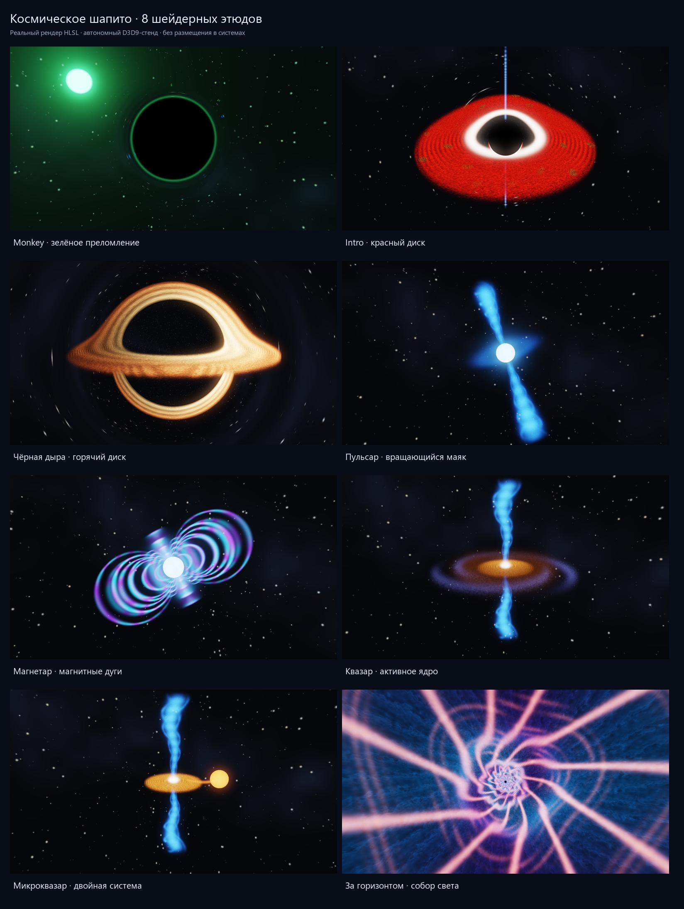

# Cosmic anomaly shader laboratory

**English** · [Русский](../ru/space_anomalies/shaders.md)

Open the [offline visual gallery](previews/report.html) for full-size images. Every image is rendered from the supplied HLSL on a standalone D3D9 HAL fixture. These are deliberately theatrical prototypes; no system placement or game renderer integration is included.



## Implemented studies

| Preset | Implementation |
|---|---|
| Monkey | Dark silhouette, green solar-background refraction, animated ripples and a chromatic fringe; no mirror BRDF |
| Intro | Red disk, white inner ring, dark core, narrow blue polar jet and procedural glowing debris clusters |
| Original black hole | Golden disk, approximate ray bending and brightness asymmetry |
| Pulsar | A tilted magnetic axis rotating in 3D, two emission cones, helical filaments and a faint equatorial wind |
| Magnetar | Spatial dipole arcs, flowing emission, star occlusion and a separate flare control |
| Quasar | Bright nucleus, disk, absorbing dusty torus, decorative circumnuclear spiral and jets |
| Microquasar | Companion star, mass-transfer stream, disk and jets; an additional study |
| Interior | A fictional volumetric tunnel of plasma and luminous ribs; see [interior directions](interior.md) |

The author clarified that the original Monkey effect exploits solar-atmosphere refraction, explaining its reflective appearance. Local Monkey configuration confirms `BlackHoleCoreHuge` and green illumination. The new shader remaps background directions instead of reflecting light off a material.

The [official promo](https://freelancer2.space/en/) embeds a trailer. Its [01:24 frame](https://www.youtube.com/watch?v=vm0QkrtOF2Q&t=84s) was inspected and used to correct the intro study's palette and structure. The earlier agent's separate intro report was not found, and that precise intro reference remains unconfirmed. This is an interpretation of the identified promo, not an ALE reconstruction. Small procedural clusters stand in for the promo's large rock meshes.

## Reproduction

From the repository root:

```powershell
python tools/space_anomalies/build.py --output src/obj/space_anomalies/final
python tools/space_anomalies/build.py --no-build --width 640 --height 360 --checks --output src/obj/space_anomalies/checks
python tools/space_anomalies/report.py
```

Rendering needs MSVC, Windows SDK, June 2010 DirectX SDK and `d3dx9_43.dll`; no Python packages. The report generator additionally needs Pillow. Override SDK paths with `ANOMALIES_MSVC`, `ANOMALIES_WINSDK`, `DXSDK_DIR`. In a sandbox that blocks D3D9 device creation, run the fixture with desktop/GPU access. Its window stays hidden and the game is never launched.

`--preset 0..7` selects one study; `--time-offset`, `--yaw-offset`, `--flare` control its appearance. `--frames 36 --step 0.1` writes a PNG sequence. `--build-only` only builds the executable. `--no-build` skips C++ compilation but always recompiles HLSL. Changes to [presets.json](../../tools/space_anomalies/presets.json) require rebuilding its generated C++ table.

## Shader contract

Sources live in [ANOMALIES](../../DATA_EXTRA/SHADERS/ANOMALIES), fixture and utilities in [tools/space_anomalies](../../tools/space_anomalies). Each effect exposes `VSMain` / `PSMain`; `VARIANT` selects a family member. The input is a POSITION float4 / TEXCOORD float2 fullscreen quad.

- `c0`: time, aspect, inverse width, inverse height; bind in both VS and PS.
- PS `c1`: camera inclination, azimuth, exposure, object-local camera distance.
- PS `c2.x`: magnetar flare strength, normally 0..1.
- `s0`: linear HDR equirectangular background, U wrap / V clamp.
- `s1`: periodic volume noise, wrap XYZ / linear filtering.
- Post passes use `s2`, `s3` and PS `c3` for HDR source, bloom and filter controls.

Camera positions are outside the volumes in the supplied presets. The neutron star radius is 0.46 local units. The interior interprets camera yaw as view roll. Both texture inputs are generated procedurally by the fixture, without game assets.

FP16 output is followed by bright extraction, quarter-resolution bloom (three separable blur pairs), tone mapping and approximate gamma 2.2. Final alpha is 1: this is an opaque fixture composition, not a drop-in transparent sprite.

## Evidence and remaining work

[Validation log](previews/validation.txt), [source/image hashes and image-change measurements](previews/manifest.json), and [phase comparisons](previews/phases.jpg) are included. Eight effect shaders, one shared vertex shader and three post shaders were created on an NVIDIA GeForce RTX 5080. HDR readback was finite/nonnegative; identical constants reproduced identical pixels, while time, camera and flare changes altered the images.

The bounded loops use 176 steps for disk black holes, 144 for neutron stars, 164 for active nuclei and 148 for the tunnel. Static instruction counts do not represent executed work or establish in-game performance. No game-frame timing was measured.

Ray bending is an artistic approximation; the intro variant additionally uses a projected core mask for a stable silhouette. This is not a GR solver. Thin structures can alias or shimmer. Filtering, geometry-quality debris, close-up camera behavior and lower-cost quality tiers need further work.

Integration requires scene-color/depth sampling, ship occlusion, world/local transforms and scale, bounded screen coverage, resource/device-loss management and target-GPU profiling. No RP9 hooks, archetypes, loadouts, systems or the other agent's code-beam files were changed.
